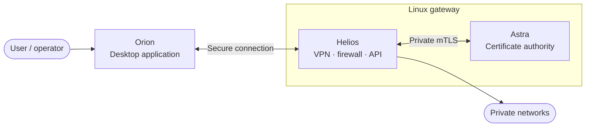
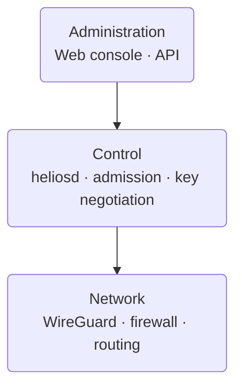
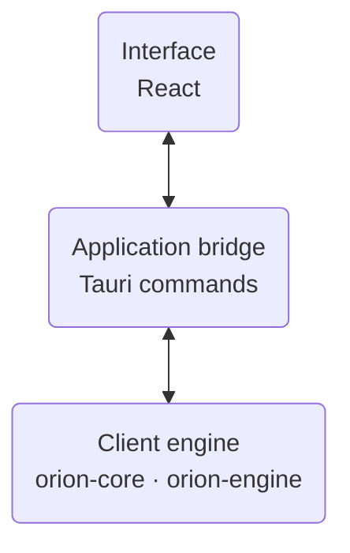
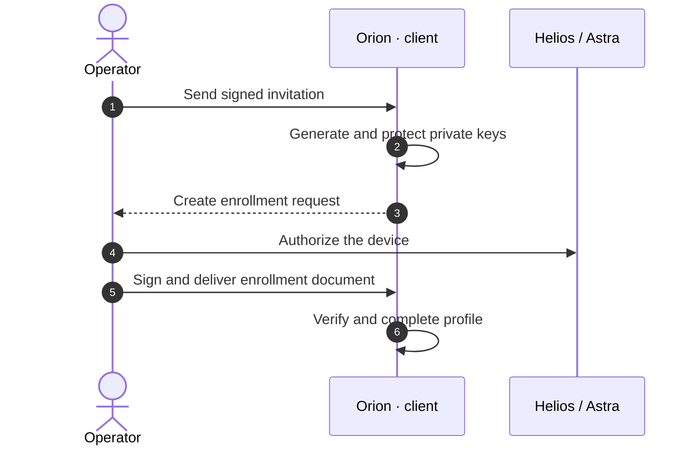
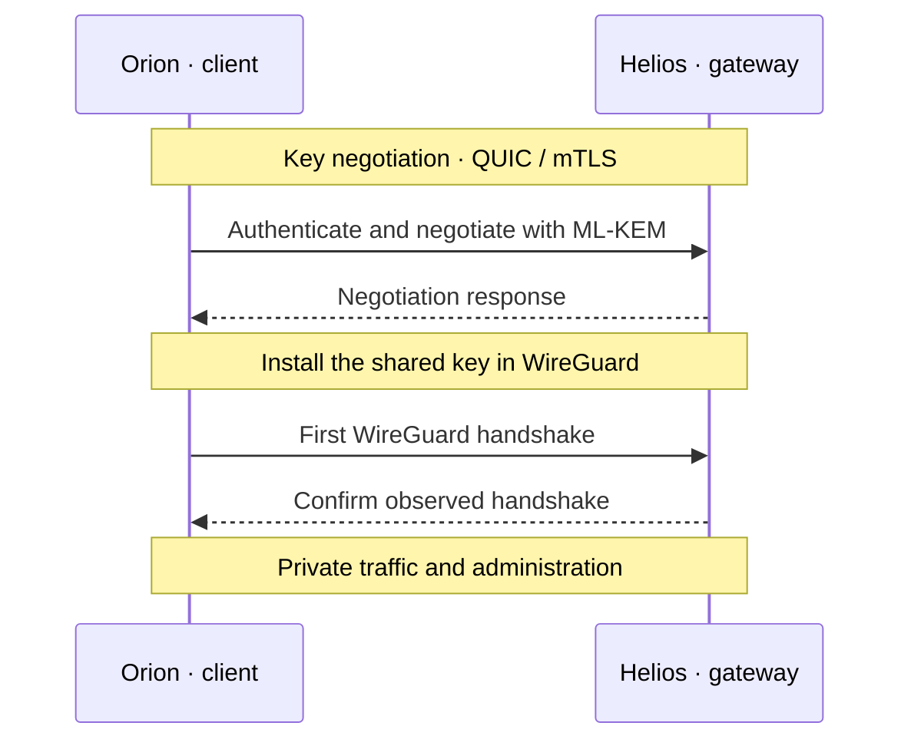

# Helios

**Un réseau privé WireGuard, de l'identité des appareils à l'administration de la passerelle.**

Helios est une passererelle VPN pour Linux. Elle associe le transport WireGuard,
une négociation de clé post-quantique et des outils pour gérer les appareils,
leurs identités et le réseau auquel ils accèdent.

Le projet réunit une passerelle, une application de bureau et une autorité de
certificats :

| Composant | Rôle |
| --- | --- |
| **Helios** | Passerelle Linux : tunnels, routage, pare-feu et API d'administration. |
| **Orion** | Application de bureau pour se connecter et administrer le domaine. |
| **Astra** | Autorité de certificats : confiance, renouvellement et récupération des identités. |
| **Aether** | Contrats et mécanismes partagés par les composants du projet. |

## Vue d'ensemble



Orion prépare la connexion avec Helios avant d'établir le tunnel WireGuard. Le
trafic privé et les échanges d'administration passent ensuite par ce tunnel.
Astra gère les certificats et leur cycle de vie ; son canal privé avec Helios
est authentifié par mTLS.

## Fonctionnalités

- **Connecter** : tunnels WireGuard, admission des pairs, attribution des
  adresses, routage et prise en charge de plusieurs accès réseau.
- **Protéger** : règles nftables appliquées atomiquement, kill-switch,
  négociation post-quantique et stockage chiffré des secrets.
- **Administrer** : application Orion, console web et outils en ligne de
  commande pour gérer les pairs, le réseau et les certificats.
- **Gérer les identités** : enrôlement, renouvellement des certificats et
  récupération d'identité avec Astra et les autorisations de l'opérateur.
- **Maintenir** : mises à jour signées, protection contre le retour arrière,
  prise en charge du TPM et séquestre opérateur.

## À l'intérieur du projet

### Helios : la passerelle

`heliosd` orchestre les services de la passerelle. Il relie l'administration,
l'admission des appareils et la négociation des clés au plan de données
WireGuard et au pare-feu. Astra reste un service distinct, joint par un canal
privé.



Les composants dédiés aux mises à jour, au TPM, au coffre et au séquestre
complètent la passerelle. [La vue d'architecture](docs/architecture/overview.md)
détaille leurs responsabilités.

### Orion : le client

Orion réunit l'interface React, le pont Tauri qui relie ses commandes au client,
et la logique qui gère les profils et le tunnel. Sous Windows, le moteur qui
pilote le tunnel fonctionne dans un processus élevé, distinct de l'interface ;
`orion-engine` porte le canal entre les deux.



## Comment ça marche

### Enrôler un appareil

L'enrôlement donne à un appareil une identité reconnue par le domaine. Orion
génère et protège ses clés privées sur le poste client. L'opérateur autorise
l'admission et remet un document signé qui permet à Orion de finaliser son
profil.



Les clés privées du client ne sont pas transportées dans le document
d'enrôlement. Les opérations sur les identités et les certificats s'appuient
sur Astra et sur les autorisations de l'opérateur.

### Protéger le premier handshake

Avant d'établir WireGuard, Orion et Helios s'authentifient mutuellement par
QUIC/mTLS et négocient une clé partagée à l'aide de **ML-KEM-1024**. Cette clé
est installée dans WireGuard avant le premier handshake. Le protocole utilise
également des signatures **ML-DSA-87** pour l'authentification de négociation.



La connexion QUIC porte la transaction de négociation ; l'état du tunnel est
suivi à partir des handshakes WireGuard. Une clé négociée peut ensuite être
renouvelée dans le tunnel. Le protocole et ses garanties sont décrits dans
l'[ADR-005](docs/adr/ADR-005-NEGOCIATION-DE-CLE.md) et la
[spécification v5](docs/specification/NEGOCIATION-DE-CLE-V5.md).

## Développement

Le dépôt contient un workspace Rust et deux interfaces React : la console web
Helios et l'application Orion. Il nécessite Rust 1.95 ou supérieur et Node.js
`^22.22.2 || ^24.15.0 || >=26.0.0`. Sous Linux, la compilation du shell Tauri
nécessite WebKitGTK 4.1 et GTK3 ; `scripts/setup-dev.sh` installe les
dépendances de développement sur Debian et Ubuntu.

### Essayer la console en local

Dans deux terminaux, lancez la passerelle en mode de développement simulé et
la console web :

```sh
cargo run -p heliosd -- run --dev
```

```sh
npm run dev --prefix web
```

### Construire et tester

```sh
cargo build
cargo test --workspace --all-features
```

Pour les commandes ciblées, le laboratoire local, la compilation sur les
plateformes cibles et la campagne de régression, voir les guides de
[développement](docs/development/build.md) et de
[tests](docs/development/testing.md).

## Documentation

- [Architecture](docs/architecture/overview.md) — responsabilités des composants et flux principaux.
- [Négociation de clé v5](docs/specification/NEGOCIATION-DE-CLE-V5.md) — protocole, enrôlement et renouvellement des clés.
- [Astra et les certificats](docs/adr/ADR-008-ASTRA-AUTORITE-CERTIFICATS.md) — autorité, confiance et cycle de vie des identités.
- [Développement](docs/development/build.md) et [tests](docs/testing/TESTING.md) — construire le projet et comprendre les environnements de validation.
- [Contribution](CONTRIBUTING.md) et [sécurité](SECURITY.md) — contribuer et signaler un problème de sécurité.
- [Index de la documentation](docs/README.md) — architecture, ADR, spécifications et exploitation.
