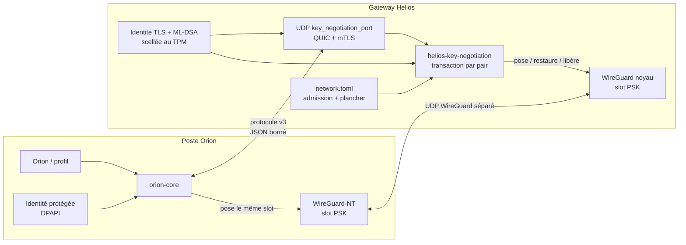
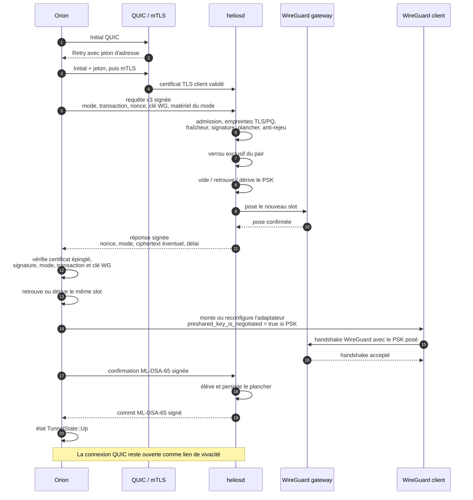
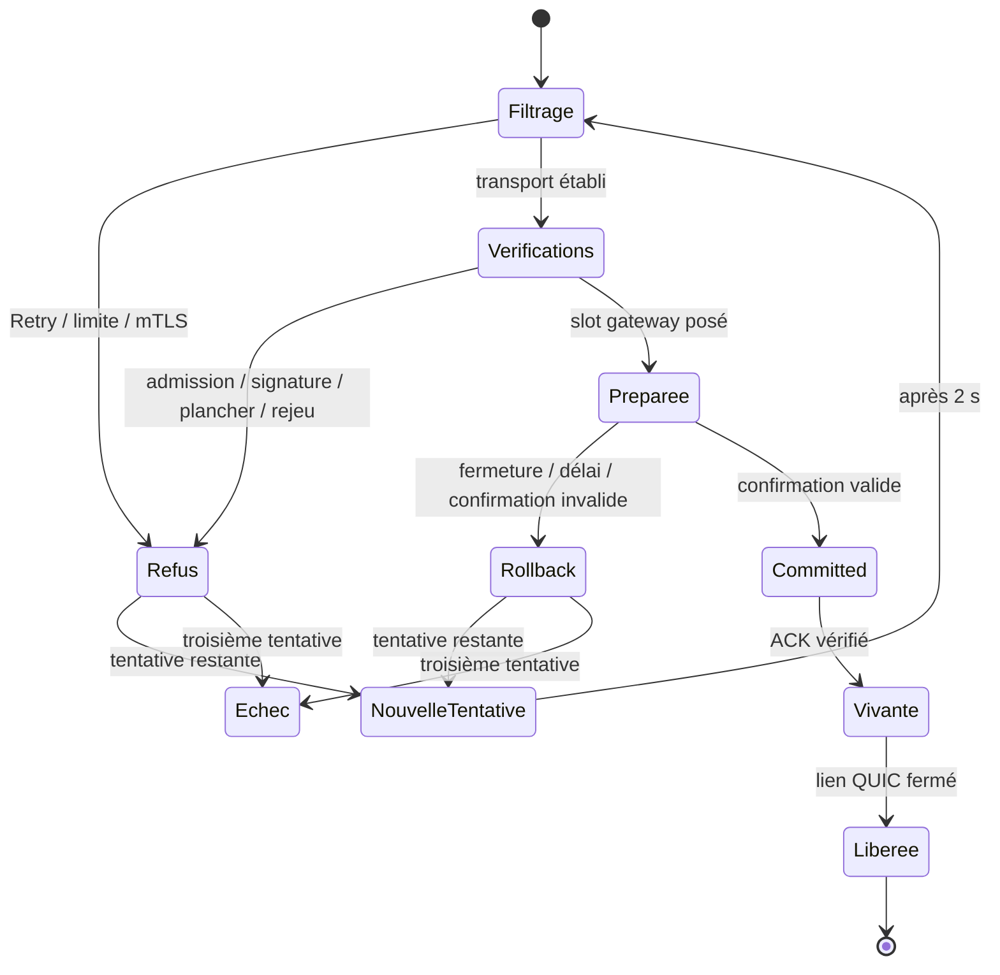
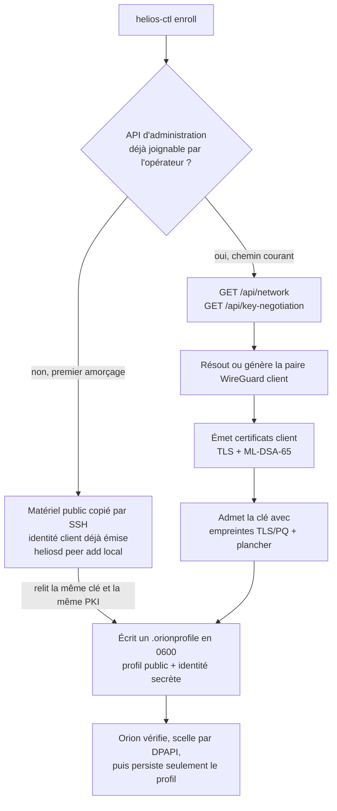

# ADR 005 — Négociation de clé pré-WireGuard

**Statut** : accepté (2026-07-25), révisé pour le protocole v3 (2026-07-28)

Remplace et détaille l'amendement du 24 juillet 2026 de
[ADR-001](ADR-001-WIREGUARD.md), qui reste la référence pour le transport
WireGuard lui-même.

## Contexte

WireGuard protège une session par Curve25519. Un adversaire qui enregistre
aujourd'hui le trafic et disposera plus tard d'un calculateur quantique casse
cet échange et déchiffre l'enregistrement : c'est le « récolter maintenant,
déchiffrer plus tard ». Le slot `PresharedKey` de WireGuard neutralise cette
menace — il entre dans la dérivation et n'est pas cassé par Shor — mais il faut
que les deux pairs portent la même valeur **avant** le handshake.

Le provisioning post-quantique existant (ADR-001 §2) pose ce PSK par l'API
interne, qui vit derrière `admin_iface`. Il exige donc un tunnel déjà monté. La
conséquence est structurelle et n'a pas de correctif dans ce cadre : **le
premier handshake d'un client n'est jamais protégé**, et c'est précisément
celui qu'un adversaire patient enregistre. Le second l'est ; le premier a déjà
révélé la session qui a servi à poser le PSK.

Le choix initial de n'exposer aucun plan de contrôle avant WireGuard empêchait
exactement la chose qu'il fallait faire.

## Décision

Un second port UDP public, distinct du transport WireGuard, porte une
négociation authentifiée dont le seul produit est le PSK du premier handshake.

| | port | rôle |
|---|---|---|
| `key_negotiation_port` | 51821 par défaut | négociation, aucun trafic utilisateur |
| `wg_listen_port` | 51820 par défaut | transport WireGuard, inchangé |

Les deux se redirigent séparément sur la box. Sans le second port, un profil
qui réclame une négociation échoue — il n'existe **aucun repli** vers un
premier handshake nu.

### Vue d'ensemble



Le port public ne transporte ni trafic utilisateur, ni clé privée, ni PSK en
clair. Il prépare une transaction sur le slot `PresharedKey`, puis sa connexion
QUIC devient un lien de vivacité conservé pendant toute la durée du tunnel.

### Contrat effectivement servi

| Élément | Valeur actuelle | Raison |
|---|---:|---|
| version applicative | `3` | rupture volontaire avec les transcripts antérieurs |
| transport | QUIC avec TLS 1.3 mutuel | authentification classique préalable et chiffrement du parseur |
| flux QUIC | un flux bidirectionnel | une transaction ordonnée par connexion |
| trame | longueur `u32` big-endian + JSON | découpage non ambigu |
| taille maximale d'un message | 64 Kio | borne mémoire du parseur |
| datagramme QUIC | 1200 octets | minimum garanti par RFC 9000 §14 |
| découverte de MTU | désactivée | évite `WSAEMSGSIZE` après capture de route par WireGuard |
| connexion QUIC | 10 s au plus | erreur rapide si le port dédié n'est pas joignable |
| réponse de préparation | 15 s au plus | couvre ML-KEM, ML-DSA et la pose sur le plan de données |
| confirmation WireGuard | 45 s au plus | rollback si aucun handshake ne réussit avec le PSK posé |
| ACK de commit | 5 s au plus | borne la dernière phase transactionnelle |
| keep-alive / expiration du lien | 10 s / 35 s | trois battements manqués avant libération du slot |

Tous les objets JSON du protocole refusent les champs inconnus. Les
identifiants de transaction et les nonces font 16 octets et viennent du CSPRNG
du système.

### Activation et démarrage

La négociation n'est une feature de compilation ni dans Orion ni dans
`heliosd` : tout binaire porte le protocole. Son activation gateway dépend
uniquement de `key_negotiation_port` :

- champ absent → aucun listener, aucune erreur de démarrage ;
- champ présent → `heliosd` charge l'identité scellée, les CA clientes et la
  clé publique WireGuard, puis écoute sur toutes les adresses UDP du port ;
- matériel absent, illisible ou impossible à desceller → le démarrage du
  service échoue explicitement ; hors `--dev`, aucune identité en clair ne
  remplace le TPM.

Un profil Orion qui porte un bloc `key_negotiation` emprunte toujours ce chemin
avant le montage WireGuard. L'absence de stockage protégé, un port fermé ou une
identité invalide sont des échecs, jamais un repli vers le backend classique.
Un profil sans ce bloc conserve le provisioning hérité.

Comme le nom d'interface, le port d'écoute et l'adresse d'API, le port de
négociation ne se déplace pas pendant le hot-reload du plan de données : le
modifier dans `network.toml` exige un redémarrage de `heliosd`.

### 1. Trois modes, choisis par le client, jamais substitués

| Mode | Slot préparé par la gateway |
|---|---|
| `classic` | vidé |
| `static_psk` | PSK déjà configuré, retrouvé par comparaison d'empreinte |
| `ml_kem` | PSK frais dérivé d'une encapsulation ML-KEM-1024 |

Orion choisit ; Helios exécute exactement le mode demandé ou refuse. Une
réponse qui sélectionnerait un autre mode est rejetée par le client, le mode
étant couvert par les signatures et par la dérivation.

En `static_psk`, seule l'**empreinte** du PSK circule : la valeur ne quitte
jamais les deux configurations.

### 2. L'ancre d'authentification est ML-DSA-65, pas TLS

QUIC impose TLS 1.3 ; le port l'utilise en mutuel. Mais **TLS n'est pas
l'ancre de sécurité** : ses certificats sont classiques (ECDSA P-256), donc
cassables par le même adversaire quantique dont on se protège. Un attaquant
capable de forger un certificat pourrait substituer `kpub` et connaître le
PSK — la protection ML-KEM serait vidée de son sens.

Une PKI applicative ML-DSA-65 (FIPS 204) est donc superposée :

- **CA opérateur** — deux autorités créées ensemble sur le poste opérateur,
  une TLS et une ML-DSA-65. Leurs moitiés privées ne vont jamais sur une
  gateway.
- **Certificat gateway** — naît **sur** la gateway, auto-signé, ses clés
  privées TLS et ML-DSA scellées au TPM. Il lie le nom du serveur à la clé
  publique WireGuard de la gateway.
- **Certificat client** — émis par la CA opérateur, lie la clé de signature du
  client à sa clé publique WireGuard. Son empreinte est déclarée à l'admission.

Le certificat client est d'abord accepté par mTLS, puis son empreinte TLS et
l'empreinte de son certificat PQ doivent toutes deux correspondre au pair
admis. Ces deux contrôles sont indépendants de la clé WireGuard, que le
certificat PQ lie à son tour au sujet. Une identité valide pour un autre pair
ne suffit donc pas.

Les signatures utilisent une sérialisation canonique binaire, distincte du
JSON de transport. Chaque famille de message porte son domaine propre :

| Message | Champs couverts par ML-DSA-65 |
|---|---|
| certificat PQ | version, série, rôle, sujet, émetteur, clé WireGuard, clé ML-DSA, validité |
| requête Orion | version, transaction, mode, clé WireGuard client, nonce client, `kpub` ou empreinte du PSK statique, empreinte du certificat PQ client |
| réponse Helios | version, transaction, mode, clé WireGuard gateway, nonce gateway, ciphertext éventuel, délai de confirmation, empreinte du certificat PQ gateway |
| confirmation Orion | domaine de confirmation, version, transaction |
| commit Helios | domaine de commit, version, transaction |

Casser ECDSA ne permet donc ni de substituer `kpub`, ni d'altérer le
ciphertext, ni de forger une confirmation ou un commit utilisable. TLS reste
une première barrière qui réduit l'exposition du parseur applicatif.

Le protocole applicatif courant est **v3**. Toute autre version est refusée
avant modification du plan de données ; il n'existe pas de négociation de
version ni de compatibilité silencieuse avec un transcript ancien.

### 3. Dérivation liée à toute la transaction

En mode ML-KEM, Orion génère une paire éphémère, envoie `kpub`, conserve
`kpriv` ; Helios encapsule et renvoie le ciphertext. Les deux obtiennent le
même secret, puis dérivent :

```
sel = identifiant de transaction ‖ nonce client ‖ nonce gateway

PSK = HKDF-SHA-512(
        sel,
        secret ML-KEM-1024,
        domaine ‖ version ‖ mode ‖ horodatage
              ‖ len(clé WG client)  ‖ clé WireGuard client
              ‖ len(clé WG gateway) ‖ clé WireGuard gateway,
        32 octets )
```

Lier ces éléments rend inutilisable un ciphertext rejoué, destiné à un autre
pair, associé à un autre mode ou **réémis à un autre instant**. Les deux clés
WireGuard sont préfixées de leur longueur : aucun décalage de frontière entre
champs ne peut produire la même concaténation. Le PSK fait 32 octets et n'est
**jamais** écrit sur disque, d'aucun côté.

#### Choix des paramètres

**ML-KEM-1024** (catégorie NIST 5) plutôt que 768 (catégorie 3). Ce que ce KEM
produit devient un PSK WireGuard, c'est-à-dire exactement ce qu'un adversaire
« récolter maintenant, déchiffrer plus tard » conserve : le secret vaut, en
durée, bien plus que la session. Payer 384 octets de clé publique et 480 de
ciphertext de plus, une fois par connexion, est un mauvais prix à ne pas payer
pour rester une catégorie en dessous. La taille du secret, elle, ne change
pas : 32 octets quel que soit le jeu de paramètres.

**HKDF-SHA-512** plutôt que SHA-256. L'argument n'est pas que SHA-256 serait
le maillon faible — face à Grover, une préimage SHA-256 coûte 2¹²⁸, au-dessus
de ce qu'exige la catégorie 3 — mais qu'à partir du moment où le KEM vise la
catégorie 5, un KDF à 2¹²⁸ deviendrait le plafond du protocole. SHA-512 porte
la dérivation à 2²⁵⁶ et referme la question, pour deux lignes de différence et
aucune dépendance nouvelle : `aws-lc-rs` le fournit déjà.

Il faut être exact sur ce que cela apporte : **la sécurité effective du tunnel
ne bouge pas**, parce que WireGuard mélange ensuite le PSK avec BLAKE2s-256 et
plafonne de toute façon vers 2¹²⁸ post-quantiques. Ce choix aligne les
catégories du protocole de négociation ; il ne rend pas le tunnel plus fort.

**KMAC256 a été étudié et écarté.** L'idée — réutiliser le cœur Keccak déjà
présent via ML-KEM et ML-DSA — est saine, mais aucune implémentation validée
n'était atteignable : `aws-lc-rs` n'expose pas KMAC, la crate `sha3` fournit
cSHAKE mais pas KMAC, et l'écrire à la main aurait remplacé une primitive
validée par une primitive maison. La piste wolfCrypt en FFI a été examinée
sérieusement : elle apporte bien un KMAC natif testé sur les vecteurs
SP 800-185, mais wolfCrypt est sous GPLv2 ou licence commerciale, ce qui est
incompatible avec le MIT/Apache-2.0 de ce dépôt, et sa validation FIPS 140-3
des algorithmes PQ n'est à ce jour qu'une validation **CAVP** d'algorithmes,
la soumission **CMVP** de module étant en cours. Si une exigence FIPS apparaît,
la réponse est la feature `fips` d'`aws-lc-rs`, pas un second moteur.

#### Horodatage : borner le rejeu dans le temps

La requête porte un horodatage Unix lié à la dérivation. Helios refuse au-delà
de trente secondes de dérive, dans les deux sens, **avant** toute vérification
de signature — le contrôle coûte une soustraction là où le reste coûte une
vérification post-quantique.

Ce contrôle ne double pas le cache anti-rejeu, il le complète là où celui-ci
est structurellement faible. Un cache est **borné** : à 4096 entrées, un pair
capable d'ouvrir des transactions légitimes finit par en faire oublier
d'anciennes, et une transaction capturée jadis redevient rejouable. Une horloge
ne s'évince pas. Le cache arrête le rejeu immédiat d'une transaction vivante ;
l'horodatage arrête le rejeu différé d'une transaction ancienne.

Une requête venue du futur est refusée aussi : l'accepter permettrait de
constituer d'avance une transaction à rejouer plus tard. Un poste dont
l'horloge dérive reçoit un message interne qui **nomme l'horloge** ; la
frontière publique conserve néanmoins une erreur grossière afin de ne pas
transformer le port en oracle d'admission.

Dans le transcript v3 actuellement codé, l'horodatage n'entre pas dans la
signature ML-DSA de la requête. Il reste protégé par TLS pendant l'échange et
entre dans HKDF : le modifier fait dériver deux PSK différents et échoue donc
fermé, mais un adversaire actif capable de rompre TLS peut provoquer ce déni
de service. L'inclure dans la sérialisation signée exige une version
applicative suivante, car changer les octets signés sans changer de version
rendrait deux binaires v3 incompatibles.

### 4. Méthode complète d'une connexion



La méthode se décompose ainsi :

1. **Préfiltrage public.** QUIC impose un Retry tant que l'adresse source
   n'est pas validée. Une fois cette preuve obtenue, Helios applique la limite
   de huit handshakes par minute et par adresse, puis la limite globale de
   128 négociations actives. Le handshake mTLS vient seulement ensuite.
2. **Construction de la requête.** Orion charge l'identité TLS et ML-DSA depuis
   le stockage protégé, résout l'endpoint public, génère transaction et nonce,
   puis ajoute le matériel strictement permis par le mode : rien en
   `classic`, une empreinte SHA-256 en `static_psk`, une `kpub` éphémère en
   `ml_kem`.
3. **Autorisation gateway.** Helios retrouve le pair par sa clé WireGuard,
   compare l'empreinte du certificat TLS présentée à celle de l'admission,
   vérifie le certificat PQ contre la CA opérateur et son empreinte admise,
   contrôle la fenêtre d'horloge, la signature, le plancher et le cache
   anti-rejeu. Un verrou par clé WireGuard sérialise ensuite les transactions
   de ce pair.
4. **Préparation du slot.** `classic` produit un slot vide ; `static_psk`
   retrouve la valeur locale dont l'empreinte correspond en temps constant ;
   `ml_kem` encapsule vers `kpub`, dérive le PSK et conserve le ciphertext pour
   la réponse. Helios sauvegarde en mémoire le slot précédent pour un rollback.
5. **Pose gateway avant annonce.** Helios demande au plan de données de poser
   le slot candidat et attend son acquittement. Seulement après ce succès il
   signe et renvoie la réponse. Aucune valeur négociée n'est persistée.
6. **Pose Orion.** Orion vérifie le certificat PQ gateway auto-signé et épinglé,
   le nom, la clé WireGuard, la signature, la transaction et le mode. Il
   décapsule si nécessaire, reconfigure le backend avec le même slot et marque
   explicitement tout PSK issu de la négociation par
   `preshared_key_is_negotiated`.
7. **Preuve par le plan de données.** Orion ne confirme pas sur la seule foi des
   calculs : il interroge le backend toutes les 250 ms et exige un handshake
   WireGuard plus récent que la pose, dans la fenêtre de 45 s.
8. **Commit bilatéral.** Orion signe la confirmation. Helios la vérifie, élève
   le plancher persistant si nécessaire, déplace la transaction de
   `active` vers `committed`, signe l'ACK et l'envoie. Orion vérifie cet ACK
   avant d'annoncer `TunnelState::Up`.
9. **Vivacité.** Le flux applicatif est fini, mais la connexion QUIC reste
   détenue par le contrôleur Orion. Sa fermeture devient l'ordre de libérer le
   slot runtime de la gateway.

La pose gateway de l'étape 5 précède la réponse : un PSK annoncé mais non posé
ferait échouer tous les handshakes, sans canal de rattrapage puisque le tunnel
est justement ce qui manque. Si le plan de données refuse la pose, aucune
réponse de succès ne part.

Si la session QUIC se ferme, si le handshake n'arrive pas dans le délai, ou si
la confirmation est invalide, Helios **restaure le slot précédent**. Les
transactions sont sérialisées par pair.

#### Rattrapage d'une désynchronisation

La restauration côté gateway crée un cas que le protocole seul ne referme pas.
Si la confirmation — ou le commit qui y répond — se perd sur le réseau, les
deux bouts divergent de la pire manière : Helios restaure l'ancien slot pendant
qu'Orion conserve le PSK qu'il vient de poser. Tous les handshakes échouent
ensuite, et **aucun journal ne dit pourquoi**, puisque chaque côté a fait
exactement ce qu'il devait.

Si la pose Orion, le handshake avec ce PSK, la confirmation ou le commit n'aboutit
pas, Orion renégocie entièrement — jusqu'à trois tentatives, espacées de deux
secondes. Une négociation neuve pose un PSK neuf des deux côtés, ce qui remet
les bouts en phase.

Trois tentatives, parce que la panne principalement visée est un **message
perdu** : ce qu'une deuxième tentative ne rattrape pas, une quatrième ne le
rattrapera vraisemblablement pas non plus. Le code réessaie désormais aussi la
préparation — DNS, Retry, mTLS ou réponse peuvent échouer transitoirement avant
toute pose. Le journal distingue alors explicitement « rien n'a été posé » d'un
échec postérieur à la reconfiguration locale.

Si au moins une tentative a monté ou reconfiguré l'adaptateur et que les trois
échouent, l'adaptateur reste monté avec son dernier slot : WireGuard jette les
paquets si la gateway a restauré le sien. C'est l'invariant anti-fuite
d'Orion. Si les trois échecs arrivent avant toute pose locale, aucun slot
négocié n'a été installé ; le résultat reste un échec visible, sans repli vers
le chemin hérité.



### 5. La session reste ouverte : lien de vivacité

WireGuard est sans connexion. Quand un bout s'en va, l'autre ne l'apprend que
lorsque les handshakes cessent d'être répondus — jusqu'à 150 secondes plus
tard. Pendant toute cette fenêtre, Orion affiche un tunnel déjà mort et Helios
conserve un secret post-quantique pour un pair qui n'est plus là.

La connexion QUIC qui a porté la négociation résout cela sans rien ajouter :
elle est authentifiée, elle est déjà là, et **sa fermeture est un signal**. Elle
est donc conservée aussi longtemps que le tunnel.

- Orion se déconnecte explicitement → il ferme QUIC avant de démonter
  l'adaptateur → Helios libère le slot PSK dès réception.
- Orion s'arrête brutalement ou le chemin disparaît → aucun message d'adieu
  n'est requis : les keep-alives QUIC font expirer le lien après au plus
  35 secondes de silence.
- Helios s'arrête ou le réseau coupe le lien → Orion le journalise. Le tunnel
  peut continuer sur sa clé WireGuard courante, puis échouera au rekey suivant
  puisque la gateway a libéré son slot.

Libérer le slot ne crée pas de repli : le prochain `connect` repasse par la
négociation imposée par le profil et le plancher. En revanche, la chute
inattendue du lien ne déclenche pas aujourd'hui de reconnexion automatique :
Orion avertit que la gateway a libéré le PSK et demande de se reconnecter. Ce
choix évite une boucle de remontage implicite ; l'automatiser demanderait une
politique explicite de reconnexion et de temporisation.

Le lien ne transporte plus de message applicatif après le commit. Sans trafic,
QUIC le déclarerait mort après son délai par défaut ; la gateway viderait alors
le slot environ trente secondes après chaque connexion et le tunnel mourrait
au rekey WireGuard deux à trois minutes plus tard. Les deux côtés envoient donc
un keep-alive toutes les 10 secondes et tolèrent 35 secondes de silence.

La découverte de MTU est désactivée et la taille UDP est épinglée à 1200
octets sur les deux endpoints. Le matériel PQ occupe plusieurs kilooctets et
est fragmenté par QUIC ; laisser `quinn` sonder jusqu'à 1452 octets fonctionne
souvent avant le montage, puis peut échouer sous Windows lorsque l'interface
WireGuard capture la route avec un MTU inférieur.

Le permis de concurrence est relâché **avant** l'attente de fermeture : la
phase coûteuse est finie, et un tunnel de longue durée n'a pas à retenir un
jeton qui n'existe que pour borner le coût des handshakes.

### 6. Plancher anti-downgrade, qui ne monte que

L'ordre des modes est monotone : `classic < static_psk < ml_kem`. Chaque pair
Helios et chaque profil Orion portent un `minimum_key_negotiation_mode`.

- Une demande sous le plancher est refusée **avant** toute modification du plan
  de données.
- L'admission avec un certificat PQ choisit `ml_kem` comme plancher par défaut.
- Chaque commit réussi **élève** le plancher au mode utilisé, et le persiste.
- Le hot-reload refuse de recopier un plancher inférieur depuis la vue
  expurgée de l'API.

Un pair peut donc passer de classique à statique puis à ML-KEM, jamais dans
l'autre sens — y compris après redémarrage. Aucun message réseau, aucune
renégociation ne peut abaisser ce plancher : seule une édition locale explicite
de `network.toml` le peut.

Le même cliquet existe côté client : `ClientConfig::upsert` refuse d'abaisser
un plancher connu, **y compris en supprimant le bloc de négociation** — une
suppression est un downgrade, puisqu'elle renverrait vers le chemin hérité dont
le premier handshake est nu.

### 7. Identité cliente : scellée au poste, jamais dans le profil

L'identité cliente — deux certificats et leurs deux clés privées — naît sur le
poste opérateur et ne voyage **qu'une fois**. Sur Windows, elle est scellée par
DPAPI, liée au compte de l'utilisateur et à une entropie propre à cet usage.

Le Credential Manager a été écarté : il plafonne un secret à 2560 octets quand
la seule clé privée ML-DSA-65 en fait 4032. La découper entre plusieurs entrées
aurait reconstruit un conteneur, en moins bon.

Le profil VPN ne porte que le **nom** de l'entrée. Le document d'échange, lui,
transporte l'identité une seule fois dans un champ `key_negotiation_identity`
que l'import scelle immédiatement et qui n'atteint jamais `ClientProfile`, donc
jamais `profiles.toml`.

Une invitation créée avec `enroll --public-key` ne transporte pas la clé
privée WireGuard. À l'import, Orion cherche un profil local dont la clé
publique dérivée est exactement la clé admise portée par le certificat PQ
client. Le nom du profil ne participe jamais à cette correspondance. Si aucune
clé locale ne correspond, le brouillon reste affiché et nomme la clé attendue,
mais il demeure non connectable.

### 8. Enrôlement complet

Le client à enrôler n'a pas besoin d'avoir déjà monté WireGuard. Deux chemins
opératoires produisent exactement le même document `orion-profile` :



**Chemin courant par API.** L'opérateur possède déjà un accès administrateur à
`helios0`. `helios-ctl enroll` lit la clé publique WireGuard et l'adresse
interne par `GET /api/network`, puis le port, le nom serveur et les deux
certificats publics par `GET /api/key-negotiation`. Il vérifie que le certificat
PQ gateway épingle bien la clé WireGuard actuellement servie, émet les deux
certificats client depuis la CA opérateur, admet le pair par le même code
`helios-provisioning::admission` que les autres outils, puis écrit le document.

**Chemin d'amorçage hors API.** L'API vit derrière `admin_iface`; le tout
premier opérateur peut donc fournir à `enroll` les deux certificats publics
copiés par SSH, l'adresse attribuée et éventuellement l'URL interne. L'admission
est alors faite localement par `heliosd peer add`. Le port ne figurant dans
aucun certificat, `--negotiation-endpoint` doit le donner explicitement.
Comme l'admission contient les empreintes des certificats client, ce chemin
relit obligatoirement avec `--client-pki-dir` l'identité qui a servi à
l'admission ; en émettre une seconde produirait des empreintes différentes et
un profil refusé.

Dans les deux chemins, l'outil :

1. résout une clé WireGuard client fournie ou en génère une ;
2. émet les certificats TLS et ML-DSA-65 liés à cette même clé ;
3. fixe le mode et le plancher initial au même niveau ;
4. place dans le bloc public l'endpoint, le nom serveur, la CA TLS et le
   certificat PQ gateway épinglé ;
5. place séparément dans `key_negotiation_identity` les certificats et clés
   privées client ;
6. écrit le fichier avec des permissions `0600`.

Le mode `static_psk` n'est pas proposé par `enroll`, car il faudrait inventer
ou transporter un secret partagé hors bande. Il reste utilisable par
configuration explicite. Le document d'enrôlement, lui, est un **secret** :
il doit voyager par un canal maîtrisé et être détruit des deux côtés après que
DPAPI a scellé l'identité.

### 9. Données persistantes et données éphémères

| Donnée | Emplacement | Cycle de vie |
|---|---|---|
| CA clientes TLS et ML-DSA privées | poste opérateur | hors gateway, sauvegarde opérateur |
| identité gateway TLS et ML-DSA privée | keystore scellé TPM | créée sur la gateway, descellée en mémoire au démarrage |
| certificats gateway et CA clientes publiques | `/var/lib/helios` | publiables à l'outillage, jamais secrets |
| empreintes TLS/PQ et plancher d'un pair | `network.toml` | persistés, relus à chaud sans abaisser le plancher runtime |
| profil Orion et nom de l'identité protégée | `profiles.toml` | aucune clé privée de négociation, aucun PSK négocié |
| identité cliente TLS et ML-DSA privée | blob DPAPI du compte Windows | scellée à l'import, chargée seulement pour négocier |
| transaction, ancien slot côté gateway et PSK ML-KEM | mémoire des deux processus | jamais sur disque, restaurés ou libérés à la fin |
| PSK statique éventuel | configurations des deux pairs | secret hors bande, distinct d'un PSK négocié |

## Modèle de menace

### Ce que la feature arrête

| Attaque | Ce qui l'arrête |
|---|---|
| Récolte passive, déchiffrement quantique différé | PSK ML-KEM-1024 dans le slot dès le premier handshake |
| Substitution de `kpub` ou du ciphertext | Signature ML-DSA-65 couvrant requête et réponse |
| Rupture future d'ECDSA / de l'échange TLS | L'ancre est ML-DSA-65 ; TLS n'est qu'un transport |
| Rejeu immédiat d'une transaction | Identifiant de transaction, cache anti-rejeu, nonces liés au PSK |
| Rejeu différé après éviction du cache | Horodatage dans la fenêtre de 30 s et lié à la dérivation |
| Flood CPU par source falsifiée | Validation d'adresse QUIC (Retry) avant toute allocation ou cryptographie |
| Flood CPU par une adresse réelle | Huit handshakes par minute et par adresse |
| Perte d'un message ou échec transitoire | Nouvelle transaction côté client, jusqu'à trois tentatives |
| Slot PSK conservé pour un pair disparu | Fermeture explicite immédiate ou expiration QUIC après 35 s, pas 150 s |
| Confusion de pair | Les deux identités WireGuard entrent dans la dérivation |
| Downgrade forcé par le réseau | Plancher persistant des deux côtés, refus avant toute pose |
| Client non admis | Empreinte du certificat PQ vérifiée contre la table des pairs |
| Pose partielle du PSK | Pose avant annonce ; restauration si la confirmation n'arrive pas |
| Vol du blob d'identité sur un autre compte Windows | DPAPI lié au compte et à l'entropie applicative |

### Ce qu'elle n'arrête pas

- **La saturation du lien.** La validation d'adresse et la limite par source
  contiennent le coût CPU, elles ne créent pas de bande passante : un
  attaquant qui sature le lien montant coupe l'accès, comme il couperait
  n'importe quel service. Seul l'opérateur réseau peut y répondre.
- **Un attaquant disposant de nombreuses adresses.** La limite est par
  adresse ; un botnet la contourne par le nombre. Elle rend l'attaque
  proportionnelle à ce que l'attaquant possède vraiment, pas gratuite.
- **La compromission d'un poste client.** Une identité scellée reste
  utilisable par un code s'exécutant sous le compte de l'utilisateur. DPAPI
  protège contre le vol du fichier, pas contre l'exécution locale.
- **La compromission de la CA opérateur.** Ses clés privées émettent des
  identités clientes valides. Elles vivent hors gateway, en `0600`, et leur
  compromission impose de réémettre.
- **La révocation.** Il n'existe pas de CRL ni d'OCSP. Retirer un accès se fait
  par révocation d'admission (`peer remove`), qui coupe au handshake suivant.
- **L'analyse de trafic.** Le port de négociation est visible et identifiable ;
  il révèle qu'un client Helios se connecte, sans rien dire de la session.
- **Le DNS du client**, toujours hors tunnel (voir `helios-firewall::ruleset`).

### Surface exposée

Le port applique, dans cet ordre : validation d'adresse QUIC, limite par
adresse source, limite globale de connexions, mTLS avant tout protocole, un
ALPN dédié, des messages JSON stricts (`deny_unknown_fields`) bornés à 64 Kio,
un verrou par pair, un cache anti-rejeu borné. Les erreurs publiques restent
volontairement peu détaillées — elles ne distinguent pas un pair inconnu d'une
signature invalide.

#### Coût avant authentification

Tout ce que fait ce port est cher — TLS 1.3, vérification ML-DSA-65,
encapsulation ML-KEM — et tout cela précède le moment où la gateway sait si le
pair est légitime. Cette asymétrie **est** le déni de service : quelques
paquets falsifiés achètent beaucoup de CPU.

Deux bornes, dans l'ordre qui compte :

1. **Validation d'adresse (QUIC Retry).** Une connexion entrante dont
   l'adresse n'est pas validée reçoit un paquet Retry — un jeton, aucun état
   alloué. Le pair doit renvoyer ce jeton depuis la même adresse : une source
   falsifiée n'atteint donc **jamais** le handshake TLS.
2. **Limite par adresse source.** La validation prouve qu'une adresse est
   réelle, pas qu'elle est amicale. Au-delà de huit handshakes par minute et
   par adresse, les suivants sont refusés — le coût pour un attaquant devient
   linéaire dans le nombre d'adresses qu'il détient réellement.

Ces deux bornes précèdent le handshake TLS et la cryptographie applicative.
La limite globale de 128 connexions ne borne ensuite que ce qui a franchi les
deux premières.

## Conséquences

### Pour l'opérateur

Deux redirections UDP au lieu d'une. Une CA à créer une fois et à conserver
hors gateway. Un enrôlement par client, qui produit un fichier **secret** à
transférer par canal maîtrisé et à détruire des deux côtés après import.

### Pour l'utilisateur

L'écran *Profils* d'Orion expose le mode, le plancher, l'empreinte du
certificat épinglé et l'état de l'identité. Les modes sous le plancher sont
montrés **désactivés** plutôt que masqués : voir ce qu'on a laissé derrière est
le sens même d'un cliquet.

### Pour le code

Une dépendance de test de `heliosd` vers `orion-core`. Elle est assumée : la
gateway ne dépend pas du client, mais leur interopérabilité doit être prouvée
quelque part, et le seul endroit honnête est un test qui fait dialoguer le vrai
handler et le vrai client à travers un vrai socket. Ce test compare les deux
PSK dérivés — une divergence d'un seul champ dans la dérivation laisserait les
deux côtés « réussir » puis échouer à chaque handshake, sans rien qui désigne
la cause.

## Limites connues

- **L'horodatage v3 n'est pas couvert par ML-DSA.** Il est protégé par mTLS et
  lié à HKDF ; une altération donne des PSK différents et échoue fermé, mais
  elle permet un déni de service à un attaquant actif qui aurait déjà rompu
  TLS. Le signer impose un protocole v4 afin de ne pas rendre deux
  implémentations v3 incompatibles.
- **La chute du lien de vivacité ne reconnecte pas automatiquement.** Orion la
  journalise et avertit que le prochain rekey échouera ; l'utilisateur doit se
  reconnecter. L'automatisation exige d'abord une politique bornée de retry et
  de backoff qui ne transforme pas une coupure WAN en boucle agressive.
- **DPAPI ne se compile ni ne s'exerce en WSL2.** Hors Windows, le scellement
  échoue explicitement (`IdentityStoreError::UnsupportedPlatform`) plutôt que
  d'écrire ces clés en clair. Débloquer Linux suppose `libsecret`, macOS le
  Keychain — chacun avec sa sémantique de déverrouillage, ce qui interdit de
  les simuler.
- **Les effets matériels ne sont pas prouvés en WSL2.** La transaction est
  couverte par les tests ; la pose réelle du slot sur WireGuard-NT et sur le
  backend noyau exige deux machines et les deux redirections
  ([TESTING](../testing/TESTING.md)).
- **Aucune rotation automatique des certificats.** Ils valent 825 jours ; leur
  expiration se traite en réémettant. Rien n'avertit à l'approche de l'échéance.
- **Les catégories NIST ne sont pas homogènes.** Le KEM est en catégorie 5
  (ML-KEM-1024) et le KDF au-dessus, mais l'authentification reste en
  catégorie 3 (ML-DSA-65) : c'est désormais elle le maillon le plus bas du
  protocole. La conséquence est bornée — casser ML-DSA-65 permettrait de
  substituer `kpub` sur une négociation **en cours**, pas de déchiffrer un
  enregistrement passé, que seul le KEM protège. Passer en ML-DSA-87
  (catégorie 5) est possible sans changement de structure, mais impose de
  réémettre toute la PKI, gateway et clients : c'est une décision d'exploitation
  autant que de cryptographie, et elle n'est pas prise ici.
- **Le profil hérité reste servi.** Un profil sans bloc `key_negotiation`
  emprunte l'ancien provisioning, dont le premier handshake n'est pas protégé.
  Supprimer ce chemin exige que tous les profils déployés aient été réenrôlés.

## Alternatives écartées

**Réutiliser le port WireGuard.** Il aurait fallu démultiplexer un protocole
applicatif sur le même socket UDP que WireGuard, donc modifier le plan de
données ou s'interposer devant lui. Coût élevé, surface d'attaque déplacée sur
un composant critique, pour économiser une redirection.

**S'en remettre à TLS seul.** C'était l'implémentation initiale. Elle protège
contre la récolte passive mais pas contre un adversaire quantique **actif**,
qui forge un certificat et substitue `kpub`. Le PSK serait alors connu de
l'attaquant tout en étant issu de ML-KEM — la pire des situations, celle qui
donne l'apparence de la protection.

**Négocier à chaque handshake WireGuard.** WireGuard rekeye seul toutes les
deux minutes ; s'y accrocher aurait imposé une négociation applicative au même
rythme, pour un gain nul — le PSK couvre déjà toutes les sessions dérivées.

**Une PKI post-quantique complète en remplacement de X.509.** Aucune pile QUIC
ne l'accepte aujourd'hui. La superposition retenue donne la même propriété
d'authentification PQ sans réécrire une pile TLS.
