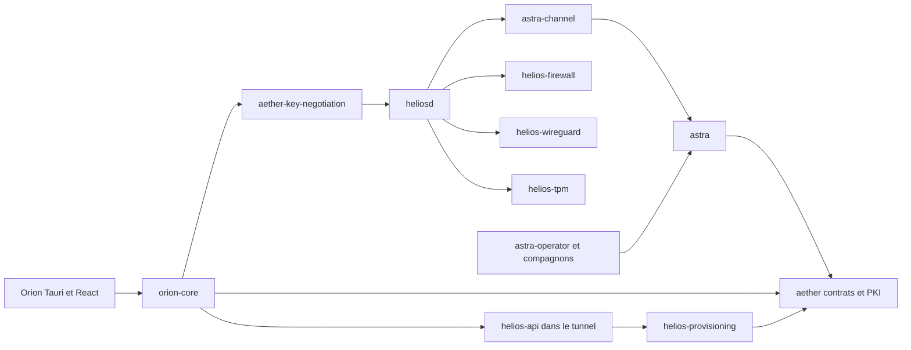

# Inventaire du workspace

Audit du 23 octobre 2026, révision `7ebc020d0425de4a30d64a93af1ead048c3f0fc7`, branche `audit/coverage-plan-2026-10-23`. Les références sont relatives à la racine du dépôt et figées sur cette révision. **Fait** = lecture du code ou commande locale ; **hypothèse** = à vérifier par exécution ; **recommandation** = travail futur soumis à validation.

## Périmètre et points d’entrée

Le workspace contient **23 packages**, dont **22 default-members** : `helios-publisher` est membre mais absent du build par défaut. `--workspace` l’ajoute. Resolver 2, édition 2021, MSRV déclarée 1.95 ; l’hôte d’audit utilise 1.99 et ne prouve donc pas la MSRV. `fuzz/` déclare son propre workspace ; `vendor/rustables` est exclu et patché dans le graphe principal (`Cargo.toml`). Ce code vendor participe à la sécurité Netlink : le suivre séparément plutôt que l’oublier dans le périmètre produit.

L’inventaire suivant provient des manifestes actuels et de `cargo metadata --frozen --no-deps --format-version 1`. Les nombres de marqueurs de tests sont **statiques**, incluent les tests conditionnels et ne représentent ni les tests collectés ni les tests exécutés. Les lignes physiques incluent commentaires et tests : elles ne sont pas un dénominateur LLVM.

## Cartographie complète

| Crate | Rôle | Type Cargo | Criticité | Fichiers Rust / lignes physiques / marqueurs de tests | Testabilité |
|---|---|---|---|---|---|
| `aether` | Contrats canoniques, configuration, états, signatures, PKI, aléa | custom-build, lib | critique | 77 / 33958 / 487 | Bonne pour logique pure ; X509 et signatures plus coûteux |
| `aether-fido` | Authentificateurs CTAP2/HID et WebAuthn Windows | lib | critique | 4 / 2159 / 7 | Difficile pour cérémonie réelle ; bonne pour validation |
| `aether-key-negotiation` | Transport QUIC/mTLS de négociation v5 | lib | critique | 17 / 3263 / 27 | Moyenne : sockets loopback, temps, annulation |
| `aether-vault` | Enveloppe AEAD et fichiers secrets bornés | lib | critique | 2 / 1124 / 39 | Bonne hors durabilité réelle du système de fichiers |
| `astra` | Coordinateur PKI, émetteur délégué, registre, opérations et audit | bin, lib, test | critique | 53 / 16908 / 155 | Moyenne à difficile : services, fichiers et plusieurs verrous |
| `astra-channel` | Canal privé TLS 1.3, ALPN et API de cycle de vie | lib | critique | 7 / 2301 / 14 | Bonne sur loopback ; veth réel séparé |
| `astra-operator` | Coffre opérateur, approbations et signatures de décisions | lib, test | critique | 31 / 9252 / 89 | Moyenne ; FIDO et coffre réel nécessitent cible |
| `astra-signer` | CLI opérateur et cérémonies d’approbation | bin | critique | 12 / 4059 / 2 | Moyenne ; délègue à astra-operator, matériel séparé |
| `helios` | CLI administration, admission, diagnostic et campagnes | bin | élevée | 23 / 13644 / 134 | Moyenne : HTTP, fichiers, processus, firmware |
| `helios-api` | API Axum, WebSocket, administration et console embarquée | lib | élevée | 25 / 7750 / 98 | Bonne via routeur ; frontière interface/UID système séparée |
| `helios-astra-helper` | Compagnon opérateur lancé par Orion, IPC et WebAuthn | bin | critique | 3 / 1085 / 15 | Moyenne pour IPC ; difficile pour foreground/FIDO Windows |
| `helios-escrow` | Récupération par séquestre opérateur | lib | critique | 1 / 316 / 8 | Bonne en mémoire |
| `helios-firewall` | Politique/ruleset nftables et transaction Netlink | lib | critique | 28 / 7365 / 128 | Bonne pour règles ; difficile pour effets noyau |
| `helios-installer` | Application de bundles signés et activation | bin | critique | 1 / 425 / 5 | Moyenne pour staging ; cible pour installation |
| `helios-provisioning` | Admission, IPAM, PSK et registre de certificats | lib | critique | 18 / 6697 / 117 | Bonne avec stockage temporaire et horloge explicite |
| `helios-publisher` | Clés éditeur et signature des publications | bin, test | critique | 2 / 870 / 4 | Bonne en répertoire temporaire ; secrets opérateur uniquement |
| `helios-tpm` | Scellement, billets, fenêtre NV et restauration firmware | lib, test | critique | 14 / 4370 / 61 | Bonne pour décisions ; difficile pour PCR/NV réels |
| `helios-update` | Vérification, staging, activation et rollback applicatif | custom-build, lib | critique | 3 / 1746 / 23 | Moyenne : liens/fichiers, services réels séparés |
| `helios-wireguard` | Interface commune, dry-run et backend WireGuard | lib | critique | 3 / 1072 / 18 | Bonne pour doubles ; difficile pour noyau |
| `heliosd` | Démon gateway, orchestration, négociation et intégration | bin | critique | 47 / 19566 / 218 | Difficile : processus, réseau, TPM et état partagé |
| `orion` | Shell Tauri, commandes IPC, sidecars et UI desktop | bin, custom-build | élevée | 14 / 6485 / 44 | Difficile pour cycle de vie GUI ; commandes pures isolables |
| `orion-core` | Client portable, confiance, identité, renouvellement et réseau | lib | critique | 83 / 32195 / 477 | Moyenne ; DPAPI/Win32 et WireGuard-NT sur Windows |
| `xtask` | Fabrication des bundles et support build Orion | bin, lib | élevée | 4 / 1276 / 16 | Moyenne : sous-processus et artefacts externes |

## Dépendances, features, cibles et tests par package

Les dépendances externes ci-dessous sont les **dépendances directes complètes**, tous types Cargo confondus. Les dépendances internes de build/dev et de plateforme restent visibles ; le graphe résolu transitif se reconstruit depuis `Cargo.lock`. Une arête optionnelle ne prouve pas que la feature est active.

### `aether` — `crates/aether/Cargo.toml`

- Internes : aucune.
- Externes : `aws-lc-rs`, `aws-lc-sys`, `base64`, `curve25519-dalek`, `fips204`, `hex`, `libc`, `rand_core`, `rcgen`, `serde`, `serde_json`, `thiserror`, `time`, `tokio`, `toml`, `windows-sys`, `x25519-dalek`, `x509-parser`, `zeroize`.
- Features : `default` → vide; `fuzzing` → vide; `key-negotiation-signing` → `fips204/default-rng`, `dep:rcgen`; `publisher-signing` → `fips204/default-rng`.
- Cibles : `crates/aether/src/lib.rs` [lib]; `crates/aether/build.rs` [custom-build].
- Conditions de dépendances : `cfg(target_os = "linux")`, `cfg(windows)`.
- Tests/fixtures repérés : `crates/aether/src/certificates/approval/tests.rs`, `crates/aether/src/certificates/authority/tests.rs`, `crates/aether/src/certificates/client/tests.rs`, `crates/aether/src/certificates/gateway/tests.rs`, `crates/aether/src/certificates/state/tests.rs`, `crates/aether/src/certificates/status/tests.rs`, `crates/aether/src/certificates/transport/tests.rs`, `crates/aether/src/config/tests/ipv6.rs`, `crates/aether/src/config/tests.rs`, `crates/aether/src/key_negotiation/tests.rs`, `crates/aether/src/net/tests.rs`, `crates/aether/src/sig/tests.rs`, `crates/aether/src/speedtest.rs`.

### `aether-fido` — `crates/aether-fido/Cargo.toml`

- Internes : `aether`.
- Externes : `anyhow`, `aws-lc-rs`, `base64`, `ctap-hid-fido2`, `thiserror`, `windows-sys`.
- Features : aucune.
- Cibles : `crates/aether-fido/src/lib.rs` [lib].
- Conditions de dépendances : `cfg(windows)`.
- Tests/fixtures repérés : `crates/aether-fido/src/authenticator/tests.rs`.

### `aether-key-negotiation` — `crates/aether-key-negotiation/Cargo.toml`

- Internes : `aether`.
- Externes : `async-trait`, `aws-lc-rs`, `base64`, `hex`, `libc`, `quinn`, `rcgen`, `rustls`, `serde`, `serde_json`, `socket2`, `thiserror`, `tokio`, `tracing`, `zeroize`.
- Features : aucune.
- Cibles : `crates/aether-key-negotiation/src/lib.rs` [lib].
- Conditions de dépendances : `cfg(unix)`.
- Tests/fixtures repérés : `crates/aether-key-negotiation/src/tests/dual_stack.rs`, `crates/aether-key-negotiation/src/tests/fixtures.rs`, `crates/aether-key-negotiation/src/tests/limits.rs`, `crates/aether-key-negotiation/src/tests/material.rs`, `crates/aether-key-negotiation/src/tests/mod.rs`, `crates/aether-key-negotiation/src/tests/protocol.rs`, `crates/aether-key-negotiation/src/tests/rollback.rs`, `crates/aether-key-negotiation/src/tests/transport.rs`.

### `aether-vault` — `crates/aether-vault/Cargo.toml`

- Internes : `aether`.
- Externes : `aws-lc-rs`, `thiserror`, `zeroize`.
- Features : aucune.
- Cibles : `crates/aether-vault/src/lib.rs` [lib].
- Conditions de dépendances : aucune au manifeste ; voir `cfg` dans les sources.
- Tests/fixtures repérés : `crates/aether-vault/src/tests.rs`.

### `astra` — `crates/astra/Cargo.toml`

- Internes : `aether`, `aether (dev)`, `astra-channel`.
- Externes : `anyhow`, `async-trait`, `axum`, `base64`, `clap`, `rcgen`, `rustls`, `serde`, `serde_json`, `tempfile`, `thiserror`, `time`, `tokio`, `tokio-rustls`, `tracing`, `tracing-subscriber`, `zeroize`.
- Features : aucune.
- Cibles : `crates/astra/src/lib.rs` [lib]; `crates/astra/src/main.rs` [bin]; `crates/astra/tests/cli.rs` [test]; `crates/astra/tests/private_channel.rs` [test].
- Conditions de dépendances : aucune au manifeste ; voir `cfg` dans les sources.
- Tests/fixtures repérés : `crates/astra/src/issuer/tests.rs`, `crates/astra/src/operations/tests.rs`, `crates/astra/src/registry/tests/challenges.rs`, `crates/astra/src/registry/tests/delegation.rs`, `crates/astra/src/registry/tests/mod.rs`, `crates/astra/src/registry/tests/peer_lifecycle.rs`, `crates/astra/src/registry/tests/persistence.rs`, `crates/astra/src/registry/tests/transitions/ca_pq.rs`, `crates/astra/src/registry/tests/transitions/client_tls_ca.rs`, `crates/astra/src/registry/tests/transitions/fixtures.rs`, `crates/astra/src/registry/tests/transitions/gateway.rs`, `crates/astra/src/registry/tests/transitions/trust_transitions.rs`, `crates/astra/src/registry/tests/transitions.rs`, `crates/astra/src/renewal/tests.rs`, `crates/astra/src/service/tests.rs`, `crates/astra/tests/cli.rs`, `crates/astra/tests/private_channel.rs`.

### `astra-channel` — `crates/astra-channel/Cargo.toml`

- Internes : `aether`.
- Externes : `async-trait`, `axum`, `http-body-util`, `hyper`, `hyper-util`, `rcgen`, `rustls`, `serde`, `serde_json`, `time`, `tokio`, `tokio-rustls`, `tower`, `tracing`.
- Features : aucune.
- Cibles : `crates/astra-channel/src/lib.rs` [lib].
- Conditions de dépendances : aucune au manifeste ; voir `cfg` dans les sources.
- Tests/fixtures repérés : `crates/astra-channel/src/tests.rs`.

### `astra-operator` — `crates/astra-operator/Cargo.toml`

- Internes : `aether`, `aether-fido`, `aether-vault`.
- Externes : `anyhow`, `aws-lc-rs`, `base64`, `hex`, `rcgen`, `reqwest`, `serde`, `serde_json`, `tempfile`, `thiserror`, `time`, `x509-parser`, `zeroize`.
- Features : aucune.
- Cibles : `crates/astra-operator/src/lib.rs` [lib]; `crates/astra-operator/tests/enrolment.rs` [test]; `crates/astra-operator/tests/signing.rs` [test]; `crates/astra-operator/tests/tunnel.rs` [test].
- Conditions de dépendances : aucune au manifeste ; voir `cfg` dans les sources.
- Tests/fixtures repérés : `crates/astra-operator/src/vault/ca_tls_window_tests.rs`, `crates/astra-operator/src/vault/tests.rs`, `crates/astra-operator/src/vault/tests_support.rs`, `crates/astra-operator/tests/enrolment.rs`, `crates/astra-operator/tests/signing.rs`, `crates/astra-operator/tests/support/mod.rs`, `crates/astra-operator/tests/tunnel.rs`.

### `astra-signer` — `tools/astra-signer/Cargo.toml`

- Internes : `aether`, `aether-fido`, `astra-operator`.
- Externes : `anyhow`, `base64`, `clap`, `hex`, `rpassword`, `serde`, `serde_json`, `tempfile`, `x509-parser`, `zeroize`.
- Features : aucune.
- Cibles : `tools/astra-signer/src/main.rs` [bin].
- Conditions de dépendances : aucune au manifeste ; voir `cfg` dans les sources.
- Tests/fixtures repérés : `tools/astra-signer/src/tests.rs`.

### `helios` — `tools/helios/Cargo.toml`

- Internes : `aether`, `aether-key-negotiation`, `helios-escrow`, `helios-tpm`, `helios-update`, `orion-core`.
- Externes : `anyhow`, `base64`, `clap`, `directories`, `futures-util`, `hex`, `libc`, `rcgen`, `reqwest`, `rustls`, `rustyline`, `serde`, `serde_json`, `shlex`, `tempfile`, `thiserror`, `time`, `tokio`, `tokio-tungstenite`, `toml`, `x25519-dalek`, `zeroize`.
- Features : aucune.
- Cibles : `tools/helios/src/main.rs` [bin].
- Conditions de dépendances : `cfg(target_os = "linux")`.
- Tests/fixtures repérés : `tools/helios/src/inspect/tests.rs`, `tools/helios/src/tests.rs`.

### `helios-api` — `crates/helios-api/Cargo.toml`

- Internes : `aether`, `astra-channel`, `helios-firewall`, `helios-provisioning`, `helios-update`, `helios-wireguard`.
- Externes : `anyhow`, `async-trait`, `axum`, `base64`, `futures-util`, `hyper`, `hyper-util`, `libc`, `mime_guess`, `rust-embed`, `serde`, `serde_json`, `tokio`, `tokio-tungstenite`, `tower`, `tracing`, `x25519-dalek`.
- Features : `default` → vide; `embed-ui` → `dep:rust-embed`.
- Cibles : `crates/helios-api/src/lib.rs` [lib].
- Conditions de dépendances : `cfg(target_os = "linux")`.
- Tests/fixtures repérés : `crates/helios-api/src/certificates/tests.rs`, `crates/helios-api/src/routes/tests.rs`, `crates/helios-api/src/security_tests.rs`, `crates/helios-api/src/speedtest.rs`.

### `helios-astra-helper` — `tools/helios-astra-helper/Cargo.toml`

- Internes : `aether`, `aether-fido`, `astra-operator`.
- Externes : `anyhow`, `serde`, `serde_json`, `tempfile`, `thiserror`, `windows-sys`, `zeroize`.
- Features : aucune.
- Cibles : `tools/helios-astra-helper/src/main.rs` [bin].
- Conditions de dépendances : `cfg(windows)`.
- Tests/fixtures repérés : tests inline dans les fichiers source.

### `helios-escrow` — `crates/helios-escrow/Cargo.toml`

- Internes : `aether`.
- Externes : `aws-lc-rs`, `thiserror`, `x25519-dalek`, `zeroize`.
- Features : aucune.
- Cibles : `crates/helios-escrow/src/lib.rs` [lib].
- Conditions de dépendances : aucune au manifeste ; voir `cfg` dans les sources.
- Tests/fixtures repérés : tests inline dans les fichiers source.

### `helios-firewall` — `crates/helios-firewall/Cargo.toml`

- Internes : `aether`.
- Externes : `async-trait`, `ipnetwork`, `rustables`, `tokio`, `toml`, `tracing`.
- Features : `default` → vide; `netlink` → `dep:rustables`.
- Cibles : `crates/helios-firewall/src/lib.rs` [lib].
- Conditions de dépendances : aucune au manifeste ; voir `cfg` dans les sources.
- Tests/fixtures repérés : `crates/helios-firewall/src/netlink/capabilities_tests.rs`, `crates/helios-firewall/src/ruleset/tests/access.rs`, `crates/helios-firewall/src/ruleset/tests/egress.rs`, `crates/helios-firewall/src/ruleset/tests/golden.rs`, `crates/helios-firewall/src/ruleset/tests/ipv6_relay.rs`, `crates/helios-firewall/src/ruleset/tests/link_ipv6.rs`, `crates/helios-firewall/src/ruleset/tests/meshnet_ipv6.rs`, `crates/helios-firewall/src/ruleset/tests/mod.rs`, `crates/helios-firewall/src/ruleset/tests/support.rs`, `crates/helios-firewall/src/ruleset/tests/transport.rs`, `crates/helios-firewall/src/ruleset/tests/uplinks.rs`.

### `helios-installer` — `tools/helios-installer/Cargo.toml`

- Internes : `helios-update`.
- Externes : `anyhow`, `clap`.
- Features : aucune.
- Cibles : `tools/helios-installer/src/main.rs` [bin].
- Conditions de dépendances : aucune au manifeste ; voir `cfg` dans les sources.
- Tests/fixtures repérés : tests inline dans les fichiers source.

### `helios-provisioning` — `crates/helios-provisioning/Cargo.toml`

- Internes : `aether`.
- Externes : `base64`, `blake3`, `serde`, `serde_json`, `tempfile`, `thiserror`, `tracing`, `zeroize`.
- Features : `certificate-signing` → `aether/key-negotiation-signing`; `default` → vide.
- Cibles : `crates/helios-provisioning/src/lib.rs` [lib].
- Conditions de dépendances : aucune au manifeste ; voir `cfg` dans les sources.
- Tests/fixtures repérés : `crates/helios-provisioning/src/certificates/tests/distribution.rs`, `crates/helios-provisioning/src/certificates/tests/fixtures.rs`, `crates/helios-provisioning/src/certificates/tests/mod.rs`, `crates/helios-provisioning/src/certificates/tests/persistence.rs`, `crates/helios-provisioning/src/certificates/tests/staging.rs`, `crates/helios-provisioning/src/certificates/tests/transitions.rs`, `crates/helios-provisioning/src/certificates/tests/trust.rs`.

### `helios-publisher` — `tools/helios-publisher/Cargo.toml`

- Internes : `aether`, `helios-update`.
- Externes : `anyhow`, `base64`, `clap`, `hex`, `serde`, `serde_json`, `tempfile`.
- Features : aucune.
- Cibles : `tools/helios-publisher/src/main.rs` [bin]; `tools/helios-publisher/tests/cli_security.rs` [test].
- Conditions de dépendances : aucune au manifeste ; voir `cfg` dans les sources.
- Tests/fixtures repérés : `tools/helios-publisher/tests/cli_security.rs`.

### `helios-tpm` — `crates/helios-tpm/Cargo.toml`

- Internes : `aether`, `aether (dev)`, `aether-vault`, `helios-escrow`.
- Externes : `aws-lc-rs`, `hex`, `serde`, `serde_json`, `sha2`, `tempfile`, `thiserror`, `tracing`, `tss-esapi`, `zeroize`.
- Features : `default` → vide; `tpm` → `dep:tss-esapi`.
- Cibles : `crates/helios-tpm/src/lib.rs` [lib]; `crates/helios-tpm/tests/materiel.rs` [test].
- Conditions de dépendances : aucune au manifeste ; voir `cfg` dans les sources.
- Tests/fixtures repérés : `crates/helios-tpm/src/escrow_recovery_tests.rs`, `crates/helios-tpm/tests/materiel.rs`.

### `helios-update` — `crates/helios-update/Cargo.toml`

- Internes : `aether`, `aether (dev)`.
- Externes : `aws-lc-rs`, `hex`, `serde`, `serde_json`, `tempfile`.
- Features : `default` → vide; `publisher-signing` → `aether/publisher-signing`.
- Cibles : `crates/helios-update/src/lib.rs` [lib]; `crates/helios-update/build.rs` [custom-build].
- Conditions de dépendances : aucune au manifeste ; voir `cfg` dans les sources.
- Tests/fixtures repérés : tests inline dans les fichiers source.

### `helios-wireguard` — `crates/helios-wireguard/Cargo.toml`

- Internes : aucune.
- Externes : `async-trait`, `base64`, `defguard_wireguard_rs`, `thiserror`, `tokio`, `tracing`, `zeroize`.
- Features : `default` → vide; `wireguard` → `dep:defguard_wireguard_rs`.
- Cibles : `crates/helios-wireguard/src/lib.rs` [lib].
- Conditions de dépendances : aucune au manifeste ; voir `cfg` dans les sources.
- Tests/fixtures repérés : tests inline dans les fichiers source.

### `heliosd` — `crates/heliosd/Cargo.toml`

- Internes : `aether`, `aether-key-negotiation`, `aether-vault`, `astra-channel`, `helios-api`, `helios-escrow`, `helios-firewall`, `helios-provisioning`, `helios-tpm`, `helios-update`, `helios-wireguard`, `orion-core (dev)`.
- Externes : `anyhow`, `async-trait`, `aws-lc-rs`, `base64`, `clap`, `libc`, `rcgen`, `rustls`, `serde`, `serde_json`, `tempfile`, `thiserror`, `time`, `tokio`, `tracing`, `tracing-subscriber`, `zeroize`.
- Features : `default` → vide; `embed-ui` → `helios-api/embed-ui`; `netlink` → `helios-firewall/netlink`; `tpm` → `helios-tpm/tpm`; `wireguard` → `helios-wireguard/wireguard`.
- Cibles : `crates/heliosd/src/main.rs` [bin].
- Conditions de dépendances : `cfg(unix)`.
- Tests/fixtures repérés : `crates/heliosd/src/certificates/tests.rs`, `crates/heliosd/src/gateway_rotation/tests.rs`, `crates/heliosd/src/key_negotiation/tests/fixtures.rs`, `crates/heliosd/src/key_negotiation/tests/identity.rs`, `crates/heliosd/src/key_negotiation/tests/interop.rs`, `crates/heliosd/src/key_negotiation/tests/mod.rs`, `crates/heliosd/src/key_negotiation/tests/renewal.rs`, `crates/heliosd/src/key_negotiation/tests/transaction.rs`, `crates/heliosd/src/orchestrator/tests.rs`.

### `orion` — `apps/orion/src-tauri/Cargo.toml`

- Internes : `aether`, `orion-core`, `xtask (build)`.
- Externes : `anyhow`, `serde`, `serde_json`, `tauri`, `tauri-build`, `tauri-plugin-single-instance`, `tokio`, `tracing`, `tracing-subscriber`, `windows-sys`, `zeroize`.
- Features : `default` → vide; `wireguard` → `orion-core/wireguard`.
- Cibles : `apps/orion/src-tauri/src/main.rs` [bin]; `apps/orion/src-tauri/build.rs` [custom-build].
- Conditions de dépendances : `cfg(target_os = "windows")`.
- Tests/fixtures repérés : `apps/orion/src-tauri/src/security_tests.rs`.

### `orion-core` — `crates/orion-core/Cargo.toml`

- Internes : `aether`, `aether-fido`, `aether-key-negotiation`, `aether-vault`.
- Externes : `anyhow`, `async-trait`, `aws-lc-rs`, `base64`, `bytes`, `defguard_wireguard_rs`, `directories`, `futures-util`, `rcgen`, `reqwest`, `serde`, `serde_json`, `tempfile`, `thiserror`, `time`, `tokio`, `toml`, `tracing`, `unicode-normalization`, `url`, `windows`, `windows-sys`, `x25519-dalek`, `zeroize`.
- Features : `certificate-signing` → `aether/key-negotiation-signing`; `default` → vide; `wireguard` → `dep:defguard_wireguard_rs`.
- Cibles : `crates/orion-core/src/lib.rs` [lib].
- Conditions de dépendances : `cfg(windows)`.
- Tests/fixtures repérés : `crates/orion-core/src/backend/tests.rs`, `crates/orion-core/src/certificate_renewal/tests/candidate_identity.rs`, `crates/orion-core/src/certificate_renewal/tests/fixtures.rs`, `crates/orion-core/src/certificate_renewal/tests/gateway_exchange.rs`, `crates/orion-core/src/certificate_renewal/tests/mod.rs`, `crates/orion-core/src/certificate_renewal/tests/renewal_eligibility.rs`, `crates/orion-core/src/certificate_renewal/tests/trust_store_scoping.rs`, `crates/orion-core/src/certificate_renewal/tests/trust_store_seeding.rs`, `crates/orion-core/src/certificates/tests.rs`, `crates/orion-core/src/config/tests.rs`, `crates/orion-core/src/endpoint_resolution/tests.rs`, `crates/orion-core/src/identity_store/tests.rs`, `crates/orion-core/src/key_negotiation/tests.rs`, `crates/orion-core/src/profile_import/tests/address_v6.rs`, `crates/orion-core/src/profile_import/tests/document_intake.rs`, `crates/orion-core/src/profile_import/tests/field_inspection.rs`, `crates/orion-core/src/profile_import/tests/fixtures.rs`, `crates/orion-core/src/profile_import/tests/identity_material.rs`, `crates/orion-core/src/profile_import/tests/invitation_completion.rs`, `crates/orion-core/src/profile_import/tests/json_document.rs`, `crates/orion-core/src/profile_import/tests/key_negotiation_block.rs`, `crates/orion-core/src/profile_import/tests/mod.rs`, `crates/orion-core/src/profile_import/tests/preshared_key_rules.rs`, `crates/orion-core/src/profile_import/tests/profile_kind.rs`, `crates/orion-core/src/profile_import/tests/wg_quick.rs`, `crates/orion-core/src/speedtest/tests.rs`, `crates/orion-core/src/test_domain.rs`, `crates/orion-core/src/vault/store/tests.rs`.

### `xtask` — `tools/xtask/Cargo.toml`

- Internes : `helios-update`.
- Externes : `anyhow`, `clap`, `reqwest`, `zip`.
- Features : aucune.
- Cibles : `tools/xtask/src/lib.rs` [lib]; `tools/xtask/src/main.rs` [bin].
- Conditions de dépendances : aucune au manifeste ; voir `cfg` dans les sources.
- Tests/fixtures repérés : tests inline dans les fichiers source.

## Frontières architecturales

`aether` possède types, encodage, politique et validation ; `aether::random` et `aether::ml_dsa` sont les entrées canoniques. `aether-vault` possède le format AEAD, `private_file` la mécanique privée de fichiers. Les registres Astra/gateway et le magasin Orion ont des propriétaires et décisions distincts : ne pas créer un second état partagé pour simplifier les tests.

Le couplage difficile se situe dans `astra::service::AstraService` (plusieurs mutex et accès gateway), les sessions Orion qui ouvrent directement `ProtectedIdentityStore` et `ClientConfig::path`, les tâches Tokio d’orchestration et la sélection des backends OS. Les horloges explicites des états/registre et les traits existants de plan de données sont déjà des points de test utiles. Les fonctions pures peuvent être testées sans simuler la cryptographie.

## Contraintes d’exécution et tests réellement sélectionnés

| Environnement | Ce qu’il peut prouver | Ce qu’il ne prouve pas |
|---|---|---|
| WSL2, Linux utilisateur | états, signatures réelles, stockage temporaire, routeurs, QUIC/mTLS loopback, refus non-Windows | nftables/WG cible, TPM/PCR réels, Win32/DPAPI, WebAuthn matériel |
| Linux CI Ubuntu 24.04 | Clippy/tests des packages modifiés et dépendants, toutes features, libtss2/libudev/libclang | shell Tauri Linux exclu de cette sélection ; aucun TPM implicite |
| Windows CI 2025 | packages Windows sélectionnés, Tauri/Win32 compilables, tests DPAPI du compte runner | WireGuard-NT actif, BitLocker réel, autre compte DPAPI, clé FIDO physique |
| VM Linux jetable privilégiée | namespaces/veth, nftables et WG noyau, installation systemd | TPM physique et état de boot matériel |
| TPM logiciel explicitement choisi | ESAPI, sessions/politiques/NV sous TCTI | PCR mesurés au boot et résistance du matériel |
| Deux hôtes Linux/Windows et console | négociation + PSK réel + trafic, renouvellement puis reconnexion, firmware/PCR | preuve formelle ou certification crypto |

La CI (`.github/workflows/regression.yml`, `scripts/ci-plan.py`) sélectionne les dépendants transitifs, y compris dev/build/platform. Linux retire `orion`; Windows vise `aether-fido`, `orion-core`, `orion`, `astra-signer`, `helios-astra-helper`. Le helper est relié explicitement à Orion dans le plan CI car son staging n’est pas une arête runtime Cargo. Une modification documentaire seule ne lance pas les builds.

`scripts/check.sh` construit les deux frontends, lance Clippy workspace all-targets/all-features, les tests `aether --lib` seuls puis le workspace toutes features. `scripts/regression.sh` ajoute campagnes dry-run, contrôles release et audits réseau. Ce dernier n’est pas exécuté par la CI, même en dispatch manuel. `scripts/coverage.sh` est local, couvre Rust et **Orion UI uniquement** ; la console `web` n’a pas de mesure dans ce script.

Aucun attribut `#[ignore]` n’a été trouvé par recherche sous `crates`, `tools`, `apps/orion/src-tauri`. Cela ne remplace pas la liste de collecte : `crates/helios-tpm/tests/materiel.rs:51` retourne explicitement sans test matériel si `HELIOS_TPM_MATERIEL` manque. Les `cfg(windows)`, features `tpm`, `netlink`, `wireguard`, `certificate-signing` et signatures `aether` déterminent aussi les corps effectivement compilés. L’unification des features justifie le contrôle séparé `aether --lib` (`scripts/check.sh:26`).

## Fuzz, exemples, benches, frontend et scripts

Les cibles Cargo exactes, y compris les cibles d’intégration, sont listées par package ci-dessus. Aucun benchmark ni exemple Cargo n’apparaît dans ces métadonnées. Les cinq binaires libFuzzer hors workspace sont `signed_object`, `trust_transaction`, `x509_documents`, `gateway_state_machine`, `tunnel_addresses` (`fuzz/Cargo.toml`). Les harnais vivent dans `aether/src/fuzzing.rs` et ont des tests de graines stables ; la feature `fuzzing` peut donc introduire du code de harnais dans une mesure `--all-features`. Quantifier cet effet avant de parler de production.

Le workflow fuzz utilise nightly, ASan, `cargo-fuzz` 0.13.2, cinq budgets de 60 s et conserve corpus/crashes/logs 30 jours. `fuzz/README.md` signale absence de corpus versionné et absence de signatures valides générées ; le fuzzing n’exerce pas seul les workflows authentifiés.

Les tests Python sont sous `scripts/tests`, les campagnes système dans `scripts/campaign.sh`, `scripts/target_campaign.py`, `scripts/campaign-windows.ps1`. Ils n’entrent pas automatiquement dans l’instrumentation Rust. Les applications `web` et `apps/orion` utilisent Vitest ; leurs métriques JS restent séparées du dénominateur Rust. Référence normative d’environnement : `docs/testing/TESTING.md`, sans reprendre ses anciennes tables protocolaires comme description du v5 courant.

## Outillage local ajouté après l’audit initial

Le premier lot de développement ajoute les scripts locaux `audit-rust.sh`, `audit-collect.py`, `audit-report.py` et `binary-size.py`. Leurs tests Python sont dans `scripts/local-tests/`, hors de la découverte CI `scripts/tests`. Aucun package Cargo, dépendance runtime ou workflow n’est ajouté. Les nombres Rust historiques de l’inventaire restent inchangés.
