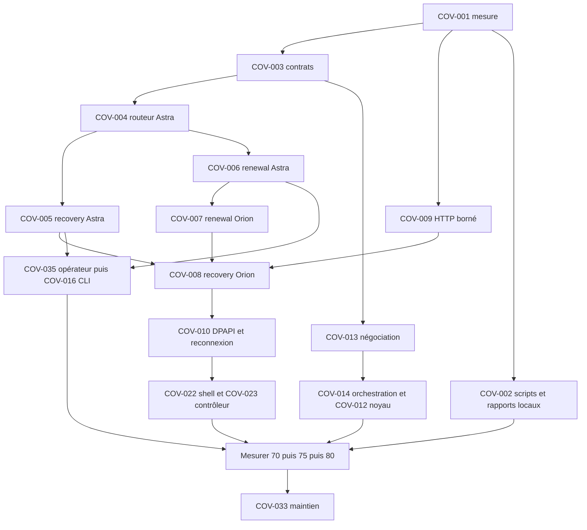

# Roadmap priorisée vers la couverture maximale

## Statut et unité de compte

État mesuré et limites du lot suivant : [journal de développement](09-implementation-progress.md). Les nombres historiques ci-dessous restent des références de planification. COV-036 ajoute le déblocage des audits de dépendances avant livraison. Le [deuxième lot](10-certificate-workflows.md) documente la poursuite de COV-003/COV-005/COV-006. Le [troisième lot](11-companion-journal.md) corrige les mutations du compagnon. Le [quatrième lot](12-renewal-concurrency.md) vérifie annulation, concurrence et routes privées ; les limites de durabilité et de cible restent explicites.

**Démarrage autorisé par le responsable.** Le premier lot a livré COV-001/COV-002 et leurs tests locaux. Le responsable demande désormais de poursuivre vers **100 % des lignes de production pertinentes** : 80 % reste un jalon symbolique, jamais un critère d’arrêt. COV-003/COV-004/COV-009 constituent le lot suivant ; leur état réel et leurs validations sont consignés dans le journal de développement. Les autres fiches restent ouvertes tant que leurs critères ne sont pas prouvés.

Référence recommandée : lignes de production Linux `DA`, hors tests/fixtures/harnais selon la méthode à ratifier de COV-001 : **30 870 / 53 009 = 58,24 %**. Manque à 80 % à taille constante : **11 538 lignes**. Les résumés LLVM bruts sont suivis séparément (66,10 %, manque 9 825) ; les bibliothèques seules ne sont jamais le total projet. Windows et matériel ont des critères distincts, pas une couverture supposée.

Les gains sont des **fourchettes d’estimation**, pas des mesures ni garanties. Ils portent sur les lignes actuellement non exécutées des familles possédées par chaque lot, sans compter lignes de tests ou code retiré. 100 lignes correspondraient à environ 0,19 point à dénominateur 53 009 constant. Tout code nouveau modifie ce calcul. Les lots qui touchent plusieurs couches ne s’attribuent que les gains de leur famille principale : COV-009=trust-update, COV-008=recovery, COV-007=renewal, COV-013=négociation, COV-020=registre, COV-021=API/canal. Les factorisations et campagnes Windows n’ont **aucun gain Linux crédité**, afin d’éviter le double comptage.

Somme des potentiels des lots fonctionnels : **13 365–17 455 lignes**. C’est une réserve de scénarios au-delà du besoin 11 538, pas une promesse d’atteindre un taux sans mesurer. Les profils cible Linux ne peuvent être combinés qu’avec même source, toolchain, features et conventions ; sinon publier une vue cible séparée. Les gains matériels seront reclassés si cette combinaison n’est pas valide.

Effort historique des 35 premières fiches, révisé pour F11 : **137–240 jours-personne**, forte incertitude sur matériel, GUI, frontières de test et outillage local. Inclut assurance au-delà de 80 % et consolidation ; les jours de disponibilité de cible ou validation humaine ne sont pas inclus. Ordre de grandeur pour deux développeurs : environ 4–8 mois, selon parallélisation et disponibilité des environnements ; cette conversion calendaire reste une estimation, pas une date contractuelle.

La baseline historique ci-dessus vient du collecteur `rust-ast-da-v1`. Il retire aussi les 31 lignes du module de fixture `crates/orion-core/src/config/legacy_fixture.rs`, dont la déclaration est sous `cfg(test)`. L’audit initial conservé dans 02 comptait encore ces lignes ; la révision de périmètre est explicite et ne représente aucun test métier ajouté.

Baseline suivante : [F11, code d41835e](15-f11-file-baseline.md), **36 131 / 56 421 = 64,04 %**, reliquat 20 290 lignes vers 100 % et 9 006 vers 80 %. Les réserves et gains ci-dessous restent historiques, ne sont pas additionnés à cette nouvelle baseline et ne constituent pas une estimation du travail restant après F14. Les 137–240 jours-personne incluent du travail déjà réalisé ; COV-036 et la disponibilité matérielle doivent être estimés séparément.

## Objectif au-delà de 80 %

À périmètre constant de la baseline v1, 100 % demanderait de couvrir les **22 139 lignes restantes**. La réserve estimée des lots fonctionnels (13 365–17 455 lignes) ne couvre donc pas intégralement cet objectif : il resterait théoriquement **4 684–8 774 lignes** après ces gains, avant tout changement de code. Cette soustraction est un repère, pas une prévision. L’effort historique de 135–237 jours-personne ne constitue pas une estimation validée pour atteindre 100 %.

Après chaque lot, COV-033 réattribue les lignes, fonctions et branches restantes à des scénarios observables, puis ouvre des sous-tâches concrètes par fichier. Les paliers 90 %, 95 % puis 100 % sont suivis avec les mêmes dénominateurs documentés. Les campagnes Windows, noyau, TPM et FIDO restent nécessaires pour leurs chemins propres ; aucune couverture Linux n’est inventée pour eux. Tout reliquat impossible à exercer est expliqué et garde son statut non couvert. Aucune exclusion, suppression ou assertion affaiblie ne sert à atteindre le chiffre. Un taux de 100 % des lignes ne prouve pas la sécurité ni la couverture des branches.

## Contraintes ajoutées au plan

Le responsable du dépôt a exclu tout temps CI supplémentaire pour cette mission. Les collectes, rapports, comparaisons et contrôles de tailles seront lancés par scripts locaux à la demande ; les workflows existants restent dans leur périmètre actuel. Les campagnes complémentaires lourdes restent locales, sans nouveau job ni recompilation instrumentée en CI ; les tests unitaires courts peuvent intégrer les suites ciblées existantes, comme le responsable l’a confirmé. Aucun workflow CI n’est modifié par ce lot.

Tous les lots doivent préserver la taille des artefacts livrables. La borne canonique de **128 Mio (134 217 728 octets)** concerne les fichiers acceptés par update/bundle ; elle ne doit pas être relevée pour faire passer une campagne. Comparer aussi les tailles avant/après par binaire, même sous cette borne, avec même SHA de référence, target, toolchain, features et profil release. Toute hausse significative doit être expliquée ; aucun nouveau seuil de pourcentage n’est inventé sans décision du responsable. L’installateur compressé, le cache Cargo et un binaire instrumenté sont des objets distincts de ce contrôle.

Le matériel de test reste dans tests/fixtures et dépendances dev ; aucun framework de test, générateur ou bibliothèque de propriétés n’entre dans les dépendances runtime pour faciliter la couverture. Préserver `lto = "thin"` et `strip = true`, sans modifier le profil d’optimisation pour masquer une hausse. Ne jamais distribuer/signer une sortie llvm-cov. COV-002 définit les scripts correspondants ; chaque tâche qui modifie du Rust livrable doit produire un relevé local de taille ou dire précisément pourquoi la comparaison ne peut pas être obtenue.

## Dix tâches initiales (ordre historique)

| Ordre | ID | Motif |
|---|---|---|
| 1 | COV-001 | Ratifier périmètre et éviter une fausse réussite à 80 |
| 2 | COV-009 | Réponses réseau non bornées et preuve de transaction complète |
| 3 | COV-003 | Validation canonique grant/recovery/ledger |
| 4 | COV-004 | Routes Astra publiques non exercées |
| 5 | COV-005 | Récupération et commit/reprise côté autorité |
| 6 | COV-006 | Renouvellement délégué et journal côté Astra |
| 7 | COV-013 | Annulation, génération et PSK côté gateway/client |
| 8 | COV-007 | Workflow de renouvellement client, pas seulement primitives |
| 9 | COV-008 | Recovery client et réponse de commit perdue |
| 10 | COV-010 | Scellement/promotion puis vraie reconnexion Windows |

COV-014, COV-034 et COV-035 sont également P0 ; ils se préparent pendant les dépendances des dix premières tâches. P0 indique un risque d’assurance à traiter en premier, pas une exploitation démontrée. COV-002 prépare tôt la conservation des résultats.

## Paliers et chemin critique initiaux

| Palier | Lots indicatifs | Gain cumulé bas estimé | Résultat théorique à N constant | Critère réel |
|---|---|---:|---:|---|
| 1 Fiabiliser | 001,002,032 | 0 | 58,24 % | Baseline/contrôles locaux ratifiés et environnement propre reproduit |
| 2 Lacunes critiques | 003–010,013,014,034,035 | Suivi par mesures, pas seuil imposé | pas d’engagement | Parcours sensibles, refus et reprises vérifiés |
| 3 Atteindre70 | Étendre 015,017,019,020,021 | au moins6 237 **mesurées** nécessaires | 70 % | N,C recalculés ; aucune limite critique cachée |
| 4 Atteindre75 | Compléter 011,012,016 et workflows opérateur | au moins8 887 **mesurées** nécessaires | 75 % | Intégrations réelles et négatifs ; vue Windows distincte |
| 5 Atteindre80 | Compléter 018,022,023 puis reliquat mesuré | au moins11 538 **mesurées** nécessaires | 80 % | Deux collectes stables ; pas d’exclusion opportuniste |
| 6 Étendre et consolider | Tous les lots ouverts, 024–031,033 et reliquats mesurés | aucune garantie chiffrée | 90 puis 95 puis 100 % visés | Chaque chemin restant a un scénario ou une limite explicite ; contrôles locaux et cibles maintenus |

Franchir un palier ne clôt aucun lot dont les scénarios restent pertinents. À chaque mesure, réordonner les scénarios restants par criticité et lignes réellement manquantes. Les tâches de sécurité restent nécessaires même si le seuil est franchi avant elles. Les fenêtres de renouvellement à 80 % de vie d’un certificat sont un contrat **distinct** du seuil de couverture80 %.

Le blocage matériel le plus probable est la disponibilité simultanée Windows/DPAPI/WireGuard-NT, gateway Linux/TPM et clés opérateur. Provisionner ces environnements tôt ; développer d’abord les oracles portables, sans présenter les doubles comme preuve matériel. Aucun backend obligatoire ne devient best-effort pour faciliter un test.

## Attribution historique des estimations

Les fourchettes sont des **estimations expertes**, fondées sur le volume restant et les scénarios proposés, pas une attribution ligne→scénario déjà démontrée. Le tableau borne chaque estimation par les lignes non exécutées mesurées de sa famille principale, sans chevauchement de fichiers entre familles créditées. Les fichiers supplémentaires cités dans une tâche sont des dépendances/test seams ; ils ne lui donnent pas un crédit additionnel. Les scénarios d’une même famille peuvent exercer les mêmes helpers : un seul crédit final mesuré reste autorisé. Les faibles bornes ne sont pas des engagements contractuels.

| Lot | Réserve de lignes non couvertes mesurée dans sa famille | Gain proposé, estimation |
|---|---:|---:|
| COV-003 | 193 | 100–180 |
| COV-004 | 520 | 350–480 |
| COV-005 | 371 | 260–350 |
| COV-006 | 727 | 550–700 |
| COV-007 | 503 | 330–460 |
| COV-008 | 273 | 200–260 |
| COV-009 | 55 | 35–55 |
| COV-011 | 716 | 450–620 |
| COV-012 | 127 | 60–100 |
| COV-013 | 1039 | 450–620 |
| COV-014 | 659 | 450–580 |
| COV-015 | 1026 | 600–850 |
| COV-016 | 2257 | 1300–1600 |
| COV-017 | 2620 | 1700–2200 |
| COV-018 | 1892 | 1130–1500 |
| COV-019 | 596 | 430–550 |
| COV-020 | 666 | 400–480 |
| COV-021 | 1063 | 750–900 |
| COV-022 | 1784 | 1150–1450 |
| COV-023 | 1393 | 900–1200 |
| COV-024 | 251 | 100–200 |
| COV-025 | 514 | 320–400 |
| COV-026 | 250 | 150–220 |
| COV-034 | 370 | 200–300 |
| COV-035 | 1437 | 1000–1200 |

COV-026 a changé de périmètre depuis F11 : les 150–220 lignes de l’ancien helper ne sont plus créditées. Sa nouvelle réserve estimée de 60–120 lignes portables reste à mesurer et ne remplace pas automatiquement l’ancienne dans la somme historique.

Les COV sans ligne dans ce tableau ne s’attribuent aucun gain Linux. Cette convention se vérifie avec les chemins du tableau par fichier de 02 et les familles décrites dans chaque objectif ; elle ne certifie pas qu’un test donné pourra couvrir toute la réserve.

## Fiches de développement et critères de clôture

Chaque liste de fichiers désigne des chemins existants, sauf les nouveaux scripts explicitement proposés dans COV-002 ; une future suite nouvelle devra être placée auprès de ces modules et reprendre leurs patterns. Les listes larges des outils représentent des lots à fractionner en PR atomiques par sous-commande, sans refactor transverse non demandé. Les critères incluent succès **et** refus. Les estimations en jours-personne supposent connaissance du dépôt ; incertitude environ ×1,5 à ×2 sur interfaces matérielles.

### COV-001 — Ratifier et automatiser le périmètre de mesure de production

**Identifiant :** COV-001

**Titre :** Ratifier et automatiser le périmètre de mesure de production.

**Objectif :** Rendre comparables les deux vues et fixer le dénominateur du seuil.

**Fichiers concernés :** `scripts/coverage.sh`, `scripts/coverage-summary.mjs`, `scripts/cargo-budget.sh`, `scripts/wsl-cargo`, `docs/testing/TESTING.md`.

**Constat vérifié :** Deux mesures globales identiques en lignes/fonctions ; résumé LLVM 66,10 %, projection production 58,24 %. Tests inline et écart LF/DA documentés dans 02.

**Travail proposé :** Définir production livrée/harnais, versionner un calcul conservateur vérifié sur AST/macros, épingler outils et commandes, conserver global/libs séparés, harmoniser verrou/budget de fin. Résoudre ou définir explicitement la sémantique des compteurs LF/DA.

**Scénarios à tester :** Fichier mixte tests/production, fichier sans test, backend à zéro, cfg Windows/Linux, macro, profil incomplet, échec test, features minimales et toutes features.

**Préconditions :** Toolchain/LLVM/llvm-cov et dépendances natives provisionnés ; pas de téléchargement implicite ; budget cache disponible.

**Critères d’acceptation :** Deux campagnes isolées sur même SHA, périmètre identique, tableaux par crate/fichier, liste tests réelle, échecs non publiés comme baseline ; autre environnement local propre documenté ; aucune exclusion de production pour gagner un taux.

**Gain de couverture estimé :** 0 ligne créditée ; tâche de mesure, plateforme distincte ou consolidation.

**Risque :** moyen.

**Effort estimé :** 3–5 jours-personne ; incertitude plus forte si dépendances cible indisponibles.

**Dépendances :** aucune tâche préalable ; démarrage validé ; contraintes et préconditions de la fiche applicables.

**Priorité :** P0.

### COV-002 — Ajouter les scripts locaux de rapport, comparaison et taille binaire

**Identifiant :** COV-002

**Titre :** Ajouter les scripts locaux de rapport, comparaison et taille binaire.

**Objectif :** Rejouer l’audit et contrôler les régressions localement, sans temps CI supplémentaire ni instrumentation dans les binaires livrés.

**Fichiers concernés :** `scripts/coverage.sh`, `scripts/coverage-summary.mjs`, `docs/testing/TESTING.md` ; nouveaux scripts du premier lot : `scripts/audit-rust.sh`, `scripts/audit-report.py`, `scripts/binary-size.py`. Le helper interne `scripts/audit-collect.py` et les tests sous `scripts/local-tests/` complètent ces entrées sans nouvelle étape CI.

**Constat vérifié :** La CI ne mesure pas la couverture pour coût runner. `tools/xtask/src/main.rs:872` protège explicitement cette séparation. La limite canonique du chemin update est `helios_update::MAX_BINARY_SIZE = 128 * 1024 * 1024` (`crates/helios-update/src/lib.rs:26`), reprise par la publication et les bundles ; `Cargo.toml` conserve LTO thin et strip release.

**Travail proposé :** Ajouter un pilote shell local qui réutilise coverage.sh et wsl-cargo, un analyseur Python sans dépendance supplémentaire pour provenance/production/écarts, et un lecteur de tailles des artefacts livrables. Conserver JSON/LCOV/HTML et comparaison de référence sur disque local. Rendre chaque contrôle coûteux explicite à la commande, et séparer collecte instrumentée des artefacts release. Détail des interfaces proposées dans 08 ; aucun job, déclenchement, seuil PR ou publication CI ajouté.

**Scénarios à tester :** Référence comparable/non comparable, profil incomplet ou test échoué, interruption d’export, dérive de dénominateur, outil absent, budget disque refusé, artefact absent/vide/hors borne, taille exactement à la limite, baseline de taille incompatible, binaire instrumenté ou debug fourni comme livrable.

**Préconditions :** Métrique ratifiée COV-001, outils déjà provisionnés, espace dans le cache unique ; artefacts release locaux de même cible/features/toolchain pour comparer les tailles. Aucune installation réseau ou reconstruction release implicite.

**Critères d’acceptation :** Une commande locale documentée produit les deux vues et leurs rapports ; un contrôle local retourne un code d’échec pour vraie régression et distingue un rapport non comparable ; la borne canonique de 128 Mio est respectée par les artefacts auxquels elle s’applique et n’est jamais relevée ; deltas de taille sont chiffrés à provenance identique. Aucun code d’audit, fixture, dépendance de test ou instrumentation n’entre dans les artefacts livrés. Aucun ajout de temps CI.

**Gain de couverture estimé :** 0 ligne créditée ; outillage local et protection des artefacts.

**Risque :** moyen.

**Effort estimé :** 2–4 jours-personne ; incertitude sur la validation des métadonnées d’artefacts et les règles de comparaison.

**Dépendances :** COV-001.

**Priorité :** P1.

### COV-003 — Compléter les preuves négatives du grant et du ledger

**Identifiant :** COV-003

**Titre :** Compléter les preuves négatives du grant et du ledger.

**Objectif :** Verrouiller identité, autorité, révocations et snapshot.

**Fichiers concernés :** `crates/aether/src/certificates/client/grant.rs`, `crates/aether/src/certificates/client/tests.rs`, `crates/aether/src/certificates/state/ledger.rs`, `crates/aether/src/certificates/state/tests.rs`.

**Constat vérifié :** 193 lignes production DA non couvertes sur ces deux modules ; verify_for_recovery et verify_signed_by sans hit ; fonctions ledger déjà exécutées.

**Travail proposé :** Partir des fixtures de grants existantes ; ajouter matrices de mutations et tests des bornes de ledger ; caractériser état de propriétaire sur échec apply_due.

**Scénarios à tester :** Mauvais domaine/CA/époque/CSR, reçu autre gateway, issuer délégué interdit, preuve campagne, signature corrompue, capacité/expiration/statut par cible, snapshot modifié.

**Préconditions :** Portable, vraies clés ML-DSA de test et certificats rcgen, horloge explicite.

**Critères d’acceptation :** Chaque refus nomme le contrat violé ; grant légal accepté pour chaque rôle ; aucun rôle installateur réduit à verify_signed_by ; état persistant cohérent sur erreur.

**Gain de couverture estimé :** **Estimation** 100–180 lignes existantes, soit environ 0.19–0.34 points à N=53 009 constant. À mesurer après changement ; aucune garantie.

**Risque :** élevé.

**Effort estimé :** 2–4 jours-personne ; incertitude plus forte si dépendances cible indisponibles.

**Dépendances :** COV-001.

**Priorité :** P0.

### COV-004 — Tester le routeur public Astra et ses frontières

**Identifiant :** COV-004

**Titre :** Tester le routeur public Astra et ses frontières.

**Objectif :** Vérifier les méthodes, extracteurs, budgets et refus visibles.

**Fichiers concernés :** `crates/astra/src/service.rs`, `crates/astra/src/service/tests.rs`, `crates/astra/Cargo.toml`.

**Constat vérifié :** 520 lignes production non couvertes ; router et handlers sans compteur, neuf tests locaux de primitives seulement.

**Travail proposé :** Construire service et registre temporaires, jouer HTTP avec ConnectInfo réel/contrôlé, assertions sur statuts et corps ; justifier seulement si nécessaire une dépendance dev routeur déjà utilisée ailleurs.

**Scénarios à tester :** Body trop gros/malformé, source IPv4/mapped/IPv6, bearer absent/expiré/autre scope, ID inconnu et ordinary ID, campagne publique 501, méthodes/chemins refusés, aucun inventaire/secret.

**Préconditions :** Loopback sans privilège, fixture service ; pas de FIDO réel requis pour tester le refus.

**Critères d’acceptation :** Matrice routes×méthodes documentée et testée ; refus publics grossiers ; limites effectives via HTTP ; aucun handler sensible public ajouté.

**Gain de couverture estimé :** **Estimation** 350–480 lignes existantes, soit environ 0.66–0.90 points à N=53 009 constant. À mesurer après changement ; aucune garantie.

**Risque :** élevé.

**Effort estimé :** 3–6 jours-personne ; incertitude plus forte si dépendances cible indisponibles.

**Dépendances :** COV-001, COV-003.

**Priorité :** P0.

État courant : COV-036 est débloquée pour la révision testée ; COV-003/COV-005/COV-006/COV-020 progressent et restent partielles. Le [journal 12](12-renewal-concurrency.md) mesure 61,63 % global et 71,04 % bibliothèques ; 9 763 lignes restent à couvrir pour le jalon 80 % global au nouveau dénominateur, sans en faire une fin de mission. Deux courses de publication sont corrigées et l’annulation après écriture du stage est vérifiée ; autres coupes d’annulation, listener Astra mTLS complet et fautes post-renommage restent ouvertes. Les estimations des fiches restent historiques, sans addition automatique aux gains mesurés.

### COV-005 — Exercer la récupération Astra et sa réconciliation

**Identifiant :** COV-005

**Titre :** Exercer la récupération Astra et sa réconciliation.

**Objectif :** Prouver la chaîne autorisation–reçu–grant–commit sans tunnel client.

**Fichiers concernés :** `crates/astra/src/recovery.rs`, `crates/astra/src/recovery/tests/workflow.rs`, `crates/astra/src/reconciliation.rs`, `crates/astra/tests/private_channel.rs`.

**Constat vérifié :** 371 lignes recovery non couvertes ; étapes async à zéro ; seules capacité/expiration du store testées localement.

**Travail proposé :** Monter canal privé loopback avec handler gateway contrôlé, registres durables et barrières ; tester chaque étape, coupure et reprise ; caractériser puis corriger sous contrat le rejeu après état Committed.

**Scénarios à tester :** Historique admission jamais renouvelé, challenge consommé après refus, révocation, mauvaise clé maître/raison, identité servie fausse, stage réussi puis réponse perdue, intent écrit puis commit perdu, réconciliation échouée/concurrente.

**Préconditions :** TLS loopback, clés et répertoires de test ; aucun réseau externe.

**Critères d’acceptation :** Preuves vérifiées avant effets ; intent durable avant commit ; reprise après réponse perdue sans deuxième autorisation ni génération orpheline ; refus identiques pour inconnus sensibles.

**Gain de couverture estimé :** **Estimation** 260–350 lignes existantes, soit environ 0.49–0.66 points à N=53 009 constant. À mesurer après changement ; aucune garantie.

**Risque :** élevé.

**Effort estimé :** 4–7 jours-personne ; incertitude plus forte si dépendances cible indisponibles.

**Dépendances :** COV-003, COV-004.

**Priorité :** P0.

### COV-006 — Exercer le renouvellement Astra sur canal privé

**Identifiant :** COV-006

**Titre :** Exercer le renouvellement Astra sur canal privé.

**Objectif :** Prouver l’émission déléguée et le raccordement du journal au registre.

**Fichiers concernés :** `crates/astra/src/renewal/approval.rs`, `crates/astra/src/renewal/companion.rs`, `crates/astra/src/renewal/mod.rs`, `crates/astra/src/renewal/request.rs`, `crates/astra/src/renewal/router.rs`, `crates/astra/src/renewal/stage.rs`, `crates/astra/src/renewal/tests.rs`, `crates/astra/src/renewal/test_support.rs`, `crates/astra/src/renewal/workflow_tests.rs`, `crates/astra/src/renewal/workflow_tests/companion.rs`, `crates/astra/src/renewal/workflow_tests/concurrency.rs`, `crates/astra/src/renewal/workflow_tests/router.rs`, `crates/astra/src/operations.rs`, `crates/astra/src/operations/tests.rs`, `crates/astra/tests/private_channel.rs`.

**Constat vérifié :** 727 lignes production du dossier non couvertes ; request/stage/companion/router à zéro, cinq tests de fenêtre existants.

**Travail proposé :** Ajouter workflow request→stage→receipt→grant avec vrai issuer et canal loopback ; points de coupure déterministes autour persistance ; assertions de reprise du grant publié.

**Scénarios à tester :** Seuil et durée délégation, campagne exacte, peer mismatch, timeout, token scopes, rafraîchissement challenge, dépôt identique/divergent, crash après grant avant mark_granted, concurrence révocation.

**Préconditions :** Fixture issuer/registre/canal avec horloge contrôlée, matériel crypto réel de test.

**Critères d’acceptation :** Renouvellement ordinaire sans maître ni opérateur ; grant durable jamais retiré ; réparation uniquement pour stage exact ; aucun ID ordinary résolu sur voie publique.

**Gain de couverture estimé :** **Estimation** 550–700 lignes existantes, soit environ 1.04–1.32 points à N=53 009 constant. À mesurer après changement ; aucune garantie.

**Risque :** élevé.

**Effort estimé :** 5–8 jours-personne ; incertitude plus forte si dépendances cible indisponibles.

**Dépendances :** COV-003, COV-004.

**Priorité :** P0.

### COV-007 — Tester la séquence complète de renouvellement Orion

État F11 : reprise et refus de session testés dans le moteur ; cycle positif complet encore ouvert. Voir le [journal 14](14-f11-engine.md). Les nombres de lignes ci-dessous sont les estimations historiques, pas une mesure du lot F11.

**Identifiant :** COV-007

**Titre :** Tester la séquence complète de renouvellement Orion.

**Objectif :** Vérifier l’ordre de scellement, staging, commit et promotion.

**Fichiers concernés :** `crates/orion-core/src/certificate_renewal/exchange.rs`, `crates/orion-core/src/certificate_renewal/promotion.rs`, `crates/orion-core/src/certificate_renewal/trust_store.rs`, `crates/orion-core/src/certificate_renewal/tests/gateway_exchange.rs`, `crates/orion-core/src/certificate_renewal/tests/candidate_identity.rs`, `crates/orion-engine/src/service/certificates.rs`, `crates/orion-engine/src/service/certificates/tests.rs`.

**Constat vérifié :** Baseline initiale : 503 lignes de production non couvertes. Depuis F11, la map de renouvellement appartient au moteur ; le lot 14 vérifie sa conservation sur erreur de reprise, sans changer la demande ni les octets persistés. La préparation publique est testable sous Linux ; `begin/resume` lisent un magasin protégé concret et les succès complets restent à isoler.

**Travail proposé :** Introduire le plus petit point d’injection interne du magasin existant, sans élargir les API cryptographiques ni livrer de backend plaintext. Utiliser HTTP loopback et vrais grants ; vérifier insertion/reprise/suppression de la session moteur, ordonnancement de la tâche automatique après le rafraîchissement de confiance, annulation et rejeu exact du commit ; garder DPAPI sur cible. Mesurer les binaires après tout changement de testabilité.

**Scénarios à tester :** Candidat -next, aucune écriture avant vérification, stage puis réponse perdue, identité store refusée, commit distant réussi/local échoué, promotion avant/à/après activation, rollback borné, corps HTTP chunké hors borne.

**Préconditions :** Portable pour ordre logique ; Windows pour magasin concret. Point d’injection n’autorise aucun backend plaintext livré.

**Critères d’acceptation :** État rechargé correspond au résultat distant ; mêmes octets/fingerprint pour reprise ; ancien actif utilisable pendant overlap ; nouvelle négociation après promotion avec bonne paire.

**Gain de couverture estimé :** **Estimation** 330–460 lignes existantes, soit environ 0.62–0.87 points à N=53 009 constant. À mesurer après changement ; aucune garantie.

**Risque :** élevé.

**Effort estimé :** 5–9 jours-personne ; incertitude plus forte si dépendances cible indisponibles.

**Dépendances :** COV-003, COV-006.

**Priorité :** P0.

### COV-008 — Tester la récupération Orion hors tunnel et ses reprises

État F11 : sélection d’un identifiant absent et absence de mutation testées ; les sessions positives restent à exercer. Voir le [journal 14](14-f11-engine.md).

**Identifiant :** COV-008

**Titre :** Tester la récupération Orion hors tunnel et ses reprises.

**Objectif :** Restaurer une identité expirée sans perdre la continuité de clés.

**Fichiers concernés :** `crates/orion-core/src/certificate_recovery.rs`, `crates/orion-core/src/certificate_renewal/exchange.rs`, `crates/orion-core/src/certificate_renewal/promotion.rs`, `crates/orion-engine/src/service/certificates.rs`, `crates/orion-engine/src/service/certificates/tests.rs`.

**Constat vérifié :** La baseline initiale signalait 273 lignes recovery non couvertes. Après F11, le moteur possède une map de récupération distincte et sélectionne une session par identifiant opaque. `RecoverySession` n’a pas de constructeur public comparable à `RenewalSession::prepare` ; un succès réel de `begin` exige identité protégée et challenge distant. Le lot 14 ne prouve pas le cycle de récupération positif.

**Travail proposé :** Serveur Astra contrôlé, vraie preuve historique et grant ; fixture de magasin isolée selon COV-007. Tester sélection entre plusieurs récupérations et refus d’un identifiant de renouvellement, maintien de la session non terminale, suppression après `Recovered`, perte de réponse commit et reprise après échec de promotion. Ne pas rendre publics les champs privés de session uniquement pour fabriquer des tests.

**Scénarios à tester :** Opérateur absent, ancienne preuve incorrecte, ID/fingerprint/état étranger, HTTP 4xx/5xx/timeout/JSON altéré, candidat scellé puis crash, commit confirmé perdu, local déjà committé non promu, nouvelle connexion sans tunnel.

**Préconditions :** Portable pour HTTP/logique ; Windows pour scellement/promotion concrète.

**Critères d’acceptation :** Aucune réussite affichée avant génération réellement utilisable ; reprise idempotente du commit confirmé ; ancienne génération expirée jamais réactivée ; aucune sortie de clés en logs/erreurs.

**Gain de couverture estimé :** **Estimation** 200–260 lignes existantes, soit environ 0.38–0.49 points à N=53 009 constant. À mesurer après changement ; aucune garantie.

**Risque :** élevé.

**Effort estimé :** 4–7 jours-personne ; incertitude plus forte si dépendances cible indisponibles.

**Dépendances :** COV-005, COV-007, COV-009.

**Priorité :** P0.

### COV-009 — Borner les réponses trust-update et vérifier le succès HTTP

**Identifiant :** COV-009

**Titre :** Borner les réponses trust-update et vérifier le succès HTTP.

**Objectif :** Appliquer le contrat d’octets avant allocation non bornée et avant mutation.

**Fichiers concernés :** `crates/orion-core/src/trust_update.rs`, `crates/aether/src/certificates/transport.rs`, `crates/orion-core/src/certificate_recovery.rs`, `crates/orion-core/src/certificate_renewal/exchange.rs`.

**Constat vérifié :** poll lit response.bytes sans plafond 64 KiB ; DTO permissif ; renewal contrôle après lecture ; seul test HTTP trust-update actuel = refus 404.

**Travail proposé :** Définir lecture bornée par contrat sur les helpers existants, tester streaming sans Content-Length et JSON strict selon spec ; vérifier vraie transaction signée de bout en bout. Ne pas créer de transport universel.

**Scénarios à tester :** Borne−1/borne/borne+1, longueur absente/fausse, chunked ou stream sans fin, redirection/proxy, champ inconnu, fragment répété, MAX_POLLS, base changée, dernière page perdue.

**Préconditions :** Loopback et store temporaire ; fixtures transaction déjà existantes ; décision sur strictness DTO à aligner avec spec.

**Critères d’acceptation :** Refus borné en octets avant désérialisation et état inchangé ; aucun fragment appliqué seul ; succès complet durable en une application ; temps et mémoire de scénario bornés.

**Gain de couverture estimé :** **Estimation** 35–55 lignes existantes, soit environ 0.07–0.10 points à N=53 009 constant. À mesurer après changement ; aucune garantie.

**Risque :** élevé.

**Effort estimé :** 2–4 jours-personne ; incertitude plus forte si dépendances cible indisponibles.

**Dépendances :** COV-001.

**Priorité :** P0.

### COV-010 — Valider DPAPI et reconnexion après promotion sur Windows

État F11 : les protections Windows restent hors mesure WSL ; la compilation MSVC ne remplace pas cette recette native. Voir le [journal 14](14-f11-engine.md).

**Identifiant :** COV-010

**Titre :** Valider DPAPI et reconnexion après promotion sur Windows.

**Objectif :** Prouver l’effet concret du magasin protégé dans le cycle client.

**Fichiers concernés :** `crates/orion-core/src/identity_store.rs`, `crates/orion-core/src/identity_store/tests.rs`, `crates/orion-core/src/certificate_renewal/promotion.rs`, `crates/orion-core/src/certificate_recovery.rs`, `scripts/campaign-windows.ps1`, `docs/testing/MANUAL-TESTING.md`, `crates/orion-engine/src/pipe/windows.rs`, `crates/orion-core/src/protected_root/windows.rs`, `crates/orion-core/src/vault/windows/tpm.rs`, `crates/orion-core/src/vault/relocation.rs`, `apps/orion/src-tauri/src/engine_host.rs`, `apps/orion/src-tauri/src/ui_access.rs`.

**Constat vérifié :** Trois tests Windows de primitive/store existent ; Linux exerce le refus ; cycle renouvellement/récupération puis reconnexion non démontré par cette campagne.

**Travail proposé :** Automatiser cycle même compte avec identité et profil jetables sous le moteur élevé F11 ; garder recette deux SID et WireGuard-NT. Vérifier refus du mauvais processus/SID sur le pipe, DACL et points d’analyse, clé TPM machine, nettoyage sous le jeton IHM et échec de migration sans destruction de l’ancien coffre. Respecter l’accès accepté des autres administrateurs : ne pas inventer une protection contre eux.

**Scénarios à tester :** Scellement/tamper, candidat distinct, promotion répétée, previous slot expiré, import puis suppression fichier source, reconnect après activation, copie vers autre compte refusée.

**Préconditions :** Windows natif, compte isolé ; deux comptes et hôtes pour recette finale ; clés FIDO dédiées.

**Critères d’acceptation :** Tunnel rouvert avec génération promue après renouvellement ET récupération ; ancien compteur ne baisse pas ; aucun plaintext persistant ; preuve inter-compte distincte.

**Gain de couverture estimé :** 0 ligne créditée ; tâche de mesure, plateforme distincte ou consolidation.

**Risque :** élevé.

**Effort estimé :** 6–10 jours-personne après extension F11 ; incertitude forte sur la disponibilité des comptes, TPM et cibles.

**Dépendances :** COV-007, COV-008.

**Priorité :** P0.

### COV-011 — Exécuter le backend ESAPI en environnement TPM explicite

**Identifiant :** COV-011

**Titre :** Exécuter le backend ESAPI en environnement TPM explicite.

**Objectif :** Distinguer essais matériels réellement exécutés des retours anticipés.

**Fichiers concernés :** `crates/helios-tpm/src/blob_store.rs`, `crates/helios-tpm/src/boot_controller.rs`, `crates/helios-tpm/src/firmware_recovery.rs`, `crates/helios-tpm/src/keystore.rs`, `crates/helios-tpm/src/provisioning.rs`, `crates/helios-tpm/src/reseal_ticket.rs`, `crates/helios-tpm/src/secret.rs`, `crates/helios-tpm/src/settings.rs`, `crates/helios-tpm/src/tpm_interface.rs`, `crates/helios-tpm/src/tpm_real.rs`, `crates/helios-tpm/src/update_window.rs`, `crates/helios-tpm/tests/materiel.rs`, `scripts/target_campaign.py`, `docs/testing/TESTING.md`.

**Constat vérifié :** 527 lignes DA tpm_real sans hit ; les six tests matériels peuvent quitter dès hardware_requested.

**Travail proposé :** Runner swtpm isolé, TCTI explicite et preuve de précondition ; couverture backend réel ; compléter scénarios erreur ; vraie cible pour PCR/boot et NV.

**Scénarios à tester :** Blob absent/altéré, mauvaise sélection PCR, NV armement/consommation/rejeu/expiration, tcti indisponible, interruption sauvegarde, échec autorisation.

**Préconditions :** Provisioning réseau/privilèges éventuels annoncé ; swtpm et état jetables, cible TPM physique avec console pour boot.

**Critères d’acceptation :** Journal prouve backend ESAPI appelé ; index NV test 0x01804846 identifié/nettoyé selon recette ; aucune affirmation PCR matériel issue du simulateur ; aucune baisse fail-closed.

**Gain de couverture estimé :** **Estimation** 450–620 lignes existantes, soit environ 0.85–1.17 points à N=53 009 constant. À mesurer après changement ; aucune garantie.

**Risque :** élevé.

**Effort estimé :** 5–9 jours-personne ; incertitude plus forte si dépendances cible indisponibles.

**Dépendances :** COV-001.

**Priorité :** P1.

### COV-012 — Valider transaction firewall et pose WireGuard réelle

**Identifiant :** COV-012

**Titre :** Valider transaction firewall et pose WireGuard réelle.

**Objectif :** Observer les effets noyau et les refus sur backends existants.

**Fichiers concernés :** `crates/helios-firewall/src/dryrun.rs`, `crates/helios-firewall/src/lib.rs`, `crates/helios-firewall/src/netlink/expressions.rs`, `crates/helios-firewall/src/netlink/maintenance.rs`, `crates/helios-firewall/src/netlink/transaction.rs`, `crates/helios-firewall/src/ruleset.rs`, `crates/helios-firewall/src/ruleset/administration.rs`, `crates/helios-firewall/src/ruleset/astra_channel.rs`, `crates/helios-firewall/src/ruleset/client_ipv6_egress.rs`, `crates/helios-firewall/src/ruleset/gateway_wan.rs`, `crates/helios-firewall/src/ruleset/kill_switch.rs`, `crates/helios-firewall/src/ruleset/link_ipv6.rs`, `crates/helios-firewall/src/ruleset/meshnet.rs`, `crates/helios-firewall/src/ruleset/nftables.rs`, `crates/helios-firewall/src/ruleset/transport.rs`, `crates/helios-firewall/src/ruleset/tunnel_interface.rs`, `crates/helios-wireguard/src/dryrun.rs`, `crates/helios-wireguard/src/kernel.rs`, `crates/helios-wireguard/src/lib.rs`, `scripts/target_campaign.py`, `scripts/netns-bench.sh`.

**Constat vérifié :** 127 lignes production restantes dans ces deux crates ; taux élevés du ruleset ne prouvent pas son effet Netlink/WG.

**Travail proposé :** Tests de traduction/erreur restants puis VM/netns isolé, observation règles et trafic ; mêmes profils/version si agrégation de couverture Linux.

**Scénarios à tester :** Premier démarrage table absente, erreur traduction avant envoi, échec batch, NAT/filtre atomiques, multi-WAN, kill-switch sur panne/arrêt, slot PSK après pose et après retrait.

**Préconditions :** VM Linux jetable, capabilities réseau, nft/WG, deux hôtes pour PSK réel ; aucun test sur gateway de production.

**Critères d’acceptation :** Aucun paquet autorisé hors Up sauf ouvertures prévues ; aucun ruleset partiel/orphan PSK ; nettoyage namespace et pas de mutation hôte hors périmètre.

**Gain de couverture estimé :** **Estimation** 60–100 lignes existantes, soit environ 0.11–0.19 points à N=53 009 constant. À mesurer après changement ; aucune garantie.

**Risque :** élevé.

**Effort estimé :** 4–7 jours-personne ; incertitude plus forte si dépendances cible indisponibles.

**Dépendances :** COV-001, COV-013.

**Priorité :** P1.

### COV-013 — Compléter négociation v5, annulation et propriétaire de génération

État : **partiellement réalisé**, code `a43a319` ; 16 tests supplémentaires et correction de débordement, voir le [journal 13](13-negotiation-cancellation.md). Les tests de collecte passent mais la finalisation, la régression et les tailles sont arrêtées par le budget disque ; aucun gain mesuré n’est crédité. Les chemins non exercés et les recettes système restent ouverts. Après rebase F11, `2f3d17b` couvre aussi révocation/réadmission à MAX et nettoyage de plusieurs pairs ; voir le [journal 14](14-f11-engine.md). Le blocage disque du lot 13 est historique, le cache étant revenu sous le seuil le 27 octobre. `d41835e` ajoute sérialisation du cache, relecture de politique et protection contre les écritures tardives ; 58 tests ciblés et la régression canonique passent. Les exports temporaires ont disparu à la reprise suivante ; voir les limites du journal 14.

**Identifiant :** COV-013

**Titre :** Compléter négociation v5, annulation et propriétaire de génération.

**Objectif :** Empêcher acteurs périmés, commits sans handshake frais et PSK orphelins.

**Fichiers concernés :** `crates/aether-key-negotiation/src/client.rs`, `crates/aether-key-negotiation/src/endpoint.rs`, `crates/aether-key-negotiation/src/framing.rs`, `crates/aether-key-negotiation/src/identity.rs`, `crates/aether-key-negotiation/src/rate_limit.rs`, `crates/aether-key-negotiation/src/server.rs`, `crates/aether-key-negotiation/src/transaction.rs`, `crates/heliosd/src/key_negotiation/candidate.rs`, `crates/heliosd/src/key_negotiation/identity.rs`, `crates/heliosd/src/key_negotiation/mod.rs`, `crates/heliosd/src/key_negotiation/origin.rs`, `crates/heliosd/src/key_negotiation/protocol.rs`, `crates/heliosd/src/key_negotiation/server.rs`, `crates/heliosd/src/key_negotiation/transaction.rs`, `crates/orion-core/src/key_negotiation.rs`, `crates/heliosd/src/key_negotiation/tests/transaction.rs`, `crates/heliosd/src/key_negotiation/tests/interop.rs`, `crates/heliosd/src/key_negotiation/tests/transaction_cancellation.rs`, `crates/heliosd/src/key_negotiation/tests/generation_limits.rs`, `crates/heliosd/src/key_negotiation/tests/fixtures.rs`, `crates/heliosd/src/key_negotiation/tests/mod.rs`, `crates/aether-key-negotiation/src/tests/connection_lifecycle.rs`, `crates/aether-key-negotiation/src/tests/fixtures.rs`, `crates/aether-key-negotiation/src/tests/rollback.rs`, `crates/aether-key-negotiation/src/tests/mod.rs`.

**Constat vérifié :** prepare/confirm client sont déjà exercés en interop IPv4/IPv6. Le lot 13 reproduit des débordements de génération et les corrige avant mutation ; annulation de la tâche QUIC réelle, rollback interrompu/repris, restauration du PSK négocié, handshake non avancé et no-op statique à MAX sont testés. La couverture et les recettes système restent à compléter.

**Travail proposé :** Terminer les contrôles et les deux collectes après nettoyage autorisé ; identifier les lignes restantes dans transaction/interop, compléter les entrelacements et tester renouvellement/release via les routes API existantes, puis la vraie pose sur cible.

**Scénarios à tester :** Abort future avant/après pose, clear échoué, generation remplacée, handshake vieux, ACK corrompu/perdu, static PSK préservé, peer/replay/mode incorrect, renouvellement via VIP source.

**Préconditions :** QUIC loopback et doubles plan de données existants ; vraie pose sur deux hôtes en recette séparée.

**Critères d’acceptation :** Rollback survit drop/abort ; ancienne génération ne modifie pas la nouvelle ; PSK posé avant annonce et jamais disque ; QUIC fermé après commit ; Classic refusé.

**Gain de couverture estimé :** **Estimation initiale, non réalisée par le lot 13** 450–620 lignes existantes, soit environ 0.85–1.17 points à N=53 009 constant. À mesurer après changement ; aucune garantie.

**Risque :** élevé.

**Effort estimé :** 4–7 jours-personne ; incertitude plus forte si dépendances cible indisponibles.

**Dépendances :** COV-001, COV-003.

**Priorité :** P0.

### COV-014 — Exercer orchestration, shutdown et hot reload

**Identifiant :** COV-014

**Titre :** Exercer orchestration, shutdown et hot reload.

**Objectif :** Préserver le kill-switch et les secrets runtime pendant erreurs/rechargement.

**Fichiers concernés :** `crates/heliosd/src/orchestrator/commands.rs`, `crates/heliosd/src/orchestrator/data_plane.rs`, `crates/heliosd/src/orchestrator/mod.rs`, `crates/heliosd/src/orchestrator/observation.rs`, `crates/heliosd/src/orchestrator/probes.rs`, `crates/heliosd/src/orchestrator/reload.rs`, `crates/heliosd/src/orchestrator/telemetry.rs`, `crates/heliosd/src/orchestrator/uplinks.rs`, `crates/heliosd/src/orchestrator/tests.rs`, `crates/aether/src/config.rs`.

**Constat vérifié :** 659 lignes production non couvertes dans orchestrator ; tests existants de logique et événements, entrée mod.rs très faible.

**Travail proposé :** Tester boucle via canaux/backends existants et horloge contrôlée ; échecs de state transition/reload/observer ; vérifier séquence réelle sur namespace après tests portables.

**Scénarios à tester :** Erreur backend au startup/arrêt, changement config pendant PSK préparé, WAN multiples, IPv6 indisponible, probe encore active, réseau config redacted, shutdown pending spawn_blocking.

**Préconditions :** Portable pour orchestration ; VM pour effets noyau ; pas d’attentes arbitraires au chronomètre.

**Critères d’acceptation :** Kill-switch actif avant réseau et sur panne/arrêt ; adoption runtime préserve clés/PSK ; config refusée ne devient pas active ; toutes tâches se terminent dans délai borné.

**Gain de couverture estimé :** **Estimation** 450–580 lignes existantes, soit environ 0.85–1.09 points à N=53 009 constant. À mesurer après changement ; aucune garantie.

**Risque :** élevé.

**Effort estimé :** 4–7 jours-personne ; incertitude plus forte si dépendances cible indisponibles.

**Dépendances :** COV-013.

**Priorité :** P0.

### COV-015 — Compléter contrats purs et transitions de sécurité aether

**Identifiant :** COV-015

**Titre :** Compléter contrats purs et transitions de sécurité aether.

**Objectif :** Exercer les chemins négatifs encore absents hors grant/ledger.

**Fichiers concernés :** `crates/aether/src/certificates/approval/campaign.rs`, `crates/aether/src/certificates/approval/credentials.rs`, `crates/aether/src/certificates/approval/mod.rs`, `crates/aether/src/certificates/approval/policy.rs`, `crates/aether/src/certificates/approval/recovery.rs`, `crates/aether/src/certificates/approval/renewal.rs`, `crates/aether/src/certificates/approval/signing.rs`, `crates/aether/src/certificates/authority.rs`, `crates/aether/src/certificates/capability.rs`, `crates/aether/src/certificates/client/commit.rs`, `crates/aether/src/certificates/client/mod.rs`, `crates/aether/src/certificates/client/recovery.rs`, `crates/aether/src/certificates/client/request.rs`, `crates/aether/src/certificates/client/signing.rs`, `crates/aether/src/certificates/client/stage.rs`, `crates/aether/src/certificates/encoding.rs`, `crates/aether/src/certificates/gateway.rs`, `crates/aether/src/certificates/mod.rs`, `crates/aether/src/certificates/operator_ipc.rs`, `crates/aether/src/certificates/operator_session.rs`, `crates/aether/src/certificates/revocation.rs`, `crates/aether/src/certificates/state/astra.rs`, `crates/aether/src/certificates/state/client_identity.rs`, `crates/aether/src/certificates/state/gateway_identity.rs`, `crates/aether/src/certificates/state/revocation_schedule.rs`, `crates/aether/src/certificates/status/campaign.rs`, `crates/aether/src/certificates/status/campaign_approval.rs`, `crates/aether/src/certificates/status/certificate_status.rs`, `crates/aether/src/certificates/status/rollback.rs`, `crates/aether/src/certificates/status/signer.rs`, `crates/aether/src/certificates/status/signing.rs`, `crates/aether/src/certificates/transport.rs`, `crates/aether/src/certificates/webauthn.rs`, `crates/aether/src/certificates/window.rs`, `crates/aether/src/certificates/x509.rs`, `crates/aether/src/config.rs`, `crates/aether/src/display_time.rs`, `crates/aether/src/enroll.rs`, `crates/aether/src/events.rs`, `crates/aether/src/key_negotiation/authentication.rs`, `crates/aether/src/key_negotiation/derivation.rs`, `crates/aether/src/key_negotiation/messages.rs`, `crates/aether/src/key_negotiation/mod.rs`, `crates/aether/src/locked.rs`, `crates/aether/src/ml_dsa.rs`, `crates/aether/src/mtu.rs`, `crates/aether/src/net.rs`, `crates/aether/src/policy.rs`, `crates/aether/src/pq.rs`, `crates/aether/src/private_file.rs`, `crates/aether/src/random.rs`, `crates/aether/src/secret.rs`, `crates/aether/src/secret/json.rs`, `crates/aether/src/sig.rs`, `crates/aether/src/speedtest.rs`, `crates/aether/src/state.rs`, `crates/aether/src/wg.rs`.

**Constat vérifié :** 1 026 lignes production restantes hors les deux fichiers COV-003 ; couverture moyenne élevée ne ferme pas chaque validation.

**Travail proposé :** Classer lignes restantes PKI/config/transport ; tests paramétrés de bornes, transitions et sérialisation ; garder l’entrée ML-DSA/aléa unique et séparation release/PKI.

**Scénarios à tester :** Générations/époques extrêmes, fenêtres inversées, paire mixte, tailles JSON/DER, erreurs RNG de fixture, mode interdit, signature Ed25519 faible et hybride AND, config sans secrets.

**Préconditions :** Stable/MSRV, signatures réelles et fournisseurs de test déjà existants ; aucun nouveau RNG.

**Critères d’acceptation :** Refus typés et absence de mutation vérifiés ; branche aether seul sans signing reste compilable ; pas de test de simple appel sans assertion métier.

**Gain de couverture estimé :** **Estimation** 600–850 lignes existantes, soit environ 1.13–1.60 points à N=53 009 constant. À mesurer après changement ; aucune garantie.

**Risque :** élevé.

**Effort estimé :** 4–7 jours-personne ; incertitude plus forte si dépendances cible indisponibles.

**Dépendances :** COV-003.

**Priorité :** P1.

### COV-016 — Tester les façades CLI astra-signer

**Identifiant :** COV-016

**Titre :** Tester les façades CLI astra-signer.

**Objectif :** Prouver arguments, refus et dépôts des décisions opérateur.

**Fichiers concernés :** `tools/astra-signer/src/cli.rs`, `tools/astra-signer/src/commands/ca_pq_rotation.rs`, `tools/astra-signer/src/commands/ca_tls_rotation.rs`, `tools/astra-signer/src/commands/campaign.rs`, `tools/astra-signer/src/commands/gateway_identity.rs`, `tools/astra-signer/src/commands/issuer.rs`, `tools/astra-signer/src/commands/mod.rs`, `tools/astra-signer/src/commands/recovery.rs`, `tools/astra-signer/src/commands/revocation.rs`, `tools/astra-signer/src/commands/vault.rs`, `tools/astra-signer/src/main.rs`, `tools/astra-signer/src/tests.rs`.

**Constat vérifié :** Signer ne couvre que 10/2267 lignes production ; commandes raccordées et nécessaires, logique métier testée ailleurs.

**Travail proposé :** Sous-processus avec coffre/document/endpoint jetables ; vérifier sorties/exit/effets et frontières de cérémonie ; factorisation minimale des appels plateforme seulement si elle conserve parcours réel.

**Scénarios à tester :** Clés ou fichier absents, vault/pin/RP altéré, document mauvais domaine, deux credentials identiques, annulation, reprise dépôt même fingerprint, serveur refusant résultat, aucun secret stdout/stderr.

**Préconditions :** Fixtures publiques et secrets de test locaux ; COV-034/035 pour les cérémonies, clés matérielles pour parcours final.

**Critères d’acceptation :** Chaque sous-commande critique a succès et refus observable ; pas de signature/dépôt avant validation et geste requis ; aucun mode de contournement dans le binaire livré.

**Gain de couverture estimé :** **Estimation** 1300–1600 lignes existantes, soit environ 2.45–3.02 points à N=53 009 constant. À mesurer après changement ; aucune garantie.

**Risque :** élevé.

**Effort estimé :** 5–9 jours-personne ; incertitude plus forte si dépendances cible indisponibles.

**Dépendances :** COV-005, COV-006, COV-034, COV-035.

**Priorité :** P1.

### COV-017 — Compléter la CLI Helios et les campagnes clientes

**Identifiant :** COV-017

**Titre :** Compléter la CLI Helios et les campagnes clientes.

**Objectif :** Valider sorties opérateur et interactions HTTP/fichiers sous échec.

**Fichiers concernés :** `tools/helios/src/api.rs`, `tools/helios/src/app_update.rs`, `tools/helios/src/campaign.rs`, `tools/helios/src/campaign_key_nego.rs`, `tools/helios/src/enroll.rs`, `tools/helios/src/escrow.rs`, `tools/helios/src/files.rs`, `tools/helios/src/firmware.rs`, `tools/helios/src/inspect.rs`, `tools/helios/src/inspect/firewall.rs`, `tools/helios/src/interactive.rs`, `tools/helios/src/interactive/palette.rs`, `tools/helios/src/interactive/presentation.rs`, `tools/helios/src/key_nego.rs`, `tools/helios/src/main.rs`, `tools/helios/src/monitor.rs`, `tools/helios/src/peer.rs`, `tools/helios/src/profile.rs`, `tools/helios/src/transport.rs`, `tools/helios/src/ui.rs`, `tools/helios/src/update.rs`.

**Constat vérifié :** 2 620 lignes production non couvertes ; firmware, campaign, main et interactive contribuent fortement malgré 134 tests.

**Travail proposé :** Découper par sous-commande en PR atomiques : firmware/escrow, campagnes/negotiation, admission/update, diagnostic interactif ; tests de processus et endpoints locaux avec vraies assertions d’effets.

**Scénarios à tester :** Manifeste altéré, PIN absent, firmware hors borne, HTTP refusé/tronqué, interruption de campagne, sélection invalide, terminal fermé, paramètres incohérents, absence de fichier et reprise.

**Préconditions :** Loopback et fichiers temporaires ; terminal contrôlé pour interactif ; matériel firmware/TPM uniquement sur cible dédiée.

**Critères d’acceptation :** Commandes refusées sans effet ni secret ; statut visible distingue hors-portée/échec/succès ; sorties et stockage conformes au contrat ; pas de réseau public durant tests portables.

**Gain de couverture estimé :** **Estimation** 1700–2200 lignes existantes, soit environ 3.21–4.15 points à N=53 009 constant. À mesurer après changement ; aucune garantie.

**Risque :** élevé.

**Effort estimé :** 8–14 jours-personne ; incertitude plus forte si dépendances cible indisponibles.

**Dépendances :** COV-009, COV-013, COV-035.

**Priorité :** P1.

### COV-018 — Tester démarrage des démons et commandes gateway/Astra

**Identifiant :** COV-018

**Titre :** Tester démarrage des démons et commandes gateway/Astra.

**Objectif :** Vérifier montage des services, absence de backend et arrêt borné.

**Fichiers concernés :** `crates/astra/src/commands/campaign.rs`, `crates/astra/src/commands/chain.rs`, `crates/astra/src/commands/gateway_identity.rs`, `crates/astra/src/commands/issuer.rs`, `crates/astra/src/commands/revocation.rs`, `crates/astra/src/commands/trust_domain.rs`, `crates/astra/src/daemon.rs`, `crates/astra/src/main.rs`, `crates/heliosd/src/commands/identity.rs`, `crates/heliosd/src/commands/ipv6_prefix.rs`, `crates/heliosd/src/commands/peer.rs`, `crates/heliosd/src/commands/tpm.rs`, `crates/heliosd/src/commands/trust.rs`, `crates/heliosd/src/commands/wan.rs`, `crates/heliosd/src/daemon.rs`, `crates/heliosd/src/main.rs`.

**Constat vérifié :** Démons à zéro ; tests astra CLI couvrent bootstrap/status/issuer mais pas tout run ; commandes trust/chain non exercées.

**Travail proposé :** Sous-processus isolés, config/ports/dossiers temporaires, readiness et shutdown ; tester refus de backend/config/identité et relecture journaux ; ne pas se limiter à tester axum::serve.

**Scénarios à tester :** Backend réel absent hors dev, état/anchor manquant, clé déléguée incohérente, port occupé, private channel indisponible selon contrat de dégradation, arrêt après démarrage partiel.

**Préconditions :** Loopback en mode explicitement dev pour absence d’effet ; VM pour démarrage réel sans simulateur.

**Critères d’acceptation :** Refus de startup lorsque backend requis absent ; disponibilité public/private conforme ADR ; sockets et tâches libérées, exit/log sans secrets, état disque stable.

**Gain de couverture estimé :** **Estimation** 1130–1500 lignes existantes, soit environ 2.13–2.83 points à N=53 009 constant. À mesurer après changement ; aucune garantie.

**Risque :** élevé.

**Effort estimé :** 8–12 jours-personne ; incertitude plus forte si dépendances cible indisponibles.

**Dépendances :** COV-004, COV-006, COV-014.

**Priorité :** P1.

### COV-019 — Tester identité gateway scellée et reprise de rotation

**Identifiant :** COV-019

**Titre :** Tester identité gateway scellée et reprise de rotation.

**Objectif :** Garder registre, candidat scellé et identité effectivement servie cohérents.

**Fichiers concernés :** `crates/heliosd/src/certificates/admission.rs`, `crates/heliosd/src/certificates/astra.rs`, `crates/heliosd/src/certificates/gateway_identity.rs`, `crates/heliosd/src/certificates/mod.rs`, `crates/heliosd/src/certificates/service.rs`, `crates/heliosd/src/certificates/trust_update.rs`, `crates/heliosd/src/certificates/views.rs`, `crates/heliosd/src/gateway_key.rs`, `crates/heliosd/src/gateway_rotation.rs`, `crates/heliosd/src/gateway_rotation/tests.rs`.

**Constat vérifié :** 596 lignes production non couvertes dans ce lot ; composition pure et certaines promotions testées mais effets scellés et redémarrage partiels.

**Travail proposé :** Injecter coupures déterministes autour écritures existantes et recharger ; compléter erreurs contextes/époques, publication/abort et adoption trust-domain.

**Scénarios à tester :** Candidat sans private half, mauvaise époque/contexte, rotation TLS seule/PQ seule/les deux, registry promoted puis fichier public échoué, restart avant/après activation, rollback hors overlap.

**Préconditions :** Secrets de test et vault backend existant ; TPM cible pour scellement matériel ; fichiers publics séparés.

**Critères d’acceptation :** Aucune paire TLS/PQ mélangée ; feuille servie et empreinte vérifiée ; génération/promotions durables et reprise sans écraser actif prématurément.

**Gain de couverture estimé :** **Estimation** 430–550 lignes existantes, soit environ 0.81–1.04 points à N=53 009 constant. À mesurer après changement ; aucune garantie.

**Risque :** élevé.

**Effort estimé :** 5–8 jours-personne ; incertitude plus forte si dépendances cible indisponibles.

**Dépendances :** COV-003, COV-011, COV-013.

**Priorité :** P1.

### COV-020 — Compléter persistance et distribution des registres

**Identifiant :** COV-020

**Titre :** Compléter persistance et distribution des registres.

**Objectif :** Valider les coupes de fichiers et conflits de transitions entre autorités.

**Fichiers concernés :** `crates/astra/src/chain.rs`, `crates/astra/src/distribution.rs`, `crates/astra/src/operations.rs`, `crates/astra/src/operations/tests.rs`, `crates/astra/src/renewal/companion.rs`, `crates/astra/src/reconciliation.rs`, `crates/astra/src/registry/challenge.rs`, `crates/astra/src/registry/delegation.rs`, `crates/astra/src/registry/peer_lifecycle.rs`, `crates/astra/src/registry/persistence.rs`, `crates/astra/src/registry/transitions.rs`, `crates/helios-provisioning/src/certificates/distribution.rs`, `crates/helios-provisioning/src/certificates/persistence.rs`, `crates/helios-provisioning/src/certificates/staging.rs`, `crates/helios-provisioning/src/certificates/transitions.rs`, `crates/helios-provisioning/src/certificates/trust.rs`, `crates/helios-provisioning/src/certificates/tests/persistence.rs`, `crates/helios-provisioning/src/certificates/tests/staging.rs`, `crates/astra/src/registry/tests/persistence.rs`.

**Constat vérifié :** 493 lignes restantes sur sous-ensemble Astra et 173 sur registre certificats gateway ; plusieurs tests de crash/write failure existent déjà. Le deuxième lot corrige `open_rotation`/`mark_granted` et les transitions request/stage/grant du journal ; les deux mutations avant persistance de `renewal/companion.rs` (challenge et approbation) sont reproduites et corrigées au lot 11, ainsi que la liaison de preuve legacy au rechargement. Les autres writers restent à qualifier ; ne pas généraliser la garantie des transitions corrigées.

**Travail proposé :** Ajouter uniquement cases restantes après lecture du profil : migrations bornées, persistance refusée, reprise journal/audit, distribution remplacée, révocation et publication concurrentes.

**Scénarios à tester :** JSON corrompu, symlink/permissions, état ancien compatible/incompatible, purge et commit à même instant, fichier grant écrit avant bit registry, base déplacée, stage pour autre pair.

**Préconditions :** Répertoires temporaires, horloge et barrières ; injection erreur fichier sans toucher état système.

**Critères d’acceptation :** Sur chaque coupe rechargement dans état légal documenté ; aucun compteur régressif ; refus de corruption sans réinitialisation implicite ; mémoire et disque concordent.

**Gain de couverture estimé :** **Estimation** 400–480 lignes existantes, soit environ 0.75–0.90 points à N=53 009 constant. À mesurer après changement ; aucune garantie.

**Risque :** élevé.

**Effort estimé :** 4–7 jours-personne ; incertitude plus forte si dépendances cible indisponibles.

**Dépendances :** COV-003, COV-005, COV-006.

**Priorité :** P1.

### COV-021 — Compléter API gateway et transport privé TLS

**Identifiant :** COV-021

**Titre :** Compléter API gateway et transport privé TLS.

**Objectif :** Fermer les branches d’erreur à la frontière HTTP/mTLS.

**Fichiers concernés :** `crates/astra-channel/src/authority_client.rs`, `crates/astra-channel/src/authority_routes.rs`, `crates/astra-channel/src/gateway_client.rs`, `crates/astra-channel/src/gateway_routes.rs`, `crates/astra-channel/src/transport.rs`, `crates/helios-api/src/auth.rs`, `crates/helios-api/src/certificates/gateway_identity.rs`, `crates/helios-api/src/certificates/operator_relay.rs`, `crates/helios-api/src/certificates/renewal.rs`, `crates/helios-api/src/certificates/trust_update.rs`, `crates/helios-api/src/certificates/views.rs`, `crates/helios-api/src/embed.rs`, `crates/helios-api/src/health.rs`, `crates/helios-api/src/key_negotiation.rs`, `crates/helios-api/src/lib.rs`, `crates/helios-api/src/local.rs`, `crates/helios-api/src/provision.rs`, `crates/helios-api/src/routes/commands.rs`, `crates/helios-api/src/routes/firewall.rs`, `crates/helios-api/src/routes/network.rs`, `crates/helios-api/src/routes/peers.rs`, `crates/helios-api/src/routes/status.rs`, `crates/helios-api/src/speedtest.rs`, `crates/helios-api/src/update.rs`, `crates/helios-api/src/ws.rs`, `crates/helios-api/src/security_tests.rs`, `crates/astra-channel/src/tests.rs`.

**Constat vérifié :** 754 lignes production API et 309 canal restent non couvertes ; tests routes/TLS réels existants.

**Travail proposé :** Tests de routeur et listeners TLS avec vrais certificats, compléter traduction des refus/erreurs et lifecycle ; speedtest traité pour comportement ici, extraction code en COV-030.

**Scénarios à tester :** Peer ordinaire/admin/UID Unix, proxy headers ignorés, API sans secrets, response oversize, TLS1.2/ALPN/pin incorrects, reprise/0-RTT refusés, coupure private route, speedtest corrompu/arrêt.

**Préconditions :** Loopback ; compte/socket Unix isolé ; veth réel pour boundary interface en recette cible.

**Critères d’acceptation :** Mutations seulement au bon boundary ; pas de CORS/JSON permissif ajouté ; aucune sérialisation secret ; tests vérifient statut/corps/effets et arrêt des transports.

**Gain de couverture estimé :** **Estimation** 750–900 lignes existantes, soit environ 1.41–1.70 points à N=53 009 constant. À mesurer après changement ; aucune garantie.

**Risque :** élevé.

**Effort estimé :** 5–8 jours-personne ; incertitude plus forte si dépendances cible indisponibles.

**Dépendances :** COV-004, COV-009, COV-020.

**Priorité :** P1.

### COV-022 — Tester commandes Tauri et cycle de profil

**Identifiant :** COV-022

**Titre :** Tester commandes Tauri et cycle de profil.

**Objectif :** Relier l’interface aux effets réels sur identité/tunnel.

**Fichiers concernés :** `apps/orion/src-tauri/src/astra.rs`, `apps/orion/src-tauri/src/commands/app.rs`, `apps/orion/src-tauri/src/commands/ceremonies.rs`, `apps/orion/src-tauri/src/commands/certificates.rs`, `apps/orion/src-tauri/src/commands/connection.rs`, `apps/orion/src-tauri/src/commands/profiles.rs`, `apps/orion/src-tauri/src/companion.rs`, `apps/orion/src-tauri/src/main.rs`, `apps/orion/src-tauri/src/operator.rs`, `apps/orion/src-tauri/src/tray.rs`, `apps/orion/src-tauri/src/security_tests.rs`.

**Constat vérifié :** 1 784 lignes production Linux du shell non couvertes ; commandes certificats et connexion à zéro ; tests payload existants ne prouvent pas le cycle.

**Travail proposé :** Réutiliser handlers et état adjacent, isoler effets commande via points existants ou petits points internes ; pas de redesign UI ; automatiser même compte Windows et sidecar contrôlé.

**Scénarios à tester :** Import fichier/picker et association, seal puis nom seul/reload, suppression tunnel-first, renouveler/récupérer/rollback, session sidecar erronée ou stale, échec lancement/annulation, erreurs rendues à UI sans secret.

**Préconditions :** Tauri et dépendances natives ; Windows pour compte/foreground et NT ; faux sidecar protocolaire sans simuler le geste FIDO.

**Critères d’acceptation :** Même comportement sur les deux entrées import ; erreurs visibles ; pas de fuite IPC ; identité active utilisable après action et reconnexion ; aucune nouvelle architecture UI.

**Gain de couverture estimé :** **Estimation** 1150–1450 lignes existantes, soit environ 2.17–2.73 points à N=53 009 constant. À mesurer après changement ; aucune garantie.

**Risque :** élevé.

**Effort estimé :** 8–14 jours-personne ; incertitude plus forte si dépendances cible indisponibles.

**Dépendances :** COV-007, COV-008, COV-010, COV-026.

**Priorité :** P1.

### COV-023 — Compléter timers, contrôleur et parcours portables Orion

**Identifiant :** COV-023

**Titre :** Compléter timers, contrôleur et parcours portables Orion.

**Objectif :** Prouver la gestion d’état concurrente du client hors modules déjà ciblés.

**Fichiers concernés :** `crates/orion-core/src/backend/controller.rs`, `crates/orion-core/src/backend/dryrun.rs`, `crates/orion-core/src/backend/mod.rs`, `crates/orion-core/src/backend/negotiation.rs`, `crates/orion-core/src/backend/renewal.rs`, `crates/orion-core/src/backend/slot_renewal.rs`, `crates/orion-core/src/backend/wireguard.rs`, `crates/orion-core/src/certificate_actions.rs`, `crates/orion-core/src/certificate_approval.rs`, `crates/orion-core/src/certificate_inventory.rs`, `crates/orion-core/src/certificates.rs`, `crates/orion-core/src/config.rs`, `crates/orion-core/src/config/legacy_fixture.rs`, `crates/orion-core/src/endpoint_resolution.rs`, `crates/orion-core/src/events.rs`, `crates/orion-core/src/identity_store.rs`, `crates/orion-core/src/mtu.rs`, `crates/orion-core/src/net_pin.rs`, `crates/orion-core/src/operator_pending.rs`, `crates/orion-core/src/profile_import/document.rs`, `crates/orion-core/src/profile_import/field_rules.rs`, `crates/orion-core/src/profile_import/json.rs`, `crates/orion-core/src/profile_import/validation.rs`, `crates/orion-core/src/profile_import/wg_quick.rs`, `crates/orion-core/src/provisioning.rs`, `crates/orion-core/src/speedtest/failure.rs`, `crates/orion-core/src/speedtest/http.rs`, `crates/orion-core/src/speedtest/mod.rs`, `crates/orion-core/src/speedtest/raw.rs`, `crates/orion-core/src/speedtest/udp.rs`, `crates/orion-core/src/speedtest/wire.rs`, `crates/orion-core/src/telemetry.rs`, `crates/orion-core/src/vault/codec.rs`, `crates/orion-core/src/vault/keys.rs`, `crates/orion-core/src/vault/manifest.rs`, `crates/orion-core/src/vault/mod.rs`, `crates/orion-core/src/vault/passphrase.rs`, `crates/orion-core/src/vault/registry.rs`, `crates/orion-core/src/vault/settings.rs`, `crates/orion-core/src/vault/store.rs`, `crates/orion-core/src/vault/windows/bitlocker.rs`, `crates/orion-core/src/vault/windows/dpapi.rs`, `crates/orion-core/src/vault/windows/dumps.rs`, `crates/orion-core/src/vault/windows/mod.rs`, `crates/orion-core/src/vault/windows/prompt.rs`, `crates/orion-core/src/vault/windows/tpm.rs`.

**Constat vérifié :** 1 393 lignes restantes hors renewal/recovery/key_negotiation/trust_update ; backend négociation/renouvellement partiel.

**Travail proposé :** Tester contrôleur via backends existants, synchroniser tâches, compléter config/import/vault/endpoint/speedtest restants et erreurs sans store supplémentaire.

**Scénarios à tester :** Timer auto à seuil 80 % certificat puis cancel disconnect, retry borné, ancienne tentative après nouveau connect, endpoint expiré/DNS/IPv6, import altéré, vault erreur, flux mesure arrêté.

**Préconditions :** Portable et temps contrôlé ; Windows pour chemins propres à OS, métrique séparée.

**Critères d’acceptation :** Aucun acteur périmé n’altère nouvelle session ; absence de tâche après disconnect ; transitions et erreurs visibles ; stores existants uniques ; comportement réel Windows séparément prouvé.

**Gain de couverture estimé :** **Estimation** 900–1200 lignes existantes, soit environ 1.70–2.26 points à N=53 009 constant. À mesurer après changement ; aucune garantie.

**Risque :** élevé.

**Effort estimé :** 6–10 jours-personne ; incertitude plus forte si dépendances cible indisponibles.

**Dépendances :** COV-007, COV-008, COV-013.

**Priorité :** P1.

### COV-024 — Compléter updates et installateur avec rollback en échec

**Identifiant :** COV-024

**Titre :** Compléter updates et installateur avec rollback en échec.

**Objectif :** Prévenir état d’activation incohérent et boucle de redémarrage.

**Fichiers concernés :** `crates/helios-update/src/bundle.rs`, `crates/helios-update/src/lib.rs`, `tools/helios-installer/src/main.rs`, `docs/adr/ADR-003-MISES-A-JOUR-APPLICATIVES.md`.

**Constat vérifié :** 251 lignes production restantes sur ces deux packages ; staging/rollback déjà testés en partie.

**Travail proposé :** Scénarios système de fichiers temporaires puis VM systemd jetable ; compléter erreurs manifest/destination/current/activation et validation de sécurité.

**Scénarios à tester :** Fichier manquant/surnuméraire/symlink, séquence rollback, write marker échoué, activation consommée avant restauration, restauration elle-même refusée, health version erronée.

**Préconditions :** Portable pour fichiers ; VM avec console pour sandbox service et installation réelle ; clés éditeur test uniquement.

**Critères d’acceptation :** Ni boucle activation ni erreur origine masquée ; current/restauration cohérents ; config/secrets préservés ; aucun secret éditeur gateway.

**Gain de couverture estimé :** **Estimation** 100–200 lignes existantes, soit environ 0.19–0.38 points à N=53 009 constant. À mesurer après changement ; aucune garantie.

**Risque :** élevé.

**Effort estimé :** 4–7 jours-personne ; incertitude plus forte si dépendances cible indisponibles.

**Dépendances :** COV-020.

**Priorité :** P2.

### COV-025 — Compléter fabrication des bundles et publication

**Identifiant :** COV-025

**Titre :** Compléter fabrication des bundles et publication.

**Objectif :** Vérifier provenance, refus et artefacts de build des outils.

**Fichiers concernés :** `tools/helios-publisher/src/main.rs`, `tools/xtask/src/main.rs`, `tools/xtask/src/orion_deps.rs`, `tools/xtask/src/orion_helper.rs`, `tools/helios-publisher/tests/cli_security.rs`.

**Constat vérifié :** 514 lignes production restantes ; xtask surtout non couvert hors tests inline et publisher incomplet.

**Travail proposé :** Tests de processus et fixtures de build/manifestes sans contact externe ; vérifier injection des assets/signatures et erreurs de sous-processus ; garder garde-fou release keyring.

**Scénarios à tester :** Version du crate vs workspace, host triple, asset absent/altéré, chemin hors racine, destination interdite, clés permissions/écrasement, signing/verif hybride et refus release keyring dev.

**Préconditions :** Dossiers et clés de test temporaires ; pas de reconstruction/dépôt de release publique ni téléchargement implicite.

**Critères d’acceptation :** Bundle réinspecté contient exactement les fichiers prévus ; signatures vérifiées ; permissions correctes ; outils échouent avec cause et sans artefact accepté partiel.

**Gain de couverture estimé :** **Estimation** 320–400 lignes existantes, soit environ 0.60–0.75 points à N=53 009 constant. À mesurer après changement ; aucune garantie.

**Risque :** élevé.

**Effort estimé :** 3–6 jours-personne ; incertitude plus forte si dépendances cible indisponibles.

**Dépendances :** COV-024.

**Priorité :** P2.

### COV-026 — Tester IPC du moteur et cérémonies opérateur F11

État F11 : `helios-astra-helper` a déjà été supprimé de main. Le moteur, ses protocoles et les cérémonies IHM remplacent ce périmètre ; aucun gain du helper disparu n'est conservé dans l'estimation ci-dessous.

**Identifiant :** COV-026

**Titre :** Tester IPC du moteur et cérémonies opérateur F11.

**Objectif :** Vérifier l'attribution des commandes à une session IHM et le séquençage des cérémonies.

**Fichiers concernés :** `crates/orion-engine/src/client.rs`, `crates/orion-engine/src/serve.rs`, `crates/orion-engine/src/session.rs`, `crates/orion-engine/src/lifecycle.rs`, `crates/orion-engine/src/pipe/windows.rs`, `apps/orion/src-tauri/src/operator/ceremony.rs`, `apps/orion/src-tauri/src/operator/mod.rs`, `apps/orion/src-tauri/src/engine_host.rs`, `apps/orion/src-tauri/src/ui_access.rs`.

**Constat vérifié :** Les protocoles portables sont déjà fortement exercés ; les effets pipe/processus/jetons Windows et la cérémonie matérielle restent hors preuve WSL. Les relais certificats Tauri transmettent les commandes au moteur sans répliquer son magasin de confiance. L'ancienne approbation ordinaire reste exposée dans des API, mais Core refuse son état obsolète.

**Travail proposé :** Étendre les suites client/serve/lifecycle existantes pour commande interrompue, mauvaise variante de réponse, fin de l'IHM pendant une commande et arrêt ordonné. Sur Windows, vérifier les liaisons processus/SID/image et le focus à chaque geste opérateur. Traiter le retrait coordonné des anciennes API d'approbation après décision de compatibilité ; conserver leur refus explicite.

**Scénarios à tester :** Frame tronquée/hors borne, séquence rejouée, deuxième client, fermeture pendant commande, mauvais processus/SID/image, erreur ou annulation entre deux gestes matériels, libération du verrou de cérémonie en échec.

**Préconditions :** Duplex local et backend de test existants pour le protocole ; Windows interactif, deux comptes et clés dédiées pour pipe/ceremony. Le token de session ne constitue pas à lui seul une frontière de privilège.

**Critères d’acceptation :** Aucun résultat attribué à une autre commande/session ; une fin d'IHM déclenche le teardown prévu ; aucune clé privée/PIN dans les vues, logs ou argv ; les protections natives et le deuxième geste sont prouvés séparément de la compilation.

**Gain de couverture estimé :** **Estimation F11** 60–120 lignes portables existantes, à confirmer par mesure. Aucun gain Windows n'est crédité dans la vue Linux ; les anciennes 150–220 lignes du helper retiré ne sont plus additionnées.

**Risque :** élevé.

**Effort estimé :** 4–7 jours-personne ; incertitude plus forte si la cible interactive ou les clés sont indisponibles.

**Dépendances :** COV-010, COV-034, COV-035.

**Priorité :** P1.

### COV-027 — Étendre corpus et propriétés sur invariants pertinents

**Identifiant :** COV-027

**Titre :** Étendre corpus et propriétés sur invariants pertinents.

**Objectif :** Faire progresser l’assurance au-delà des exemples unitaires.

**Fichiers concernés :** `crates/aether/src/fuzzing.rs`, `fuzz/README.md`, `fuzz/Cargo.toml`, `crates/aether/src/certificates/state/tests.rs`, `crates/aether/src/certificates/transport/tests.rs`.

**Constat vérifié :** Cinq harnais et smoke tests existent ; pas de corpus versionné ni génération de signatures valides par fuzz selon README.

**Travail proposé :** Ajouter graines publiques minimales, invariants transitions/assemblage/parsing et campagne longue bornée ; étudier proptest dev seulement si générateurs/shrinkers nécessaires et compatibles MSRV.

**Scénarios à tester :** Séquences de générations/révocations, horloge reculée, chunk permutation/rejeu, DER/JSON tronqués, corpus valide puis mutation ; aucun panic et invariants maintenus.

**Préconditions :** Nightly pour libFuzzer seulement, cache/budget projet et corpus sans secrets ; décision sur dépendance de propriétés ; cinq budgets fuzz CI existants inchangés, campagnes complémentaires locales.

**Critères d’acceptation :** Seeds rejouables dans suite stable ; crash réduit avec oracle métier ; statistiques campagne conservées ; aucun gain des harnais eux-mêmes compté production.

**Gain de couverture estimé :** 0 ligne créditée ; tâche de mesure, plateforme distincte ou consolidation.

**Risque :** moyen.

**Effort estimé :** 2–4 jours-personne ; incertitude plus forte si dépendances cible indisponibles.

**Dépendances :** COV-003, COV-009, COV-015.

**Priorité :** P2.

### COV-028 — Revoir et consolider les écritures atomiques justifiées

**Identifiant :** COV-028

**Titre :** Revoir et consolider les écritures atomiques justifiées.

**Objectif :** Réduire divergence de permissions et durabilité sans nouveau stockage.

**Fichiers concernés :** `crates/aether/src/private_file.rs`, `crates/helios-tpm/src/blob_store.rs`, `crates/helios-update/src/lib.rs`, `crates/heliosd/src/gateway_rotation.rs`, `crates/heliosd/src/gateway_key.rs`.

**Constat vérifié :** Helper canonique robuste ; autres writers à .tmp fixe ou garanties fsync différentes, impact exploitation non établi.

**Travail proposé :** Cartographier contenu/permissions/appelants et contrat de crash ; réutiliser private_file seulement si sémantique appropriée ; préserver types erreurs et ordre TPM irréversible.

**Scénarios à tester :** Symlink/concurrence, permissions à création, write/fsync/rename/parent refusés, ancien fichier préservé, remplacement Windows, cleanup temporaire.

**Préconditions :** Tests protecteurs COV-011/019/020/024 ; FS isolé, Windows pour ReplaceFile.

**Critères d’acceptation :** Mêmes décisions légales/refus attendus ; aucun plaintext additionnel ; durabilité précisée dans owning docs ; diff limité et régression canonique.

**Gain de couverture estimé :** 0 ligne créditée ; tâche de mesure, plateforme distincte ou consolidation.

**Risque :** élevé.

**Effort estimé :** 3–5 jours-personne ; incertitude plus forte si dépendances cible indisponibles.

**Dépendances :** COV-011, COV-019, COV-020, COV-024.

**Priorité :** P2.

### COV-029 — Partager uniquement le calcul des fenêtres de rotation

**Identifiant :** COV-029

**Titre :** Partager uniquement le calcul des fenêtres de rotation.

**Objectif :** Empêcher divergence CLI/compagnon du même calcul pur.

**Fichiers concernés :** `crates/astra-operator/src/orion.rs`, `tools/astra-signer/src/commands/ca_tls_rotation.rs`.

**Constat vérifié :** Multiplication checked jours et additions de window/validity identiques après normalisation.

**Travail proposé :** Extraire dans astra-operator un helper pur déjà possédé par cette couche ; conserver gestes, validation authority et affichages séparés.

**Scénarios à tester :** Zéro/jours limites, overflow multiplication/addition, overlap invalide, fenêtre légale, mêmes erreurs CLI/compagnon.

**Préconditions :** Suite opérateur et CLI précédemment verte ; pas de nouveau crate.

**Critères d’acceptation :** Vecteurs avant/après identiques ; aucune fusion des scopes d’autorisation ; dépendances inchangées.

**Gain de couverture estimé :** 0 ligne créditée ; tâche de mesure, plateforme distincte ou consolidation.

**Risque :** moyen.

**Effort estimé :** 1–2 jours-personne ; incertitude plus forte si dépendances cible indisponibles.

**Dépendances :** COV-016, COV-035.

**Priorité :** P3.

### COV-030 — Partager le framing speedtest sous contrat canonique

**Identifiant :** COV-030

**Titre :** Partager le framing speedtest sous contrat canonique.

**Objectif :** Prévenir divergence des octets entre client et serveur.

**Fichiers concernés :** `crates/aether/src/speedtest.rs`, `crates/orion-core/src/speedtest/wire.rs`, `crates/helios-api/src/speedtest.rs`.

**Constat vérifié :** UDP header et contrôle TCP encode/decode dupliqués ; buffers/payload et décisions de direction restent propres aux rôles.

**Travail proposé :** Déplacer le mécanisme filaire dans aether avec type/borne appropriés, garder validation de rôle aux consommateurs ; tests de conformité et aller-retour byte exact.

**Scénarios à tester :** Magic/version, endian/sequence/session, payload court/trop long, reserved bytes, direction et durée invalides.

**Préconditions :** Tests comportement COV-021/023 ; aucun protocole nouveau.

**Critères d’acceptation :** Wire bytes strictement identiques pour cas légaux ; refus malformés explicites ; aucune duplication subsistante des offsets ; mesure gain non comptée une deuxième fois.

**Gain de couverture estimé :** 0 ligne créditée ; tâche de mesure, plateforme distincte ou consolidation.

**Risque :** moyen.

**Effort estimé :** 2–3 jours-personne ; incertitude plus forte si dépendances cible indisponibles.

**Dépendances :** COV-021, COV-023.

**Priorité :** P3.

### COV-031 — Décider le sort des sondes captives sans appel

**Identifiant :** COV-031

**Titre :** Décider le sort des sondes captives sans appel.

**Objectif :** Retirer le sous-graphe mort seulement après décision produit.

**Fichiers concernés :** `crates/heliosd/src/orchestrator/probes.rs`, `docs/ARCHITECTURE.md`.

**Constat vérifié :** Trois fonctions privées sans arête entrante depuis runtime, prouvé par recherche de tous leurs noms.

**Travail proposé :** Confirmer fonctionnalité attendue ; si abandon, supprimer uniquement les trois fonctions/attributs et adapter limitation ; si raccordement voulu, ouvrir mission fonctionnelle et sécurité distincte.

**Scénarios à tester :** Références du sous-graphe, compilation, comportements MTU inchangés ; aucun appel Internet ajouté pour mesurer des lignes.

**Préconditions :** Validation humaine de suppression/raccordement ; état courant figé par audit.

**Critères d’acceptation :** Pas de retrait du fichier ni des fonctions MTU utiles ; baisse dénominateur publiée séparément ; aucune attribution de lignes supprimées comme couvertes.

**Gain de couverture estimé :** 0 ligne créditée ; tâche de mesure, plateforme distincte ou consolidation.

**Risque :** moyen.

**Effort estimé :** 1–2 jours-personne ; incertitude plus forte si dépendances cible indisponibles.

**Dépendances :** COV-014.

**Priorité :** P3.

### COV-032 — Aligner les descriptions historiques avec le protocole servi

**Identifiant :** COV-032

**Titre :** Aligner les descriptions historiques avec le protocole servi.

**Objectif :** Éviter de futurs tests fondés sur la mauvaise version.

**Fichiers concernés :** `docs/testing/TESTING.md`, `crates/orion-core/src/identity_store.rs`.

**Constat vérifié :** Tables/commentaires mentionnent ML-DSA-65 et transfert ancien alors que v5/ADR amendés prescrivent 87/CSR ; domaine release65 reste correct.

**Travail proposé :** Corriger seulement les passages descriptifs et doc-comments courants après vérification du format protégé ; qualifier explicitement les descriptions historiques de taille/stockage si conservées. Aucun changement du format, des constantes ou algorithmes.

**Scénarios à tester :** Relecture références v5, périmètres 65/87, modes StaticPsk/MlKem et refus Classic ; workflow client keygen local.

**Préconditions :** ADRs acceptés et code canonique aether ; anglais source, français docs.

**Critères d’acceptation :** Aucune contradiction courante laissée sans mention ; aucune source fonctionnelle changée dans ce lot ; commandes exactes de validation documentaire.

**Gain de couverture estimé :** 0 ligne créditée ; tâche de mesure, plateforme distincte ou consolidation.

**Risque :** faible.

**Effort estimé :** 1–2 jours-personne ; incertitude plus forte si dépendances cible indisponibles.

**Dépendances :** aucune tâche préalable ; démarrage validé ; contraintes et préconditions de la fiche applicables.

**Priorité :** P1.

### COV-033 — Clore les paliers et maintenir les seuils

**Identifiant :** COV-033

**Titre :** Clore les paliers et maintenir les seuils.

**Objectif :** Décider à partir de mesures complètes, sans supposer les gains.

**Fichiers concernés :** `scripts/coverage.sh`, `scripts/coverage-summary.mjs`, `docs/testing/TESTING.md`.

**Constat vérifié :** Il manque actuellement 11 538 lignes DA production ; nouvelles lignes/refactors modifieront ce nombre, pas les invariants.

**Travail proposé :** Après chaque lot, recalculer baseline et classement de 03 ; relever les contrôles locaux 70, 75, 80, 90, 95 puis 100 seulement après stabilité ; attribuer chaque reliquat par fichier/fonction à une sous-tâche vérifiable ; établir le registre des limitations cible et des lignes critiques restantes.

**Scénarios à tester :** Deux campagnes mêmes versions, campagne locale Windows, tests système explicitement activés, comparaison code modifié, variation périmètre, no-regression par crate critique.

**Préconditions :** COV-001/002 et jalons mesurés des lots de sécurité ; campagnes cibles disponibles.

**Critères d’acceptation :** Progression mesurée vers 100 % sur production globale définie et stable ; 80 % ne clôt pas la mission ; bibliothèques et plateformes affichées séparément ; chaque ligne restante dispose d’un scénario à implémenter ou d’une limite explicite ; aucun scénario critique reporté au seul motif du taux ; régression canonique et cibles exigées rapportées sans faux positif.

**Gain de couverture estimé :** 0 ligne créditée ; tâche de mesure, plateforme distincte ou consolidation.

**Risque :** moyen.

**Effort estimé :** 2–4 jours-personne ; incertitude plus forte si dépendances cible indisponibles.

**Dépendances :** COV-001, COV-002, COV-010, COV-011, COV-012, COV-016, COV-017, COV-018, COV-019, COV-020, COV-021, COV-022, COV-023.

**Priorité :** P1.

### COV-034 — Compléter frontières FIDO et recette authentificateur réel

**Identifiant :** COV-034

**Titre :** Compléter frontières FIDO et recette authentificateur réel.

**Objectif :** Distinguer parsing/ceremony, et vérifier la présence effective du geste requis.

**Fichiers concernés :** `crates/aether-fido/src/authenticator.rs`, `crates/aether-fido/src/authenticator/tests.rs`, `crates/aether-fido/src/authenticator/webauthn.rs`, `docs/testing/MANUAL-TESTING.md`.

**Constat vérifié :** 370 lignes production Linux non couvertes ; sept tests statiques, WebAuthn natif conditionnel ; propriétaire buffers FFI indispensable.

**Travail proposé :** Tester parsing/validation et erreurs protocole avec abstraction Authenticator existante ; ajouter recette réelle CTAP2 hmac-secret et WebAuthn, sans simuler les preuves matérielles finales.

**Scénarios à tester :** RP/challenge/credential faux, UV/presence manquante, clé retirée, PIN refusé, deux clés identiques, annulation, hmac-secret utilisé pour coffre exact.

**Préconditions :** Linux avec accès HID pour CTAP2 et Windows natif pour WebAuthn, clés dédiées ; signaler accès matériel avant lancement.

**Critères d’acceptation :** Chaque cérémonie a preuve d’exécution matériel et refuse substituts ; buffers FFI possédés jusqu’à retour ; politique opérateur inchangée.

**Gain de couverture estimé :** **Estimation** 200–300 lignes existantes, soit environ 0.38–0.57 points à N=53 009 constant. À mesurer après changement ; aucune garantie.

**Risque :** élevé.

**Effort estimé :** 3–6 jours-personne ; incertitude plus forte si dépendances cible indisponibles.

**Dépendances :** COV-001.

**Priorité :** P0.

### COV-035 — Compléter les workflows astra-operator et coffre

**Identifiant :** COV-035

**Titre :** Compléter les workflows astra-operator et coffre.

**Objectif :** Prouver préparation, reprise et dépôt des opérations opérateur.

**Fichiers concernés :** `crates/astra-operator/src/campaign.rs`, `crates/astra-operator/src/credentials.rs`, `crates/astra-operator/src/documents.rs`, `crates/astra-operator/src/gestures.rs`, `crates/astra-operator/src/handoff.rs`, `crates/astra-operator/src/operations.rs`, `crates/astra-operator/src/operations/campaign.rs`, `crates/astra-operator/src/operations/recovery.rs`, `crates/astra-operator/src/origin.rs`, `crates/astra-operator/src/orion.rs`, `crates/astra-operator/src/prepared.rs`, `crates/astra-operator/src/signing/anchor.rs`, `crates/astra-operator/src/signing/bindings.rs`, `crates/astra-operator/src/signing/ca_tls.rs`, `crates/astra-operator/src/signing/campaign.rs`, `crates/astra-operator/src/signing/gateway.rs`, `crates/astra-operator/src/signing/issuer.rs`, `crates/astra-operator/src/signing/mod.rs`, `crates/astra-operator/src/signing/recovery.rs`, `crates/astra-operator/src/signing/revocation.rs`, `crates/astra-operator/src/store.rs`, `crates/astra-operator/src/tunnel.rs`, `crates/astra-operator/src/vault.rs`, `crates/astra-operator/src/vault/tests_support.rs`, `crates/astra-operator/tests/signing.rs`, `crates/astra-operator/tests/enrolment.rs`, `crates/astra-operator/tests/tunnel.rs`.

**Constat vérifié :** 1 437 lignes production restantes ; orion.rs très faible ; signatures/coffre/tunnel ont déjà des tests séparés.

**Travail proposé :** Assembler workflows via Authenticator existant, coffre et endpoints de test ; assertions sur manifeste vérifié avant geste, préparation durable et reprise/dépôt ; conserver séparation CA/PQ/TLS.

**Scénarios à tester :** Vault altéré/credential étranger, RP/URL/pin faux, deux preuves distinctes, interruption entre touches, reprise décision identique, conflit d’époques, timeout de dépôt et erreur HTTP.

**Préconditions :** Fixtures crypto réelles ; COV-034 pour preuve de cérémonie ; clés maîtresses de test uniquement côté opérateur.

**Critères d’acceptation :** Aucun pouvoir hors scope ; aucune clé maître sur gateway ; objets signés conformes et reprises idempotentes ; effacement/absence logs vérifiés dans limites observables.

**Gain de couverture estimé :** **Estimation** 1000–1200 lignes existantes, soit environ 1.89–2.26 points à N=53 009 constant. À mesurer après changement ; aucune garantie.

**Risque :** élevé.

**Effort estimé :** 5–9 jours-personne ; incertitude plus forte si dépendances cible indisponibles.

**Dépendances :** COV-003, COV-005, COV-006, COV-034.

**Priorité :** P0.

## Revue critique du plan et décisions à prendre

- **Périmètre non encore contractuel** :58,24 % est la projection explicite de lignes DA de production Linux ; fonctions/régions restent brutes. COV-001 peut changer N et donc les gains à viser. Ne pas annoncer80 % du produit multiplateforme à partir de Linux.
- **Coût testabilité non nul** : points d’injection doivent rester internes et petits ; les abstractions existantes sont prioritaires. Si un lot nécessite un nouveau framework/store, le re-scoper et soumettre sa justification, sans l’introduire au nom des tests.
- **Effets hors WSL** : certaines lignes requièrent un backend réel ; leur coût est plus élevé que celui d’une garde pure. Aucun seuil n’autorise retrait ou simulation du composant précisément visé par la preuve d’intégration.
- **Gains pas additifs sans contrôle** : les familles principales évitent le double comptage prévu ; l’exécution peut couvrir des helpers en transit. Créditer la première apparition seulement et suivre le budget de lignes restantes après chaque lot.
- **Suppression/factorisation** : COV-028 à 031 n’améliorent pas automatiquement le numérateur. Les fusionner avec un lot de tests rendrait sa mesure confuse ; garder PR atomiques et revue sécurité.
- **Validation finale** : changements futurs transversaux/protocole/sécurité exigent `bash scripts/regression.sh`, plus cibles pertinentes selon TESTING. Une indisponibilité matérielle doit rester limitation visible, pas réussite silencieuse.

Décisions humaines : définition du contrôle local de production et de Windows ; emplacement/rétention locale des rapports et acceptation des deltas de taille ; accès aux machines et clés dédiées ; suppression ou mission produit des sondes captives ; justification éventuelle de dépendance dev pour propriétés/routeur ; priorisation des prochains lots et validation des effets cible lors des campagnes.

### COV-036 — Lever les blocages de dépendances avant livraison

**Identifiant :** COV-036

**Titre :** Rafraîchir la référence Rust et corriger la dépendance frontend signalée.

État : blocage levé pour `ed661fb`, confirmé sur `51dc912` au lot 11 et `790d559` au lot 12 ; régression canonique et audits réussis ; sept avertissements RustSec autorisés restent visibles. Voir le journal 10 pour les lockfiles et nouvelles références. Contrôle à rejouer après changement de dépendances et avant livraison, sans gain de couverture crédité.

**Objectif :** Rendre la régression canonique verte avant toute fusion ou livraison, sans masquer les audits.

**Fichiers concernés :** `Cargo.lock`, `web/package-lock.json`, `apps/orion/package-lock.json`, `docs/audits/rust-coverage/09-implementation-progress.md` ; `web/package.json` et `apps/orion/package.json` seulement si les plages verrouillées rendent une correction minimale nécessaire.

**Constat vérifié :** Régression du lot arrêtée par npm audit sur undici 8.11.2 dans les deux frontends ; audit Rust séparé bloquant sur ctutils 0.4.3, rustls-webpki 0.103.15, webpki-root-certs 1.0.9. `de95540` sur main contient déjà les corrections Rust. Logs et limites figurent dans le journal 09.

**Travail proposé :** Reprendre les correctifs de sécurité déjà présents sur main sans écraser les autres travaux ; mettre à jour uniquement la dépendance transitive frontend concernée dans les plages compatibles, sans npm audit fix global. Vérifier le diff exact, les versions Node/Rust requises et les dépendants. Rejouer audits, tests/builds, régression et couverture locale ; publier une nouvelle référence explicite après changement de lockfile. Refaire les comparaisons release à dépendances égales.

**Scénarios à tester :** Installation propre verrouillée des deux frontends, 98/162 tests actuels et builds, validation TLS négative existante, signatures et trust-update, absence des trois vulnérabilités bloquantes Rust et du high undici dans les nouveaux audits. Distinguer les avertissements acceptés des échecs bloquants.

**Préconditions :** État Git sauvegardé, réseau identifié pour registres/advisories, cache unique sous 65 Gio ; aucune hausse du budget ou nouvelle dépendance directe implicite.

**Critères d’acceptation :** Changements de versions justifiés et bornés, aucun avis masqué ni seuil affaibli ; `bash scripts/regression.sh` réussi ; mesures après sur les lockfiles corrigés et tailles comparables documentées ; limites matérielles toujours explicites.

**Gain de couverture estimé :** 0 ligne créditée. Une mise à jour de dépendance n’est pas une preuve de nouveau scénario couvert.

**Risque :** moyen.

**Effort estimé :** 0,5–2 jours-personne ; incertitude sur intégration de main et validations Windows. Addition à la fourchette historique, pas une estimation de l’objectif 100 %.

**Dépendances :** Lot COV-003/COV-004/COV-009 sauvegardé ; main et lockfiles inspectés ; ne bloque pas les tests métier indépendants, bloque fusion/livraison.

**Priorité :** P0.
