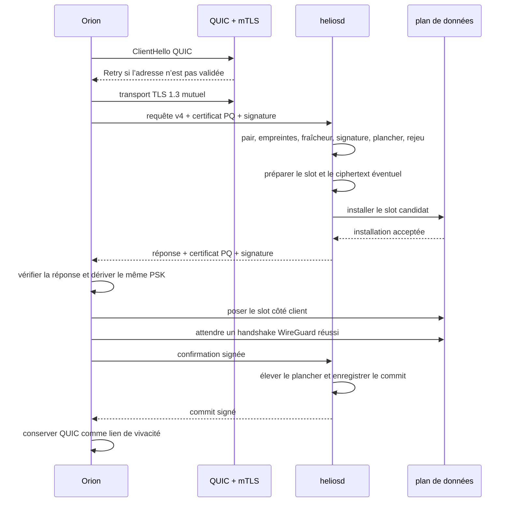

# Note technique — négociation de clé pré-WireGuard v4

**Statut** : **plus servi par le code**. Remplacé par la
[v5](NEGOCIATION-DE-CLE-V5.md), implémentée le 2026-08-06. Conservé comme trace
de ce qui tournait avant la bascule, et comme référence pour lire les
justifications de l'amendement de l'ADR-005.

**Version** : 4

**Date de la note** : 2026-08-04

> Cette note décrivait exactement ce que `heliosd` et Orion servaient jusqu'au
> 6 août 2026. Une revue de sécurité a identifié vingt défauts, dont le
> rejeu d'une requête authentifiée après éviction du cache, l'absence de
> liaison à la gateway visée, la corrélation des sessions `static_psk` et la
> coexistence d'un rollback et d'un commit signé. Leur traitement est spécifié
> dans la [v5](NEGOCIATION-DE-CLE-V5.md) §0 ; le raisonnement des décisions qui
> renversent un choix antérieur est dans l'amendement du 6 août 2026 de
> l'[ADR-005](../adr/ADR-005-NEGOCIATION-DE-CLE.md).
>
> Ne pas lire ce document comme une description du système : les deux versions
> ne négocient pas ensemble, et le code ne sert plus que la v5.

Cette note décrit le protocole réellement servi par Helios et Orion. Elle
complète [ADR-005](../adr/ADR-005-NEGOCIATION-DE-CLE.md). Elle reprend la forme
générale d’une spécification comme [X3DH](https://signal.org/docs/specifications/x3dh/),
mais le protocole est propre à Helios.

Les noms de structures et de fonctions cités correspondent au code Rust.

## 1. Résumé

WireGuard doit connaître le PSK avant son premier handshake. Le protocole
ouvre donc un second port UDP public.

| Port | Fonction |
| --- | --- |
| `key_negotiation_port` | négociation de clé, par défaut `51821` |
| `wg_listen_port` | trafic WireGuard, par défaut `51820` |

Le port de négociation ne transporte aucun trafic utilisateur. Il prépare le
slot `PresharedKey` du pair WireGuard.

Orion choisit un mode. Helios applique exactement ce mode.

| Mode | Slot WireGuard préparé |
| --- | --- |
| `classic` | vide |
| `static_psk` | PSK statique déjà configuré |
| `ml_kem` | PSK frais dérivé de ML-KEM-1024 |

Le protocole suit cette règle d’ordre :

1. authentifier le transport ;
2. authentifier l’identité applicative ;
3. préparer le slot gateway ;
4. répondre au client ;
5. poser le même slot côté Orion ;
6. prouver qu’un handshake WireGuard a réussi ;
7. confirmer et committer ;
8. conserver la session QUIC comme lien de vivacité.

Un profil avec un bloc `key_negotiation` ne retombe jamais sur un handshake
WireGuard sans négociation. Un profil sans ce bloc utilise encore le chemin
hérité, qui ne protège pas son premier handshake.

## 2. Objectifs et périmètre

### 2.1 Objectifs

Le protocole fournit :

- une protection du premier handshake contre « récolter maintenant,
  déchiffrer plus tard » ;
- une authentification TLS du canal ;
- une authentification applicative ML-DSA-65 ;
- une liaison entre identité WireGuard, transaction et PSK ;
- une protection bornée contre le rejeu immédiat et différé ;
- un plancher anti-downgrade monotone ;
- un rollback du slot gateway avant le commit ;
- une libération rapide du slot lorsque le client disparaît.

### 2.2 Hors périmètre

Le protocole ne fournit pas :

- une reconnexion automatique après perte du lien QUIC ;
- une résistance à la saturation du lien réseau ;
- une protection d’un poste Orion compromis sous le compte utilisateur ;
- une révocation par CRL ou OCSP ;
- le tunnelage du DNS client ;
- la preuve matérielle du plan de données en WSL2.

## 3. Acteurs et clés

### 3.1 Acteurs

| Symbole | Rôle |
| --- | --- |
| `O` | client Orion |
| `H` | démon `heliosd` |
| `WG-O` | pair WireGuard côté client |
| `WG-H` | pair WireGuard côté gateway |
| `CA-TLS` | CA opérateur des certificats X.509 clients |
| `CA-PQ` | CA opérateur ML-DSA-65 des certificats clients |
| `DP` | plan de données WireGuard |

### 3.2 Identité WireGuard

Chaque pair est identifié par sa clé publique WireGuard Curve25519.

La clé publique cliente apparaît dans :

- le profil Orion ;
- la table des pairs Helios ;
- le certificat PQ client ;
- la requête de négociation ;
- la dérivation du PSK.

La clé publique gateway apparaît dans :

- le profil Orion ;
- le certificat PQ gateway ;
- la réponse de négociation ;
- la dérivation du PSK.

### 3.3 Identité TLS

QUIC utilise TLS 1.3 avec authentification mutuelle.

La gateway présente un certificat X.509 auto-signé. Orion le vérifie avec le
certificat public épinglé dans le profil et avec `server_name`.

Orion présente un certificat X.509 signé par `CA-TLS`. Helios calcule son
empreinte SHA-256 DER et la compare à l’empreinte admise pour la clé WireGuard.

TLS protège le transport et réduit l’exposition du parseur. TLS n’est pas
l’ancre post-quantique du protocole.

### 3.4 Identité PQ applicative

La couche applicative utilise ML-DSA-65.

Le certificat PQ est un objet JSON `PqCertificate` :

| Champ | Rôle |
| --- | --- |
| `version` | version du certificat, actuellement `1` |
| `serial` | série aléatoire de 16 octets, non nulle |
| `subject` | nom de l’identité |
| `issuer` | nom de l’émetteur |
| `role` | `gateway` ou `client` |
| `wireguard_public_key` | clé WireGuard liée |
| `ml_dsa_65_public_key` | clé publique ML-DSA-65 en base64 |
| `not_before_unix` | début de validité |
| `not_after_unix` | fin de validité |
| `ml_dsa_65_signature` | signature de l’émetteur en base64 |

Le certificat client est signé par `CA-PQ`.

Le certificat gateway est auto-signé par sa propre clé ML-DSA-65.

La vérification du certificat contrôle :

- la version ;
- la série ;
- le rôle attendu ;
- pour la gateway, le sujet égal au `server_name` et la clé WireGuard égale à
  celle du profil Orion ;
- pour le client, la clé WireGuard égale à celle de la requête et l’empreinte
  égale à celle du pair admis ;
- la période de validité ;
- la longueur et la forme des clés ML-DSA-65 ;
- la signature de l’émetteur.

L’empreinte d’un certificat PQ est le SHA-256 d’une sérialisation binaire
canonique. Elle contient les octets signés définis au §7.1, puis la signature
ML-DSA-65 préfixée par sa longueur `u32`. Elle est représentée en hexadécimal
minuscule.

La gateway accepte encore l’ancienne empreinte SHA-256 de la sérialisation
`serde_json` pour les pairs admis avant la v4. Les nouvelles admissions et les
nouveaux profils utilisent uniquement l’empreinte canonique.

## 4. Paramètres normatifs

| Paramètre | Valeur |
| --- | --- |
| version applicative | `4` |
| ALPN QUIC | `helios-key-negotiation/4` |
| transport | QUIC avec TLS 1.3 mutuel |
| flux applicatif | un flux bidirectionnel par transaction |
| encodage de trame | longueur `u32` big-endian puis JSON |
| taille maximale d’une trame | `65536` octets |
| champs inconnus | refusés par `deny_unknown_fields` |
| longueur transaction / nonce | 16 octets |
| source aléatoire | CSPRNG système |
| taille maximale d’un datagramme QUIC | 1200 octets |
| découverte de MTU | désactivée |
| KEM | ML-KEM-1024, FIPS 203 |
| clé publique ML-KEM | 1568 octets |
| ciphertext ML-KEM | 1568 octets |
| secret ML-KEM | 32 octets |
| signature applicative | ML-DSA-65, FIPS 204 |
| clé publique ML-DSA-65 | 1952 octets |
| signature ML-DSA-65 | 3309 octets |
| KDF | HKDF-SHA-512 |
| sortie KDF | 32 octets |
| dérive maximale de l’horloge | ±30 secondes |
| handshakes par adresse | 8 par fenêtre de 60 secondes |
| négociations actives | 128 |
| identifiants anti-rejeu conservés | 4096 |
| délai d’ouverture QUIC | 10 secondes |
| délai de réponse de préparation | 15 secondes |
| délai de confirmation WireGuard | 45 secondes |
| délai d’ACK commit | 5 secondes |
| keep-alive QUIC | 10 secondes |
| expiration du lien QUIC | 35 secondes |

Le code fixe le MTU à 1200 octets sur le client et la gateway. Le matériel PQ
est fragmenté par QUIC. La découverte automatique est désactivée pour éviter
un résultat valable avant la montée de l’interface WireGuard mais invalide
après capture de la route.

L’ALPN est versionné avec le format filaire. Une modification incompatible des
octets signés, des messages ou de la dérivation incrémente la version
applicative, les domaines cryptographiques et l’ALPN.

La v3 et la v4 ne négocient pas ensemble. La gateway et Orion doivent donc être
mis à jour dans la même fenêtre d’exploitation. Les certificats existants
restent valides. Les anciennes empreintes PQ admises restent acceptées ; aucun
ré-enrôlement n’est nécessaire pour cette seule migration.

## 5. Format de transport

### 5.1 Trame

Chaque message est encodé ainsi :

```text
length: u32 big-endian
payload: length octets de JSON UTF-8
```

La longueur autorisée va de 1 à 65536 octets inclus.

Les tableaux `[u8; 16]` et `Vec<u8>` utilisent l’encodage JSON de Serde.
Ils apparaissent donc comme des tableaux d’entiers JSON. Les clés et
signatures représentées par des chaînes sont en base64.

### 5.2 Messages serveur

Le serveur envoie une enveloppe taguée :

```json
{"type":"response","response":{}}
```

```json
{"type":"committed","commit":{}}
```

```json
{"type":"error","error":{"code":"rejected"}}
```

Les erreurs publiques sont volontairement grossières :

| Code | Signification |
| --- | --- |
| `rejected` | demande refusée ou pair inconnu |
| `identity_mismatch` | identité TLS ou PQ incorrecte |
| `mode_unavailable` | mode demandé indisponible |
| `downgrade` | mode sous le plancher du pair |
| `busy` | transaction déjà active pour ce pair |
| `data_plane` | pose ou restauration du slot refusée |
| `protocol` | message invalide |

Une erreur interne ne doit pas devenir un oracle d’admission.

## 6. Objets du protocole

### 6.1 Requête client

`AuthenticatedKeyNegotiationRequest` contient :

```text
request
certificate
ml_dsa_65_signature
```

`request` contient :

| Champ | Contraintes |
| --- | --- |
| `protocol_version` | doit être `4` |
| `transaction_id` | 16 octets, pas tous nuls |
| `mode` | `classic`, `static_psk` ou `ml_kem` |
| `client_wg_public_key` | clé WireGuard valide |
| `client_nonce` | 16 octets aléatoires |
| `timestamp_unix` | non nul, dérive maximale ±30 s |
| `kem_public_key` | seulement en `ml_kem`, longueur 1568 |
| `static_psk_fingerprint` | seulement en `static_psk`, SHA-256 hex minuscule |

Les matériaux de mode sont mutuellement exclusifs :

| Mode | `kem_public_key` | `static_psk_fingerprint` |
| --- | --- | --- |
| `classic` | absent | absent |
| `static_psk` | absent | présent |
| `ml_kem` | présent | absent |

### 6.2 Réponse gateway

`AuthenticatedKeyNegotiationResponse` contient :

```text
response
certificate
ml_dsa_65_signature
```

`response` contient :

| Champ | Contraintes |
| --- | --- |
| `protocol_version` | doit être `4` |
| `transaction_id` | identique à la requête |
| `selected_mode` | identique au mode demandé |
| `gateway_wg_public_key` | identique à la clé épinglée |
| `gateway_nonce` | 16 octets aléatoires |
| `kem_ciphertext` | seulement en `ml_kem`, longueur 1568 |
| `confirmation_timeout_secs` | strictement positif |

Le client refuse une réponse qui sélectionne un autre mode. Le mode n’est
jamais négocié par une liste de capacités.

### 6.3 Confirmation client

```text
AuthenticatedKeyNegotiationConfirmation {
    confirmation: {
        protocol_version,
        transaction_id
    },
    ml_dsa_65_signature
}
```

La confirmation est envoyée seulement après un handshake WireGuard réussi
avec le slot nouvellement posé.

### 6.4 Commit gateway

```text
AuthenticatedKeyNegotiationCommit {
    protocol_version,
    transaction_id,
    ml_dsa_65_signature
}
```

Le client vérifie la signature du commit avant de déclarer la négociation
terminée.

## 7. Authentification des messages

Les certificats X.509 et les signatures ML-DSA ont des fonctions distinctes.

| Couche | Fonction |
| --- | --- |
| TLS 1.3 mTLS | authentifier le canal et chiffrer le transport |
| certificat PQ | lier une clé ML-DSA à une clé WireGuard |
| signature requête | authentifier le choix et le matériel client |
| signature réponse | authentifier le ciphertext et le résultat gateway |
| signature confirmation | autoriser le commit du pair actif |
| signature commit | authentifier l’ACK final |

Les signatures ML-DSA utilisent une sérialisation binaire dédiée. Le JSON ne
sert pas de message signé.

Les entiers sont big-endian. Les champs de longueur sont des `u32`. Un champ
optionnel est encodé par :

```text
0                         si absent
1 || len:u32 || bytes     si présent
```

### 7.1 Certificat

Le message signé d’un certificat est :

```text
PQ_CERTIFICATE_DOMAIN
|| version:u16
|| serial:16
|| role:u8
|| len(subject):u32 || subject
|| len(issuer):u32 || issuer
|| len(wireguard_public_key):u32 || wireguard_public_key
|| len(ml_dsa_65_public_key):u32 || ml_dsa_65_public_key
|| not_before_unix:u64
|| not_after_unix:u64
```

Le domaine vaut `helios-key-negotiation-pq-certificate-v1`.

### 7.2 Requête

Le message signé est :

```text
PQ_REQUEST_DOMAIN
|| protocol_version:u16
|| transaction_id:16
|| mode:u8
|| len(client_wg_public_key):u32 || client_wg_public_key
|| client_nonce:16
|| timestamp_unix:u64
|| optional(kem_public_key)
|| optional(static_psk_fingerprint)
|| len(certificate_fingerprint):u32 || certificate_fingerprint_ascii
```

Le domaine vaut `helios-key-negotiation-pq-request-v4`.

La signature de `timestamp_unix` empêche un attaquant actif de rafraîchir une
requête capturée. Le contrôle de fraîcheur reste nécessaire pour refuser une
requête signée mais trop ancienne.

### 7.3 Réponse

Le message signé est :

```text
PQ_RESPONSE_DOMAIN
|| protocol_version:u16
|| transaction_id:16
|| selected_mode:u8
|| len(gateway_wg_public_key):u32 || gateway_wg_public_key
|| gateway_nonce:16
|| optional(kem_ciphertext)
|| confirmation_timeout_secs:u32
|| len(certificate_fingerprint):u32 || certificate_fingerprint_ascii
```

Le domaine vaut `helios-key-negotiation-pq-response-v4`.

### 7.4 Confirmation et commit

La confirmation est signée sur :

```text
PQ_CONFIRMATION_DOMAIN
|| protocol_version:u16
|| transaction_id:16
```

Le domaine vaut `helios-key-negotiation-pq-confirmation-v4`.

Le commit est signé sur la même forme avec :

```text
PQ_COMMIT_DOMAIN
|| protocol_version:u16
|| transaction_id:16
```

Le domaine vaut `helios-key-negotiation-pq-commit-v4`.

## 8. Algorithmes de clé

### 8.1 Mode classique

La gateway installe `None` dans le slot PSK.

Le handshake WireGuard repose seulement sur son mécanisme standard.

Ce mode reste utile pour la migration et pour les pairs qui n’ont pas
d’identité de négociation PQ. Il ne protège pas le premier handshake contre un
adversaire quantique futur.

### 8.2 Mode PSK statique

Le secret est fourni hors bande dans les deux profils.

Orion envoie seulement :

```text
SHA-256(decoded_static_psk)
```

La représentation envoyée est une chaîne hexadécimale minuscule de 64
caractères.

Helios calcule la même empreinte et compare les deux valeurs en temps constant.

Le secret n’est jamais envoyé dans le protocole.

### 8.3 Mode ML-KEM

Le protocole utilise ML-KEM-1024.

Les rôles sont les suivants :

1. Orion génère une paire ML-KEM éphémère ;
2. Orion envoie la clé publique `kem_public_key` ;
3. Helios encapsule vers cette clé ;
4. Helios envoie `kem_ciphertext` ;
5. Orion décapsule ;
6. les deux parties obtiennent le même secret de 32 octets ;
7. les deux parties dérivent le PSK WireGuard.

La clé privée ML-KEM d’Orion reste en mémoire jusqu’à la décapsulation. Elle
est ensuite libérée. La gateway ne conserve pas de clé ML-KEM entre deux
transactions.

## 9. Dérivation du PSK

La fonction `derive_negotiated_psk` est utilisée par les deux côtés.

Soit :

- `S` le secret partagé ML-KEM de 32 octets ;
- `T` l’identifiant de transaction ;
- `N_O` le nonce client ;
- `N_H` le nonce gateway ;
- `K_O` la clé publique WireGuard client sous forme ASCII ;
- `K_H` la clé publique WireGuard gateway sous forme ASCII.

### 9.1 Extraction

```text
salt = T || N_O || N_H
PRK  = HKDF-Extract-SHA-512(salt, S)
```

Le sel mesure 48 octets.

### 9.2 Expansion

```text
info =
    "helios-key-negotiation-psk-v4"
    || protocol_version:u16
    || mode_security_level:u8
    || timestamp_unix:u64
    || len(K_O):u16 || K_O
    || len(K_H):u16 || K_H

PSK = HKDF-Expand-SHA-512(PRK, info, 32)
```

Les clés WireGuard sont préfixées par leur longueur. Cela fixe les frontières
de champs et évite une ambiguïté de concaténation.

Le résultat est exactement la taille du slot `PresharedKey` WireGuard.

`mode_security_level` est le même octet que celui utilisé dans les messages
signés et dans les comparaisons de plancher :

| Mode | Valeur |
| --- | --- |
| `classic` | `0x00` |
| `static_psk` | `0x01` |
| `ml_kem` | `0x02` |

Les deux côtés utilisent exactement `timestamp_unix` reçu dans la requête.
La gateway ne le remplace pas par son heure locale. Son horloge sert seulement
au contrôle de fraîcheur.

Les longueurs `u16` de cette expansion sont propres à HKDF. Les sérialisations
signées utilisent des longueurs `u32`.

Le ciphertext n’est pas ajouté à `info`. Il est déjà lié au secret ML-KEM et
à la signature de la réponse.

Le PSK est tenu dans un conteneur à effacement mémoire. Il n’est pas écrit sur
disque par la négociation.

## 10. Déroulement nominal



### Étape 1 — préparation côté Orion

Orion :

1. charge le profil ;
2. vérifie que `mode >= minimum_mode` ;
3. charge l’identité protégée ;
4. génère `transaction_id` et `client_nonce` ;
5. génère la paire ML-KEM si le mode vaut `ml_kem` ;
6. construit la requête ;
7. la signe avec la clé ML-DSA-65 cliente ;
8. résout l’endpoint ;
9. ouvre un socket UDP épinglé à l’interface de négociation.

Le socket est préparé avant la montée de l’interface WireGuard. Cela évite
une migration QUIC vers la route capturée par le tunnel.

### Étape 2 — filtrage QUIC

La gateway applique les limites dans cet ordre :

1. Retry QUIC pour valider l’adresse source ;
2. limite de 8 handshakes par adresse et par minute ;
3. limite globale de 128 connexions actives ;
4. TLS 1.3 mutuel ;
5. ALPN dédié ;
6. un seul flux bidirectionnel.

Une adresse source falsifiée ne doit donc pas atteindre TLS.

### Étape 3 — validation de la requête

Le code gateway effectue ces contrôles :

1. version, clé WireGuard, transaction, horodatage et matériaux de mode ;
2. recherche du pair par clé publique WireGuard ;
3. comparaison de l’empreinte du certificat TLS admis ;
4. vérification du plancher du pair ;
5. fraîcheur de l’horodatage ;
6. certificat PQ client signé par `CA-PQ` ;
7. empreinte du certificat PQ admise pour le pair ;
8. signature ML-DSA-65 de la requête ;
9. identifiant absent du cache anti-rejeu ;
10. absence de transaction concurrente pour ce pair.

Le verrou est indexé par la clé publique WireGuard cliente.

### Étape 4 — préparation du matériau

Helios prépare le résultat sans encore répondre.

| Mode | Opération gateway |
| --- | --- |
| `classic` | matériau `None` |
| `static_psk` | retrouver le PSK dont l’empreinte correspond |
| `ml_kem` | encapsuler, dériver et préparer le ciphertext |

Le slot précédent est conservé en mémoire dans la transaction.

### Étape 5 — pose gateway

Helios envoie une `InstallPskRequest` au contrôleur du plan de données.

La pose modifie :

- la configuration runtime en mémoire ;
- le pair WireGuard du backend ;
- le slot PSK du noyau ou du backend simulé.

La réponse de préparation ne part qu’après l’acquittement du plan de données.

Une erreur de pose refuse la négociation. Elle ne produit pas de réponse de
succès.

### Étape 6 — réponse et pose Orion

Orion vérifie :

- la version ;
- la transaction ;
- le mode ;
- la clé WireGuard gateway ;
- le certificat PQ gateway auto-signé ;
- le certificat PQ épinglé du profil ;
- la signature ML-DSA-65 gateway.

En `ml_kem`, Orion décapsule le ciphertext et dérive le PSK.

Le profil temporaire passé au backend porte :

```text
preshared_key = PSK négocié
preshared_key_is_negotiated = true
```

Cette distinction est obligatoire. Un PSK négocié et un PSK statique utilisent
le même slot WireGuard mais n’ont pas la même sémantique.

### Étape 7 — preuve par WireGuard

Orion installe le profil temporaire sans démonter l’adaptateur.

Il interroge le backend toutes les 250 ms.

La confirmation n’est autorisée que si un handshake WireGuard plus récent que
la pose du slot est observé dans les 45 secondes.

Orion ne confirme donc pas sur la seule réussite de ML-KEM.

Cette vérification est une règle du client Orion. La signature de confirmation
autorise le commit de la transaction active, mais ne contient pas le transcript
WireGuard. Un client admis et modifié peut mentir sur son propre handshake. Il
ne peut affecter que son pair et ne reçoit aucun accès supplémentaire.

### Étape 8 — confirmation et commit

Orion signe la confirmation avec sa clé ML-DSA-65.

Helios :

1. retrouve la transaction active ;
2. vérifie la signature avec la clé PQ cliente ;
3. élève le plancher si le mode est plus fort ;
4. persiste le plancher sans clé privée ni PSK ;
5. produit le commit signé tant que le rollback reste possible ;
6. déplace la transaction vers `committed` ;
7. envoie l’ACK.

Les données de restauration restent associées à la transaction `committed`
jusqu’à la livraison de l’ACK. Orion vérifie ensuite le commit et déclare le
tunnel `Up`.

## 11. États et restauration

### 11.1 États gateway

| État | Slot candidat | Action de sortie |
| --- | --- | --- |
| absent | aucun | nouvelle requête acceptée |
| `active` | posé | confirmation ou rollback |
| `committed`, ACK non livré | posé | rollback vers le slot précédent |
| `committed`, ACK livré | posé | fermeture du lien puis libération |

Les transactions `active` et `committed` sont indexées par
`transaction_id`.

### 11.2 Rollback

Helios restaure le slot précédent si :

- la lecture de la confirmation échoue ;
- le délai de confirmation expire ;
- la transaction est invalide ;
- la signature de confirmation échoue ;
- le commit ne peut pas être produit ;
- la réponse préparée ne peut pas être envoyée ;
- le commit ne peut pas être envoyé ou acquitté.

La restauration réinstalle le PSK précédent ou vide le slot.

Le backend restaure aussi son état en cas d’échec de `sync_peers`.

### 11.3 Désynchronisation client/gateway

Un échec après la pose locale peut laisser :

- le nouveau PSK côté Orion ;
- le slot précédent côté gateway.

Les handshakes WireGuard échouent alors. Orion conserve l’adaptateur monté.
Les paquets sont rejetés par WireGuard. Il n’y a pas de fuite vers l’interface
physique.

Orion tente trois négociations complètes, avec deux secondes entre les
tentatives. Une tentative complète pose un nouveau PSK des deux côtés.

Après trois échecs, le tunnel reste en erreur. L’utilisateur doit se
déconnecter puis se reconnecter.

## 12. Lien de vivacité QUIC

La transaction applicative est terminée après le commit. La connexion QUIC
reste pourtant ouverte.

Elle devient le signal de vie du tunnel :

- fermeture explicite Orion → Helios libère immédiatement le slot ;
- crash ou perte réseau → expiration QUIC après 35 secondes ;
- keep-alive envoyé toutes les 10 secondes ;
- disparition du lien → Orion journalise la perte et passe à `Down` ;
- aucune reconnexion automatique n’est déclenchée.

Le slot libéré n’est pas remplacé par un slot classique ou statique. La
prochaine connexion repasse par le mode et le plancher du profil. Cette règle
fait du lien QUIC une autorisation de session, y compris en `static_psk`. La
perte du lien ferme donc le tunnel au lieu de conserver un accès fondé sur un
secret statique.

Le lien QUIC est conservé dans `VpnController`, pas dans la tâche de connexion.
Il doit vivre aussi longtemps que le tunnel.

## 13. Plancher anti-downgrade

L’ordre de sécurité est :

```text
classic < static_psk < ml_kem
```

Le plancher existe des deux côtés.

### Gateway

Chaque pair porte `minimum_key_negotiation_mode`.

La gateway refuse une requête sous ce plancher avant de poser un slot.

Un commit réussi élève le plancher au mode utilisé.

Le plancher ne redescend pas par hot-reload. La relecture de configuration
adopte le plancher runtime le plus fort.

Une baisse gateway exige une édition locale explicite de `network.toml`, puis
un redémarrage de `heliosd`. Le redémarrage supprime l’état runtime plus fort
qui empêcherait la baisse pendant un hot-reload.

### Orion

Chaque profil porte `minimum_mode`.

`ClientConfig::upsert` conserve le plancher le plus fort connu. Supprimer le
bloc `key_negotiation` est aussi traité comme un downgrade.

Une édition locale explicite du fichier reste le seul moyen de descendre le
plancher.

### Admission

Si un certificat PQ client est admis sans plancher explicite, le plancher
initial est `ml_kem`.

Sans certificat PQ, le défaut est `classic`.

## 14. Enrôlement et installation

### 14.1 Gateway

`heliosd init-key-negotiation` :

1. lit la CA TLS opérateur ;
2. lit la clé publique CA ML-DSA-65 opérateur ;
3. génère une clé TLS gateway ;
4. génère une clé ML-DSA-65 gateway ;
5. lie le certificat PQ à la clé publique WireGuard gateway ;
6. scelle les deux clés privées au TPM ;
7. écrit uniquement les certificats et CA publiques.

L’identité est chargée une fois au démarrage. Une rotation exige un
redémarrage de `heliosd`.

### 14.2 Client

Le client possède :

- un certificat TLS et sa clé privée ;
- un certificat PQ et sa clé ML-DSA-65 privée ;
- la clé privée WireGuard ;
- la CA gateway ;
- le certificat PQ gateway épinglé.

Sous Windows, les clés privées sont scellées par DPAPI au compte utilisateur.
Le profil persiste uniquement le nom de l’entrée protégée.

Hors Windows, le stockage protégé échoue explicitement. Les clés ne sont pas
écrites en clair comme repli.

### 14.3 Admission

La table gateway associe à la clé WireGuard cliente :

- l’adresse VIP ;
- l’empreinte TLS cliente ;
- l’empreinte du certificat PQ client ;
- le plancher anti-downgrade.

L’admission est faite par le même chemin pour `heliosd peer add` et
`helios-ctl peer`.

`helios-ctl enroll` produit un document qui contient le profil, les paramètres
publics de négociation et l’identité cliente. L’import Orion scelle
l’identité. Le fichier d’enrôlement doit ensuite être détruit.

Une invitation qui ne contient pas de clé privée WireGuard reste importable
mais non connectable tant qu’Orion ne retrouve pas une clé locale dont la clé
publique correspond à celle admise.

## 15. Données persistantes et éphémères

| Donnée | Emplacement | Cycle de vie |
| --- | --- | --- |
| clé privée WireGuard gateway | coffre TPM | mémoire après descellement |
| clés privées TLS/PQ gateway | coffre TPM | mémoire pendant `heliosd` |
| certificat TLS gateway | `/var/lib/helios` | public, lu au démarrage |
| certificat PQ gateway | `/var/lib/helios` | public, lu au démarrage |
| CA clientes | `/var/lib/helios` | publiques, nécessaires au serveur |
| empreintes client et plancher | configuration gateway | persistants |
| PSK runtime gateway | mémoire et plan de données | supprimé à la libération |
| identité privée cliente | stockage protégé Orion | chargée pour négocier |
| PSK négocié client | mémoire et profil temporaire | jamais dans `profiles.toml` |
| clé privée ML-KEM éphémère | mémoire Orion | une transaction |
| PSK statique éventuel | configuration hors bande | indépendant de ML-KEM |

Avant une écriture de configuration gateway, `wg_private_key` et les PSK sont
retirés. La configuration rechargée adopte les secrets de l’état runtime.

Un read-modify-write depuis une vue API expurgée ne doit jamais être utilisé
pour l’admission.

## 16. Propriétés de sécurité

| Propriété | Mécanisme |
| --- | --- |
| protection du premier handshake | ML-KEM-1024 avant WireGuard |
| substitution de `kem_public_key` | signature ML-DSA-65 de la requête |
| substitution du ciphertext | signature ML-DSA-65 de la réponse |
| confusion de pair | clés WireGuard dans la requête et HKDF |
| réponse d’une autre transaction | `transaction_id` vérifié des deux côtés |
| changement de mode | mode signé et comparaison stricte |
| modification de l’horodatage | horodatage couvert par ML-DSA-65 |
| rejeu immédiat | cache de 4096 identifiants |
| rejeu différé | horodatage signé et fenêtre de ±30 s |
| source UDP falsifiée | Retry QUIC avant TLS |
| abus CPU par source réelle | 8 handshakes par minute et par adresse |
| concurrence par pair | verrou de clé WireGuard |
| PSK annoncé avant pose | installation gateway avant réponse |
| PSK conservé après disparition | fermeture QUIC et expiration 35 s |
| fuite après échec Orion | adaptateur conservé, paquets rejetés |
| downgrade réseau | planchers persistants des deux côtés |
| vol du fichier d’identité Windows | DPAPI lié au compte |

Le protocole ne prétend pas empêcher un déni de service par botnet ou par
saturation de la bande passante.

## 17. Limites et constats de revue

### 17.1 Limite résiduelle de l’anti-rejeu

L’horodatage est signé. Un attaquant ne peut donc pas rafraîchir une ancienne
requête sans invalider ML-DSA-65.

Le cache anti-rejeu reste borné et volatil. Une requête inchangée peut être
acceptée une seconde fois si les deux conditions suivantes sont réunies :

- son identifiant a été évincé du cache, ou le démon a redémarré ;
- son horodatage reste dans la fenêtre de ±30 secondes.

L’exploitation exige une requête complètement authentifiée. Les limites par
adresse et le verrou par pair réduisent le débit. Supprimer aussi cette fenêtre
résiduelle demanderait un challenge gateway supplémentaire ou un compteur
persistant. Ce coût n’est pas retenu pour la v4.

### 17.2 Portée de la confirmation WireGuard

Orion confirme seulement après avoir observé un handshake plus récent que la
pose locale. La gateway vérifie la signature de cette confirmation et la lie à
la transaction active.

La gateway ne consulte pas elle-même le compteur de handshake du backend. Un
client admis et modifié peut donc confirmer sans avoir utilisé le slot. Cette
action ne compromet aucun autre pair et laisse son propre tunnel en échec. Une
preuve côté gateway nécessiterait une nouvelle interface avec le plan de
données ; elle n’est pas ajoutée tant que ce risque reste limité au pair déjà
compromis.

### 17.3 Rotation de l’identité gateway

Les certificats et clés de négociation sont lus une fois au démarrage.

Une rotation sur disque sans redémarrage ne change pas l’identité servie. Les
profils nouvellement émis peuvent alors épingler un certificat différent de
celui présenté par le démon.

Le remède est `systemctl restart heliosd` après rotation.

### 17.4 Catégories cryptographiques

ML-KEM-1024 vise la catégorie NIST 5.

ML-DSA-65 reste en catégorie 3. Il protège l’authentification active mais est
le niveau le plus faible du protocole. Passer à ML-DSA-87 demanderait de
réémettre la PKI gateway et clients.

### 17.5 Effets non prouvés hors cible

Les tests prouvent la dérivation, les signatures, le rollback et
l’interopérabilité du vrai handler avec le vrai client Orion.

Ils ne prouvent pas :

- la pose réelle sur le noyau WireGuard gateway ;
- la pose réelle sur WireGuard-NT ;
- le stockage TPM réel ;
- le comportement réseau d’une installation publique.

Ces points exigent les machines cibles décrites dans
[TESTING.md](../testing/TESTING.md).

## 18. Correspondance avec le code

| Composant | Responsabilité |
| --- | --- |
| [`aether::key_negotiation`](../../crates/aether/src/key_negotiation.rs) | types, validation, certificats, signatures, HKDF |
| [`aether::pq`](../../crates/aether/src/pq.rs) | abstraction ML-KEM-1024 |
| [`aether-key-negotiation`](../../crates/aether-key-negotiation/src/lib.rs) | QUIC, TLS, trames, limites, session de vivacité |
| [`heliosd::key_negotiation`](../../crates/heliosd/src/key_negotiation.rs) | admission, pose, rollback, commit, TPM |
| [`orion-core::key_negotiation`](../../crates/orion-core/src/key_negotiation.rs) | requête client, décapsulation, dérivation, confirmation |
| [`orion-core::backend`](../../crates/orion-core/src/backend/mod.rs) | pose client, preuve WireGuard, retries, cycle de vie |
| [`aether::config`](../../crates/aether/src/config.rs) | ports, pairs, secrets runtime, planchers |
| [`helios-ctl::enroll`](../../tools/helios-ctl/src/enroll.rs) | enrôlement et document Orion |

Les tests les plus importants sont :

- dérivation identique des deux côtés ;
- rejet d’un mode inférieur ;
- rejet des matériaux d’un autre mode ;
- rejet d’un certificat ou d’une empreinte incorrecte ;
- rollback du slot précédent ;
- limite par adresse ;
- interopérabilité QUIC gateway/Orion sur socket réel.
