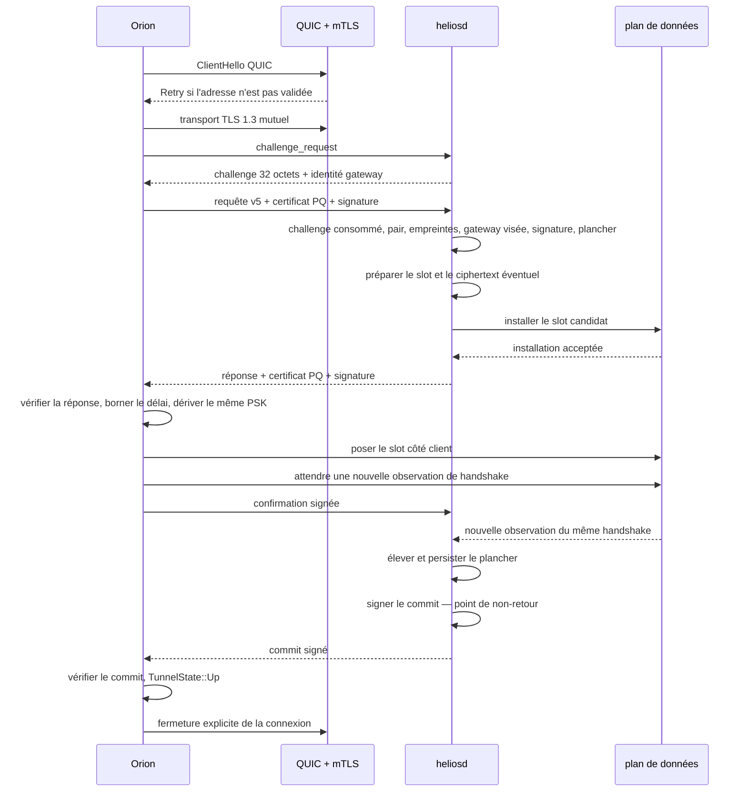
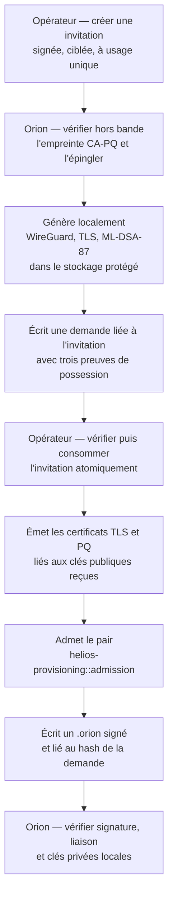

# Note technique — négociation de clé pré-WireGuard v5

**Statut** : **partiellement implémenté**. Le protocole servi par le code est
la v5 ; la [v4](NEGOCIATION-DE-CLE-V4.md) n'est plus servie. Cette note reste
un **contrat à finir d'implémenter**, pas une description du système.

> Une revue du 6 août 2026 a établi que la mention « implémenté à trois
> exceptions » portée ici auparavant était fausse : sept défauts bloquants et
> plusieurs écarts subsistaient. Six des sept ont été corrigés.
>
> Deux revues du 7 août 2026 ont montré que la correction du cinquième — la
> machine d'état générationnelle — était incomplète, et que deux défauts
> bloquants restaient dans le cycle transactionnel du PSK. Ils sont corrigés à
> leur tour :
>
> - la **génération n'était pas réservée** avant la pose du candidat. `prepare`
>   la lisait sans l'incrémenter et le slot continuait de décrire le PSK
>   *déplacé*, si bien qu'un `release` visant l'ancienne transaction ou une
>   récupération décidée sur un instantané vieux de dix secondes correspondait
>   encore, vidait le plan de données sous le candidat, et laissait la gateway
>   signer un commit pour un PSK qu'elle ne détenait plus. L'état `preparing`
>   du [§11.1](#111-états-gateway) existe désormais, la génération est prise
>   sous le **même** verrou que la réservation du pair, et la confirmation
>   revérifie l'appartenance du slot avant de persister le plancher et de
>   signer ;
> - l'**échéance absolue annulait sans rollback**. Les 90 s du
>   [§4.5](#45-délais-et-limites) étaient un `timeout` autour de toute la
>   connexion : à l'échéance la tâche était détruite, et détruire une future
>   n'exécute aucun chemin de sortie. Le candidat restait posé, le pair réservé
>   et la transaction active — un pair admis pouvait s'enfermer dehors avec une
>   seule connexion inachevée. Chaque phase est maintenant bornée par ce qui
>   reste de l'échéance, et une garde de destruction rattrape le cas résiduel.
>   La garde ne se désarme qu'**après** le retour du rollback : le désarmer
>   d'abord rouvrait exactement le trou qu'elle bouche, puisque le rollback est
>   lui-même un `await` que l'échéance peut détruire. Le repos du §11.3 se lit
>   donc sur le slot, pas sur la présence d'un enregistrement de transaction —
>   une préparation interrompue peut ne jamais avoir inséré cet enregistrement,
>   alors que le slot sait déjà qu'une écriture backend a été tentée.
>
> Une revue supplémentaire du 7 août a fermé les deux dernières courses de cette
> correction. Un `release` pouvait annuler `preparing` pendant la dérivation,
> puis la tâche initiale reprenait, posait quand même son candidat et recréait
> une transaction sans propriétaire. Et un `release` pouvait observer le
> candidat, perdre la course contre `confirm`, puis répondre `released` sans
> retirer le PSK désormais committé. La vérification d'appartenance, l'écriture
> backend et l'insertion de la transaction forment maintenant une seule
> section sérialisée ; la classification et l'application du `release` aussi.
> Si le commit gagne, le `release` retire le PSK committé.
>
> La seconde de ces deux courses a été **fermée autrement** par la revue du
> 8 août : un `release` arrivé pendant `preparing` ne restaure plus rien, c'est
> un no-op. La garde de rollback de la connexion qui prépare est la seule
> sortie du candidat, et elle survit à la destruction de sa tâche — d'où la
> priorité 2 du [§11.1](#111-états-gateway) telle qu'elle est écrite
> aujourd'hui.
>
> Sont posés au passage : la période de repos de dix secondes après rollback
> post-installation ([§4.5](#45-délais-et-limites), [§11.3](#113-rollback)) ;
> les paramètres de transport normatifs — idle timeout de 50 s, fenêtres de
> `196620` octets, reprise TLS et 0-RTT explicitement désactivés des deux
> côtés, limites de flux annoncées des deux côtés ; la **priorité 2 du
> [§11.1](#111-états-gateway)**, dont la rédaction du 7 août faisait annuler la
> transaction par un `release` visant le candidat — **remplacée le 8 août** par
> le no-op, seule la garde de rollback défaisant un candidat ; et la
> **résolution de l'identité avant le challenge** du [§5.3](#53-erreurs-publiques),
> une empreinte TLS non admise étant refusée sans qu'un challenge lui soit
> émis, le budget par identité n'étant débité que d'un pair admis, et la clé
> WireGuard de la requête étant vérifiée contre le pair résolu au lieu de
> servir elle-même de clé de recherche.
>
> **Ce qui n'est pas implémenté**, au 2026-08-16 :
>
> - la **validation du fournisseur d'aléa** du §4.3. Le reste de l'alignement
>   cryptographique du 16 août est livré : toute signature ML-DSA-87 passe par
>   `aether::ml_dsa`, qui exige le `ctx` non vide du §8, refuse un contexte
>   vide, celui d'un autre type, un NUL ou un octet non imprimable, et refuse
>   un message qui ne s'ouvre pas sur son domaine — le préfixe interne et le
>   contexte externe sont deux contrôles distincts, tous deux appliqués. Une
>   signature HashML-DSA ne vérifie pas sous ce chemin, et aucun appel n'emprunte
>   une variante préhachée. Tout tirage passe de même par `aether::random`,
>   qui ne contient **aucun** état DRBG : c'est une adaptation de type vers le
>   fournisseur, un refus ferme quand il échoue, et la bannière de démarrage que
>   ce paragraphe exige. La source est `aws_lc_rs::rand::SystemRandom` — le
>   `RAND_bytes` d'AWS-LC déjà employé pour AES-GCM, HKDF et HMAC : CTR-DRBG-AES-256
>   avec DF, état par thread, reseed toutes les 4096 générations, et
>   réinstanciation avant toute sortie après fork ou reprise d'instantané, ce
>   qui est précisément pourquoi le module n'a pas de détection de fork à lui.
>   La validation CAVP/ACVP est hors périmètre et rien ne la revendique.
>   Reste ouverte la **résistance à la prédiction par appel**, présente dans
>   l'API C d'AWS-LC mais absente du binding Rust ; la réaliser au-dessus
>   reviendrait à détenir ici l'état DRBG que ce même paragraphe interdit ;
>
>   **Migration** : le `ctx` entre dans la vérification, donc tout certificat PQ
>   émis avant ce changement cesse de vérifier. Un parc existant se ré-émet
>   (`scripts/provision-client.sh`, `heliosd init-key-negotiation --rotate`) ;
> - la variante `classic` de `ProtectionMode`
>   ([§19](#19-fin-des-chemins-hérités), [§22](#22-correspondance-avec-le-code)),
>   qui subsiste dans le type. Elle est bien refusée à la validation d'une
>   requête v5 et à la préparation — serde la décode, `validate()` la rejette,
>   et aucun message v5 ne peut donc la sélectionner — et elle doit subsister
>   pour relire un `network.toml` existant. La retirer entièrement reste une
>   migration de `network.toml` (`minimum_key_negotiation_mode = "classic"`) et
>   de l'octet `mode_id = 0` du manifeste de coffre.
>
>   Le **discriminant de type de profil Orion**, lui, est livré : un profil
>   déclare `type = "classic"` ou `type = "helios_key_negotiation"`, le document
>   `.orion` le porte, le manifeste de coffre le scelle en v5, l'écran *Profils*
>   le montre, et le chemin de connexion lit le type déclaré au lieu de la
>   présence du bloc. Les deux formes sont exclusives et la contradiction est
>   refusée. L'inférence historique ne survit qu'à la lecture d'un manifeste
>   antérieur à la v5 ou d'un document antérieur à §19, s'applique une fois, et
>   le prochain scellement écrit la réponse.
>   Ce qui débloquerait : écrire cette migration et son chemin de relecture des
>   documents déjà émis ;
> - le **renouvellement de PSK en place** ([§12.3](#123-politique-de-renouvellement)),
>   volontairement suspendu à l'essai bloquant du [§20.0](#200-essais-bloquants) :
>   son raisonnement sur la réinitialisation forcée de session n'a pas été
>   confronté à un vrai plan de données, et l'écrire d'abord reviendrait à
>   découvrir un défaut de conception à travers une implémentation qui le
>   masque. Conséquence : un PSK vit jusqu'à son échéance de 24 h, puis la
>   gateway le retire ;
> - l'**enrôlement sans clé privée et sa signature opérateur**
>   ([§15](#15-enrôlement)). `helios-ctl enroll` distribue encore l'identité
>   cliente comme en v4, avec le document `.orion` secret que cela implique ;
> - tout le **cycle de vie des certificats**
>   ([ROTATION-CERTIFICATS](ROTATION-CERTIFICATS.md)) : la leaf PQ gateway
>   est encore auto-signée, il n'y a ni slot actif/suivant, ni génération
>   anti-rollback, ni import manuel de transition ;
> - l'état **`revoked`** du [§11.1](#111-états-gateway) : une révocation est
>   exprimée par l'absence du pair dans `network.peers`, lue à chaque décision,
>   et non par un marqueur terminal dans le slot. Hors concurrence, un pair
>   retiré ne négocie plus rien ; en concurrence, l'absence de transition
>   atomique entre admission, génération et plan de données ne fournit pas
>   encore la priorité normative de `revoked`. Un marqueur mis en cache se
>   périmerait en outre au hot-reload. Ce qui débloquerait : faire porter la
>   révocation et le retrait du plan de données par le même sérialiseur que le
>   slot, génération incrémentée comprise.
>
> **Ce qui est en place et couvert par la régression** : challenge à usage
> unique, liaison à la gateway visée, ML-DSA-87, engagement HMAC du PSK
> statique, trois codes d'erreur, point de non-retour, preuve de handshake
> WireGuard au commit, machine d'état
> générationnelle par pair avec état `preparing`, réservation de la génération
> sous le verrou de la réservation du pair et compare-and-swap avant chaque
> écriture backend, installation et enregistrement du candidat atomiques
> vis-à-vis d'un `release`, classification et application du `release` dans la
> même transition, rollback garanti même quand la tâche est détruite, période
> de repos après rollback post-installation, PSK statique hors du cycle
> transactionnel, `psk_lifetime_secs` signé et contrôlé, récupération par
> vieillissement, keep-alive posé par la gateway, plancher `ml_kem` à
> l'admission, résolution de l'empreinte TLS vers son unique pair admis avant
> toute émission de challenge, et les bornes DoS du
> [§4.5](#45-délais-et-limites) — challenge unique par connexion, durée absolue
> de 90 s bornant chaque phase, budget par préfixe IPv6 `/64`, budget par
> identité admise, reprise TLS et 0-RTT désactivés, flux et fenêtres bornés des
> deux côtés.

**Version** : 5

**Date de la note** : 2026-08-09

Cette note décrit le protocole **cible**, révisé après la revue de sécurité de
la v4. Elle complète [ADR-005](../adr/ADR-005-NEGOCIATION-DE-CLE.md), dont
l'amendement du 6 août 2026 porte les décisions qui renversent des choix
antérieurs. Le cycle de vie des certificats, Astra, ses formats de transition,
le renouvellement automatique et la récupération expirée sont normés dans la
note [rotation des certificats v5](ROTATION-CERTIFICATS.md) et
[ADR-008](../adr/ADR-008-ASTRA-AUTORITE-CERTIFICATS.md).

Le code sert déjà une partie de cette cible en v5. Cette note reste un contrat
à finir d'implémenter : le bloc d'état en tête distingue les mécanismes en
place de ceux qui manquent. La v4 n'est conservée que comme historique.

Les noms de structures et de fonctions cités sont ceux qu'attend le code Rust
après bascule.

## 0. Ce que la v5 change, et pourquoi

La revue de la v4 a identifié vingt défauts ou zones grises. Le tableau
suivant est l'index de leur traitement ; chaque ligne renvoie à la section
normative.

| # | Défaut v4 | Traitement v5 | § |
| --- | --- | --- | --- |
| 1 | La session QUIC survit au commit et sert de lien de vivacité | QUIC est **fermé** après le commit ; la vivacité revient à WireGuard | [§12](#12-fin-de-session-et-vivacité) |
| 2 | Cycle de vie du PSK défini par un timeout QUIC | Cycle de vie explicite : `release` signé dans WireGuard, remplacement atomique, révocation, vieillissement du handshake, durée maximale | [§12.2](#122-cycle-de-vie-du-psk) |
| 3 | Anti-rejeu fondé sur un cache volatil de 4096 identifiants | Phase `challenge` gateway, challenge de 32 octets à usage unique, consommé atomiquement | [§6.1](#61-challenge-gateway) |
| 4 | Horodatage présenté comme défense anti-rejeu principale | Horodatage rétrogradé en contrôle secondaire ; le cache devient de la défense en profondeur | [§6.1](#61-challenge-gateway), [§17.2](#172-rôle-résiduel-de-lhorodatage) |
| 5 | Aucune contrainte de taille ni de forme sur le PSK statique | 32 octets exactement, exigés après décodage, refus sinon | [§9.1](#91-mode-psk-statique) |
| 6 | Origine de l'aléa du PSK statique non spécifiée | Pipeline TRNG → seed/reseed → DRBG → PSK, échec ferme sans repli | [§9.1](#91-mode-psk-statique) |
| 7 | `SHA-256(static_psk)` est un identifiant stable et corrélable | Remplacé par un engagement HMAC lié à la transaction | [§9.1](#91-mode-psk-statique) |
| 8 | La requête ne nomme pas la gateway visée | `gateway_wg_public_key`, `server_name` et empreinte du certificat PQ gateway attendus, signés et vérifiés | [§7.1](#71-requête-client) |
| 9 | Liaisons cryptographiques incomplètes | Challenge, gateway et identités dans toutes les signatures et dans le HKDF | [§8](#8-authentification-des-messages), [§10](#10-dérivation-du-psk) |
| 10 | `confirmation_timeout_secs` accepté tel quel par le client | Borné localement à `[1, 45]` secondes | [§7.2](#72-réponse-gateway) |
| 11 | Codes d'erreur publics distinguant pair inconnu, plancher, downgrade | Trois codes seulement ; les motifs restent au journal protégé | [§5.3](#53-erreurs-publiques) |
| 12 | Confusion entre le `classic` d'Orion et un mode de négociation | `classic` reste un profil WireGuard générique hors protocole ; la v5 ne l'accepte jamais comme mode filaire | [§9](#9-algorithmes-de-clé), [§19](#19-fin-des-chemins-hérités) |
| 13 | Empreinte PQ `serde_json` acceptée sans borne | Absente de la v5 et refusée dès la bascule | [§19](#19-fin-des-chemins-hérités) |
| 14 | L'invitation transporte les clés privées du client | Orion génère ses clés localement ; l'enrôlement ne transporte que du public | [§15](#15-enrôlement) |
| 15 | Le document d'enrôlement n'est pas authentifié | Signature opérateur, vérification à l'import, empreinte hors bande | [§15.3](#153-authentification-du-document) |
| 16 | Effacement mémoire implicite | Zéroïsation explicite et nommée de chaque secret | [§16](#16-hygiène-mémoire) |
| 17 | Rollback et commit durable coexistent | Sémantique unique : le commit signé est le **point de non-retour** | [§11](#11-états-rollback-et-point-de-non-retour) |
| 18 | Le PSK négocié ne vieillit jamais | Politique de renouvellement : 24 h, plus événements | [§12.3](#123-politique-de-renouvellement) |
| 19 | ML-DSA-65 (catégorie 3) sous un KEM de catégorie 5 | **ML-DSA-87** : tout le protocole passe en catégorie 5 | [§4.4](#44-niveau-post-quantique) |
| 20 | Chemin de production non testé | Plan de validation explicite, cible par cible | [§20](#20-plan-de-validation) |

Trois de ces changements renversent une décision de l'ADR-005 : la fermeture de
QUIC (§5 de l'ADR), le niveau de signature (§2) et l'abandon du cache anti-rejeu
comme mécanisme principal (§3). L'amendement de l'ADR porte le raisonnement.

### Seconde revue

Une relecture du présent document a produit six constats supplémentaires. Deux
portaient sur des défauts réels de la spécification elle-même, dont un aurait
rendu le renouvellement de PSK inopérant à tous les coups.

| # | Constat | Verdict | Traitement | § |
| --- | --- | --- | --- | --- |
| A | Le renouvellement n'obtient jamais son handshake de preuve : une session WireGuard vivante ne rekeye pas parce qu'on change son PSK | **fondé** | Réinitialisation forcée côté client, observation sur les deux backends, micro-coupure nommée et bornée | [§12.3](#123-politique-de-renouvellement) |
| B | Le commit sans accusé laisse les deux bouts en désaccord | **fondé sur le fait, pas sur le remède** | Divergence énumérée, convergence démontrée ; l'accusé proposé est refusé — il déplace l'ambiguïté sans la supprimer | [§11.5](#115-perte-du-commit--divergence-tolérée) |
| C | L'échéance de 24 h n'est pas persistée, un redémarrage prolongerait les slots | **prémisse fausse, gap réel** | Un redémarrage **vide** les slots ; le vrai défaut était la mort silencieuse des tunnels, sans canal pour la dire | [§12.5](#125-redémarrage-de-la-gateway) |
| D | Le ré-enrôlement complet manque aux limites | **fondé** | Section de limites connues consolidée | [§21](#21-limites-connues) |
| E | La gateway ne contrôle pas la réutilisation du `client_nonce` | **non fondé** | La fraîcheur vient de deux valeurs produites par la gateway ; l'argument est désormais écrit plutôt que sous-entendu | [§7.1](#71-requête-client) |
| F | L'accusé `released` n'est pas signé | **fondé dans le transport alors retenu, puis rendu sans objet** | La revue du 8 août supprime l'accusé applicatif et la seconde connexion QUIC ; le retrait devient une commande best-effort dans WireGuard | [§7.5](#75-libération-signée-dans-le-tunnel) |

Le constat C mérite d'être lu en entier : la remarque était fausse sur le
mécanisme mais désignait le bon endroit. En supprimant le lien QUIC, la v5 avait
supprimé sans le remplacer le seul canal qui disait à un client que la gateway
avait perdu son PSK. Le protocole reconstruit donc cette vivacité **sur le plan
de données** — âge du dernier handshake WireGuard, lu des deux côtés — ce qui la
rend cohérente avec la décision de fond de la v5 : la vivacité se lit là où
passe le trafic.

### Revue du canal de libération

Une revue du 8 août 2026 a distingué deux opérations jusque-là confondues.
La négociation initiale doit traverser Internet **avant** WireGuard et justifie
donc le port QUIC public. La déconnexion explicite arrive, elle, après un
handshake WireGuard réussi : rouvrir ce même port public pour annoncer l'arrêt
réauthentifiait par mTLS, challenge et ML-DSA une machine qui disposait déjà
d'un canal chiffré et authentifié vers la gateway.

Le `release` reste utile pour zéroïser immédiatement un secret lors d'un arrêt
propre, mais il quitte l'ALPN public. Orion l'envoie sur l'API interne à travers
le tunnel encore monté. La gateway résout d'abord la VIP source vers son unique
pair admis, compare la clé du message à ce pair, puis vérifie la signature PQ
et l'identifiant propriétaire. Il n'existe plus de message QUIC `Release`, de
réponse `Released`, ni de challenge de libération. Une déconnexion brutale ou
un tunnel déjà mort retombe sans reprise sur la récupération à 300 secondes.

### Revue amont avant implémentation

Une troisième revue, menée avant toute écriture du module v5, a fermé huit
ambiguïtés qui auraient produit des implémentations incompatibles ou des
transitions de sécurité non atomiques.

| # | Constat | Traitement normatif | § |
| --- | --- | --- | --- |
| G | La confirmation était une affirmation du client, sans preuve WireGuard côté gateway | Le commit exige aussi une progression du handshake observée par la gateway après la pose | [§11.2](#112-ordre-des-opérations-au-commit), [§13](#13-déroulement-nominal) |
| H | `release`, rollback, échéance, récupération et révocation pouvaient courir sur le même slot | Machine d'état générationnelle et verrou unique par pair ; la révocation domine | [§11.1](#111-états-gateway) |
| I | L'enrôlement prouvait des clés mais pas l'autorisation, la fraîcheur ni la possession WireGuard | Invitation opérateur signée, à usage unique, challenge X25519 dédié et réponse liée à la demande | [§15](#15-enrôlement) |
| J | Les octets signés de l'enrôlement restaient indéfinis | Formats binaires de l'invitation et de la demande ; JCS pour le document public | [§15.3](#153-authentification-du-document) |
| K | Les 128 permis QUIC pouvaient être retenus par rafraîchissement du challenge | Une requête par phase, durée absolue, limites de flux, 0-RTT et reprise TLS désactivés | [§4.1](#41-format-et-transport), [§6.1](#61-challenge-gateway) |
| L | La validation ML-KEM ne nommait que la longueur | Contrôles d'entrée FIPS 203 et représentations canoniques obligatoires | [§4.2](#42-cryptographie), [§8](#8-authentification-des-messages) |
| M | « 24 h maximum » plus une heure de grâce valait 25 h | Retrait ferme à 24 h, la fenêtre de renouvellement est incluse | [§12.3](#123-politique-de-renouvellement) |
| N | `classic` restait dans un protocole neuf derrière une date et une horloge | `classic` est sorti du protocole v5, mais conservé comme chemin Orion vers un hôte WireGuard générique | [§9](#9-algorithmes-de-clé), [§19](#19-fin-des-chemins-hérités) |

## 1. Résumé

WireGuard doit connaître le PSK avant son premier handshake. Le protocole ouvre
donc un second port UDP public.

| Port | Fonction |
| --- | --- |
| `key_negotiation_port` | négociation de clé, par défaut `51821` |
| `wg_listen_port` | trafic WireGuard, par défaut `51820` |

Le port de négociation ne transporte aucun trafic utilisateur. Il prépare le
slot `PresharedKey` du pair WireGuard, puis se tait.

Orion choisit un mode. Helios applique exactement ce mode.

| Mode | Slot WireGuard préparé |
| --- | --- |
| `static_psk` | PSK statique déjà configuré |
| `ml_kem` | PSK frais dérivé de ML-KEM-1024 |

Ces deux modes sont les modes du **protocole Helios v5**, pas tous les modes de
connexion d'Orion. Orion conserve `classic` pour joindre directement un hôte
WireGuard générique qui ne sert pas Helios. Ce chemin ne contacte jamais
`key_negotiation_port`, ne construit aucun message v5 et n'affiche aucune
propriété de protection post-quantique du premier handshake.

Le modèle de profil rend cette frontière explicite :

```text
OrionTunnelSecurity =
    ClassicWireGuard { type = "classic" }
  | HeliosKeyNegotiation {
        type = "helios_key_negotiation",
        mode = StaticPsk | MlKem,
        key_negotiation = ...
    }
```

Un profil `classic` peut porter la configuration WireGuard ordinaire, y compris
un PSK WireGuard provisionné hors bande. Ce PSK n'en fait pas une transaction
`static_psk` v5. Réciproquement, l'absence accidentelle du bloc
`key_negotiation` ne suffit jamais à transformer un profil Helios en profil
`classic` ; le discriminant `type` est obligatoire après import. Les variantes
sont exclusives : un profil `classic` qui porte un port, un certificat, une
empreinte, un plancher ou un autre champ de négociation Helios est ambigu et
refusé, jamais « nettoyé » automatiquement.

Le protocole suit cette règle d'ordre :

1. authentifier le transport ;
2. obtenir un challenge gateway lié à la connexion ;
3. authentifier l'identité applicative et consommer le challenge ;
4. préparer le slot gateway ;
5. répondre au client ;
6. poser le même slot côté Orion ;
7. prouver des **deux côtés** qu'un handshake WireGuard a réussi après la pose ;
8. confirmer, committer — **point de non-retour** ;
9. **fermer la connexion QUIC**.

La différence de forme la plus visible avec la v4 est la dernière ligne. La
connexion QUIC n'est plus un lien de vivacité : elle porte une transaction, puis
disparaît. Ce qui maintient le tunnel est WireGuard et son keep-alive ; ce qui
retire un PSK `ml_kem` est un message `release` signé transporté **dans le
tunnel**, un remplacement, une révocation, une échéance, ou le constat que le
pair ne handshake plus. Le PSK statique reste gouverné par la configuration.

Le déplacement de fond est là : la vivacité se lit **sur le plan de données**,
là où passe le trafic, et non sur un canal de contrôle parallèle dont la chute
ne prouve rien sur l'état du tunnel.

## 2. Objectifs et périmètre

### 2.1 Objectifs

Le protocole fournit :

- une protection du premier handshake contre « récolter maintenant, déchiffrer
  plus tard » ;
- une authentification TLS du canal ;
- une authentification applicative ML-DSA-87 ;
- une liaison entre identité WireGuard cliente, **identité de la gateway
  visée**, transaction, challenge et PSK ;
- une **élimination** du rejeu authentifié, et non plus une réduction ;
- un plancher anti-downgrade monotone ;
- un rollback du slot gateway strictement **avant** le commit ;
- un cycle de vie du PSK explicite et borné dans le temps.

### 2.2 Hors périmètre

Le protocole ne fournit pas :

- la connexion `classic` d'Orion à un hôte WireGuard générique : elle reste une
  fonction du client, entièrement hors de ce protocole ;
- une reconnexion illimitée après échec — la renégociation automatique existe,
  mais reste bornée à trois tentatives
  ([§12.5](#125-redémarrage-de-la-gateway)) ;
- une détection **immédiate** de la disparition d'un client : elle passe
  désormais par le vieillissement du handshake WireGuard, à cinq minutes au lieu
  des trente-cinq secondes du lien QUIC de la v4
  ([§12.4](#124-récupération-dun-slot-sans-client)) ;
- une résistance à la saturation du lien réseau ;
- une protection d'un poste Orion compromis sous le compte utilisateur ;
- une révocation par CRL ou OCSP ;
- le tunnelage du DNS client ;
- la preuve matérielle du plan de données en WSL2.

## 3. Acteurs et clés

### 3.1 Acteurs

| Symbole | Rôle |
| --- | --- |
| `O` | client Orion |
| `H` | démon `heliosd` |
| `WG-O` | pair WireGuard côté client |
| `WG-H` | pair WireGuard côté gateway |
| `CA-TLS` | CA opérateur des certificats X.509 clients |
| `CA-PQ` | CA opérateur ML-DSA-87 des certificats clients |
| `DP` | plan de données WireGuard |

### 3.2 Identité WireGuard

Chaque pair est identifié par sa clé publique WireGuard Curve25519.

La clé publique cliente apparaît dans le profil Orion, la table des pairs
Helios, le certificat PQ client, la requête de négociation et la dérivation du
PSK.

La clé publique gateway apparaît dans le profil Orion, le certificat PQ gateway,
le **challenge**, la **requête**, la réponse et la dérivation du PSK. En v4 elle
n'entrait pas dans la requête : c'était le défaut n° 8.

### 3.3 Identité TLS

QUIC utilise TLS 1.3 avec authentification mutuelle.

La gateway présente un certificat X.509 auto-signé. Orion le vérifie avec le
certificat public épinglé dans le profil et avec `server_name`.

Orion présente un certificat X.509 signé par la `CA-TLS` active ou suivante
autorisée par la [spécification de rotation](ROTATION-CERTIFICATS.md). Helios
calcule son empreinte SHA-256 DER et la compare à la génération TLS/PQ admise
pour la clé WireGuard. Une empreinte TLS et une empreinte PQ clientes ne peuvent
chacune appartenir qu'à un seul pair, génération active et suivante comprises.
L'admission, le chargement initial et le hot-reload refusent les doublons en
nommant les deux clés WireGuard concernées ; c'est ce qui rend totale la
résolution mTLS vers un pair avant le challenge.

TLS protège le transport et réduit l'exposition du parseur. TLS n'est pas
l'ancre post-quantique du protocole.

### 3.4 Identité PQ applicative

La couche applicative utilise **ML-DSA-87** (FIPS 204, catégorie NIST 5).

Le certificat PQ est un objet JSON `PqCertificate` de version `2` :

| Champ | Rôle |
| --- | --- |
| `version` | version du certificat, `2` en v5 |
| `serial` | série aléatoire de 16 octets, non nulle |
| `subject` | nom de l'identité |
| `issuer` | nom de l'émetteur |
| `role` | `gateway` ou `client` |
| `wireguard_public_key` | clé WireGuard liée |
| `ml_dsa_87_public_key` | clé publique ML-DSA-87 en base64 |
| `not_before_unix` | début de validité |
| `not_after_unix` | fin de validité |
| `ml_dsa_87_signature` | signature de l'émetteur en base64 |

Les certificats client et gateway sont signés par `CA-PQ`. La clé privée de
cette CA reste sur le poste opérateur. La gateway génère et scelle sa propre clé
ML-DSA-87, prouve sa possession dans une demande publique, puis reçoit sa leaf
signée ; elle ne reçoit jamais la clé privée de CA. La v5 refuse une leaf
gateway auto-signée.

Le profil épingle la CA déjà confirmée hors bande et conserve au plus une leaf
gateway active et une suivante, conformément à la
[spécification de rotation](ROTATION-CERTIFICATS.md). L'empreinte singulière
d'une requête reste celle de la leaf exactement utilisée par cette transaction.

La vérification du certificat contrôle :

- la version, qui doit valoir `2` ;
- la série ;
- le rôle attendu ;
- pour la gateway, le sujet égal au `server_name` et la clé WireGuard égale à
  celle du profil Orion ;
- pour le client, la clé WireGuard égale à celle de la requête et l'empreinte
  égale à celle du pair admis ;
- `not_before_unix <= not_after_unix`, une durée de 825 jours au plus et la
  période de validité courante, par comparaisons vérifiées sans soustraction ;
- la longueur et la forme des clés ML-DSA-87 ;
- la signature de l'émetteur.

L'empreinte d'un certificat PQ est le SHA-256 d'une sérialisation binaire
canonique : les octets signés définis au [§8.1](#81-certificat), puis la
signature ML-DSA-87 préfixée par sa longueur `u32`. Elle est représentée en
hexadécimal minuscule.

**Une seule représentation d'empreinte existe en v5.** L'ancienne empreinte
SHA-256 de la sérialisation `serde_json` n'est plus acceptée ; voir
[§19](#19-fin-des-chemins-hérités).

## 4. Paramètres normatifs

### 4.1 Format et transport

| Paramètre | Valeur |
| --- | --- |
| version applicative | `5` |
| ALPN QUIC | `helios-key-negotiation/5` |
| transport | QUIC avec TLS 1.3 mutuel |
| reprise TLS / données 0-RTT | désactivées |
| flux bidirectionnels initiés par le client | `1` exactement |
| flux unidirectionnels | `0` |
| encodage de trame | longueur `u32` big-endian puis JSON |
| taille maximale d'une trame | `65536` octets |
| champs inconnus | refusés par `deny_unknown_fields` |
| longueur transaction / nonce | 16 octets |
| longueur du challenge gateway | 32 octets |
| source aléatoire | DRBG SP 800-90A à 256 bits de la bibliothèque cryptographique, voir [§4.3](#43-exigences-sur-laléa) |
| taille maximale d'un datagramme QUIC | 1200 octets |
| découverte de MTU | désactivée |

La reprise TLS et le 0-RTT sont interdits. Chaque connexion refait le mTLS et
présente le certificat client courant ; aucune identité héritée d'un ticket de
session ne contourne ainsi la validité ou l'admission courante. Les paramètres
de transport annoncent un seul flux bidirectionnel initié par Orion et aucun
flux unidirectionnel. Un second flux est une erreur de protocole et ferme la
connexion.

La fenêtre de réception du flux et celle de la connexion valent chacune
`196620` octets, soit trois trames de `4 + 65536` octets — le maximum reçu par
un bout dans une négociation. Une implémentation ne conserve jamais plus d'une
trame complète non traitée par direction. La longueur est vérifiée **avant**
allocation du payload ; une longueur supérieure à 65536 ferme le flux sans
allouer la valeur annoncée.

Les représentations filaires sont canoniques : base64 RFC 4648 standard avec
padding, sans espace ni variante URL ; hexadécimal minuscule ; clés WireGuard
décodées de 32 octets et réencodées canoniquement ; `server_name` sous forme
DNS ASCII minuscule, sans point final, long de 1 à 253 octets. Les noms humains
des certificats sont UTF-8 NFC et bornés à 255 octets. Toute représentation
différente est refusée, même si un décodeur permissif pourrait produire les
mêmes octets.

Le code fixe le MTU à 1200 octets sur le client et la gateway. Le matériel PQ
est fragmenté par QUIC. La découverte automatique est désactivée pour éviter un
résultat valable avant la montée de l'interface WireGuard mais invalide après
capture de la route.

Le passage à ML-DSA-87 augmente la taille des trames. Le pire cas reste borné :

| Message | Taille JSON approximative |
| --- | --- |
| `challenge` | < 1 Kio |
| requête `ml_kem` | ≈ 23 Kio |
| réponse `ml_kem` | ≈ 23 Kio |
| confirmation, commit | ≈ 7 Kio |

La borne de 64 Kio est conservée ; elle laisse un facteur deux et demi sur le
message le plus lourd. Elle doit être vérifiée par un test, pas déduite de ce
tableau.

Le `release` ne passe pas dans cette trame QUIC. Son corps JSON signé traverse
l'API HTTP interne et est borné séparément à 32 Kio avant désérialisation.

### 4.2 Cryptographie

| Paramètre | Valeur |
| --- | --- |
| KEM | ML-KEM-1024, FIPS 203 |
| clé publique ML-KEM | 1568 octets |
| ciphertext ML-KEM | 1568 octets |
| secret ML-KEM | 32 octets |
| signature applicative | **ML-DSA-87**, FIPS 204 |
| clé publique ML-DSA-87 | 2592 octets |
| clé privée ML-DSA-87 | 4896 octets |
| signature ML-DSA-87 | 4627 octets |
| KDF | HKDF-SHA-512 |
| sortie KDF | 32 octets |
| engagement PSK statique | HMAC-SHA-256 |
| PSK statique | 32 octets exactement |

La longueur n'est jamais le seul contrôle d'une entrée cryptographique.
`ML-KEM.Encaps` reçoit une clé d'encapsulation qui a passé les contrôles
d'entrée de FIPS 203, notamment le contrôle de modulus ; `ML-KEM.Decaps` reçoit
une clé de décapsulation et un ciphertext validés selon le même standard. Une
entrée de la bonne longueur mais non canonique est un refus `rejected`, jamais
une valeur réparée ou réduite silencieusement. Les clés et signatures ML-DSA-87
passent de même les contrôles de forme de FIPS 204 avant vérification.

### 4.3 Exigences sur l'aléa

Tout matériel aléatoire du protocole — `transaction_id`, `client_nonce`,
`gateway_nonce`, `server_challenge`, séries de certificats, PSK statiques,
clés ML-KEM et ML-DSA — suit le même pipeline :

```text
source d'entropie plateforme fail-closed
    → DRBG SP 800-90A de la bibliothèque cryptographique, force 256 bits
    → octets consommés
```

Deux mécanismes seulement sont admis : **HMAC-DRBG-SHA-512** ou
**CTR-DRBG-AES-256**. Ils fournissent une force de sécurité de 256 bits. Pour
CTR-DRBG, deux instanciations sont acceptables et une seule doit être annoncée :
avec **fonction de dérivation** (`use_df = true`, SP 800-90Ar1 §10.2.1.3.2), ou
avec une **entrée d'entropie pleine** d'exactement un `seedlen`
(§10.2.1.3.1) — le cas que la fonction de dérivation existe pour éviter, et
qu'un fournisseur alimenté par une source de pleine entropie satisfait. Le
démarrage annonce laquelle est en service ; il n'existe pas de troisième forme,
ni d'annonce par défaut. Le mécanisme vient de la
bibliothèque cryptographique du projet, pas d'un générateur écrit ici : Helios,
Orion et leurs caisses communes ne réimplémentent ni DRBG, ni dérivation de
seed, ni tests de santé. Une adaptation de type et de configuration est admise
seulement si elle ne produit aucun octet elle-même. Un faux fournisseur
déterministe est permis uniquement sous `cfg(test)`, ne peut être sélectionné
par aucun binaire livré et n'est jamais présenté comme conforme.

**La validation CAVP/ACVP du fournisseur n'est pas exigée par cette version.**
Un déploiement qui la veut construit la même bibliothèque dans sa variante
validée : le mécanisme et le format filaire sont identiques, seule la
paperasse change. Réciproquement, aucun code, journal ni document du projet ne
présente le pipeline comme validé tant que cette variante n'est pas celle qui
tourne, et un numéro de certificat ne s'affirme jamais depuis une constante
compilée.

Le démarrage journalise sans secret le fournisseur, sa version, le mécanisme
choisi, l'activation de `use_df` pour CTR-DRBG et l'intervalle de reseed
annoncé.

Le choix du mécanisme est local, explicite et journalisé ; il ne se négocie pas
sur le fil. L'absence de fournisseur utilisable est une erreur de démarrage,
sans bascule silencieuse vers un PRNG généraliste. Un processus n'émet un
identifiant, une clé, un PSK ou un challenge que si le DRBG du fournisseur est
`instantiated` et que sa dernière opération d'apport d'entropie plateforme —
instanciation initiale ou reseed — a réussi. Sinon l'appel retourne une erreur
fatale et n'écrit aucun octet de sortie.

```text
instantiate : entropy_input >= 32 octets issus de la source plateforme
              + nonce >= 16 octets issu d'un tirage distinct
reseed      : intervalle fournisseur configuré <= 2^20 appels generate,
              après chaque fork, et avant toute génération de clé privée
              ML-DSA-87, ML-KEM ou TLS
generate    : prediction_resistance = true pour une clé privée ;
              false admis pour un transaction_id, nonce ou challenge public
```

Une « génération » est un appel au DRBG, indépendamment du nombre d'octets
demandé. La borne de `2^20` est configurée dans le fournisseur ou garantie par
son profil validé ; elle n'est pas réalisée par un second DRBG applicatif.
Dans le processus enfant d'un fork, le contexte fournisseur hérité est invalide
et aucune sortie n'est permise avant réinstanciation ou reseed réussi. Il n'est
**pas** exigé que les 32 octets d'un PSK soient lus directement de la source
plateforme : l'architecture NIST distingue source d'entropie et générateur
déterministe, et le bon modèle est celui ci-dessus.

Un identifiant, nonce ou challenge entièrement nul est refusé à la réception,
mais ce contrôle ne remplace pas le fournisseur : un générateur défaillant n'a
pas le droit de produire puis filtrer la valeur. Un échec de la source
plateforme, de son test de santé, d'instanciation, de reseed ou de génération
est une **erreur ferme**. Aucun repli vers l'heure, un UUID, un PRNG généraliste
ou un compteur, aucune sortie partielle, aucune génération « au mieux » et
aucun DRBG applicatif maison.

### 4.4 Niveau post-quantique

La v4 mélangeait les catégories : ML-KEM-1024 en catégorie 5, HKDF-SHA-512
au-dessus, mais ML-DSA-65 en catégorie 3. L'authentification était donc le
maillon le plus bas, et c'est elle qui protège la substitution de `kem_public_key`
sur une négociation en cours.

**La v5 tranche : ML-DSA-87, catégorie 5, sur toute la PKI de négociation.**

Ce choix a un coût d'exploitation qui n'est pas négociable : la CA opérateur PQ,
le certificat PQ gateway et **tous** les certificats PQ clients doivent être
réémis. Le parc est donc ré-enrôlé pendant la migration v4 → v5. Voir
[§18](#18-migration-v4--v5).

Ce changement ne concerne **que** la PKI de négociation de clé. Les signatures
d'artefacts éditeur restent régies par
[ADR-002](../adr/ADR-002-SIGNATURES-PQ.md) : Ed25519 **et** ML-DSA-65, trousseau
compilé, `REQUIRED_ALGS` inchangé. Confondre les deux domaines casserait la
vérification de toutes les releases déjà signées.

Concrètement, le workspace doit activer **les deux** jeux de paramètres à la
fois. La dépendance `fips204` expose déjà `ml_dsa_87` derrière une feature ;
aucune dépendance nouvelle n'est nécessaire, mais la ligne du `Cargo.toml`
racine passe de `features = ["ml-dsa-65"]` à `features = ["ml-dsa-65",
"ml-dsa-87"]`. **Remplacer** la première par la seconde, au lieu d'ajouter,
casserait `aether::sig` et donc toute la chaîne de livraison.

### 4.5 Délais et limites

| Paramètre | Valeur |
| --- | --- |
| dérive maximale de l'horloge | ±30 secondes |
| validité d'un `server_challenge` | 45 secondes |
| challenges vivants par connexion | 1 |
| demandes de challenge par connexion | 1 |
| handshakes par adresse | 8 par fenêtre de 60 secondes, par IPv4 ou préfixe IPv6 `/64` |
| négociations par identité admise | 8 par fenêtre de 60 secondes |
| **négociations** simultanées | 128 |
| identifiants anti-rejeu conservés | 4096, défense en profondeur seulement |
| délai d'ouverture QUIC | 10 secondes |
| délai de réponse au `challenge_request` | 5 secondes |
| délai de réponse de préparation | 15 secondes |
| délai de confirmation WireGuard | 45 secondes, refusé hors borne par Orion |
| durée absolue d'une connexion après Retry | 90 secondes, non renouvelable |
| idle timeout QUIC | 50 secondes |
| repos après rollback post-installation | 10 secondes par pair |
| durée de vie maximale d'un PSK `ml_kem` | 24 heures |
| déclenchement du renouvellement | à 90 % de la durée de vie |
| retrait ferme par échéance | à 24 heures, sans grâce supplémentaire |
| keep-alive QUIC | **aucun** |
| expiration du lien QUIC | **sans objet** |
| keep-alive persistant WireGuard, des deux côtés | 25 secondes, posé par la gateway |
| période d'observation du plan de données | 10 secondes |
| âge de handshake déclenchant la renégociation Orion | 150 secondes |
| âge de handshake déclenchant la récupération gateway | 300 secondes |

Les deux derniers seuils sont les seuls signaux de vivacité du protocole, et ils
se lisent tous deux sur le plan de données. Ils encadrent les 180 secondes au
bout desquelles WireGuard abandonne lui-même une session : Orion répare avant,
la gateway récupère après. Aucun des deux ne doit descendre sous les
120 secondes de la période de rekey, sous peine de traiter un tunnel sain comme
mort.

Le seuil client de 150 secondes est **le même nombre** que
`HANDSHAKE_STALE_AFTER_SECS`, déjà défini côté gateway et déjà partagé par
l'orchestrateur et l'API. Ce n'est pas une coïncidence à laisser implicite :
c'est l'âge au-delà duquel, dans ce dépôt, un handshake ne prouve plus rien. La
récupération gateway est la seule à s'en écarter, et
[§12.4](#124-récupération-dun-slot-sans-client) dit pourquoi.

La limite de 128 est désormais une limite de **négociations simultanées**, pas
de tunnels. Une connexion QUIC ne vit plus que le temps d'une transaction —
quelques centaines de millisecondes en régime nominal. Le nombre de tunnels
WireGuard établis n'est plus borné par ce paramètre.

Le permis global est acquis après validation de l'adresse et libéré au premier
des événements suivants : fermeture, erreur, fin de transaction ou échéance
absolue de 90 secondes. Aucun nouveau challenge, aucune nouvelle trame et aucun
progrès partiel ne repoussent cette échéance. Après authentification TLS, une
seconde limite porte sur l'empreinte admise et donc sur le pair, indépendamment
des adresses qu'il utilise. Un rollback survenu après la pose d'un candidat
arme en outre dix secondes de repos pour ce pair : une identité de négociation
volée mais privée de la clé WireGuard ne peut pas maintenir le slot en
oscillation continue.

L'ALPN est versionné avec le format filaire. Une modification incompatible des
octets signés, des messages ou de la dérivation incrémente la version
applicative, les domaines cryptographiques et l'ALPN.

Le retrait du `release` public ne déclenche exceptionnellement pas une v6 : il
n'entre ni dans la négociation, ni dans la dérivation, ni dans le verdict du
commit, et son échec a toujours eu pour sémantique normative de poursuivre la
déconnexion puis de récupérer le slot à 300 secondes. Deux versions mixtes
continuent donc d'établir exactement le même tunnel ; elles perdent seulement
l'effacement anticipé best-effort. Une gateway mise à jour refuse le message
QUIC historique avec `protocol` et ne lui donne aucun autre sens.

## 5. Format de transport

### 5.1 Trame

Chaque message est encodé ainsi :

```text
length: u32 big-endian
payload: length octets de JSON UTF-8
```

La longueur autorisée va de 1 à 65536 octets inclus.

Les tableaux `[u8; 16]`, `[u8; 32]` et `Vec<u8>` utilisent l'encodage JSON de
Serde. Ils apparaissent donc comme des tableaux d'entiers JSON. Les clés et
signatures représentées par des chaînes sont en base64.

### 5.2 Messages serveur

Le serveur envoie une enveloppe taguée :

```json
{"type":"challenge","challenge":{}}
```

```json
{"type":"response","response":{}}
```

```json
{"type":"committed","commit":{}}
```

```json
{"type":"error","error":{"code":"rejected"}}
```

L'enveloppe publique ne contient ni `release`, ni accusé de retrait. Une fois
le commit émis, toute libération explicite passe par le tunnel WireGuard selon
le §7.5. Le type QUIC historique `release` est une erreur `protocol`.

### 5.3 Erreurs publiques

La v4 exposait sept codes. Trois d'entre eux — `identity_mismatch`, `downgrade`,
`busy` — répondaient à des questions qu'un attaquant n'avait pas le droit de
poser : ils permettaient d'énumérer les pairs admis et de lire l'état de leur
plancher depuis un port public.

La v5 n'expose que trois codes :

| Code | Signification | Quand |
| --- | --- | --- |
| `protocol` | trame, encodage ou version invalides | avant toute authentification |
| `rejected` | demande refusée | tout refus **avant** installation du slot |
| `internal` | échec après authentification | à l'installation du slot ou après |

`rejected` couvre indistinctement : pair inconnu, empreinte TLS incorrecte,
certificat PQ invalide ou non admis, signature invalide, challenge absent,
expiré ou déjà consommé, horodatage hors fenêtre, mode sous le plancher, mode
indisponible, transaction concurrente, gateway visée incorrecte. Le client ne
peut pas distinguer ces causes par le code ou la forme de la réponse.

`internal` ne peut être observé que par un pair déjà authentifié et admis. Il
ne dit donc rien à un attaquant non admis.

Le motif réel est journalisé côté gateway, en clair et nommé, dans le journal
protégé du service — jamais sur le réseau. Un opérateur qui diagnostique lit
`journalctl -u heliosd` ; un attaquant qui sonde lit `rejected`.

L'uniformité du code ne prétend pas rendre des chemins cryptographiques de
coûts différents strictement constants. La gateway ferme la connexion après
tout `rejected` et ne permet toutefois pas à une identité admise de choisir le
pair qu'elle sonde : dès le mTLS terminé, l'empreinte DER du certificat TLS est
résolue vers **son** unique pair admis. La clé WireGuard de la requête doit être
celle de ce pair. Une empreinte inconnue est refusée avant émission d'un
challenge. Le champ fourni par la requête n'est jamais une clé de recherche
dans la table des pairs.

## 6. Phase préalable : le challenge

### 6.1 Challenge gateway

C'est le changement de fond de la v5 en matière d'anti-rejeu.

En v4, une requête entièrement authentifiée restait rejouable pendant sa fenêtre
de trente secondes si son identifiant avait été évincé du cache de 4096 entrées
ou si le démon avait redémarré. La défense était probabiliste et dépendait d'un
état volatil.

En v5, la gateway impose sa propre fraîcheur.

```text
O → H : {"type":"challenge_request", "protocol_version": 5}
H → O : {"type":"challenge", "challenge": {
            "protocol_version": 5,
            "server_challenge": [32 octets],
            "gateway_wg_public_key": "…",
            "server_name": "…",
            "expires_in_secs": 45
        }}
```

Règles normatives :

1. Le challenge fait **32 octets**, produit par le pipeline de
   [§4.3](#43-exigences-sur-laléa).
2. Il est **à usage unique**.
3. Il vit **dans l'état de la connexion QUIC**, pas dans une table globale. Une
   connexion détient exactement un challenge. Un second `challenge_request`
   est une erreur de protocole et ferme la connexion ; il ne rafraîchit ni le
   challenge ni l'échéance absolue.
4. Il expire au bout de 45 secondes, ou avec la connexion si elle se ferme
   avant.
5. Il est **consommé atomiquement** au moment où la gateway accepte la requête
   qui le porte : la consommation et la décision d'acceptation sont la même
   opération, sous le même verrou. Deux requêtes concurrentes portant le même
   challenge ne peuvent pas être acceptées toutes les deux.
6. Il entre dans le message signé de la requête, dans celui de la réponse, de
   la confirmation et du commit, ainsi que dans le sel HKDF. Le `release`
   circule plus tard dans WireGuard et ne consomme aucun challenge QUIC.
7. La première requête applicative portant ce challenge termine sa phase : un
   succès le consomme, un refus ferme la connexion et détruit le challenge.

Le challenge n'est **pas signé** par la gateway. C'est délibéré : signer
imposerait une opération ML-DSA-87 à chaque connexion entrante, avant toute
authentification du client, donc offrirait un amplificateur de déni de service
à quelques paquets près. Un challenge injecté par un attaquant actif ne lui sert
à rien — la gateway n'accepte que les challenges qu'elle a elle-même émis sur
cette connexion, et un challenge inconnu est un `rejected`.

Le fait que le challenge vive dans la connexion, et non dans une table
partagée, borne aussi sa mémoire : le plafond est déjà celui des 128 connexions
simultanées, et la durée absolue de 90 secondes empêche qu'un permis soit retenu
indéfiniment.

### 6.2 Conséquence sur le cache anti-rejeu

Le cache de 4096 identifiants de transaction est **conservé**, mais il change de
statut : il n'est plus une propriété de sécurité. Il détecte une répétition
évidente et l'écarte tôt, ce qui économise une vérification ML-DSA-87. Sa perte
au redémarrage n'ouvre aucune fenêtre.

Aucun document, aucun commentaire de code et aucun message de journal ne doit
présenter ce cache comme la défense anti-rejeu.

## 7. Objets du protocole

### 7.1 Requête client

`AuthenticatedKeyNegotiationRequest` contient :

```text
request
certificate
ml_dsa_87_signature
```

`request` contient :

| Champ | Contraintes |
| --- | --- |
| `protocol_version` | doit être `5` |
| `server_challenge` | 32 octets, identique au challenge reçu |
| `transaction_id` | 16 octets, pas tous nuls |
| `mode` | `static_psk` ou `ml_kem` ; toute autre valeur est refusée |
| `client_wg_public_key` | clé WireGuard valide |
| `gateway_wg_public_key` | clé WireGuard gateway attendue par le client |
| `server_name` | nom serveur attendu par le client |
| `gateway_certificate_fingerprint` | empreinte de la leaf PQ gateway exactement visée, active ou suivante autorisée |
| `client_nonce` | 16 octets aléatoires |
| `timestamp_unix` | non nul, dérive maximale ±30 s |
| `kem_public_key` | seulement en `ml_kem`, longueur 1568 et contrôles d'entrée FIPS 203 |
| `static_psk_commitment` | seulement en `static_psk`, HMAC-SHA-256 hex minuscule |

Les trois champs `gateway_wg_public_key`, `server_name` et
`gateway_certificate_fingerprint` sont nouveaux. Ils disent **à quelle gateway
le client croit parler**. Helios les vérifie contre sa propre identité servie
et Orion contre son état actif/suivant borné avant toute pose de slot. Une
requête authentique destinée à une gateway ne peut donc plus être rejouée contre
une autre gateway partageant la même CA opérateur — ce que la v4 n'empêchait pas
dans une infrastructure mutualisée.

La gateway ne vérifie **pas** que `client_nonce` n'a jamais été vu. C'est
délibéré et ce n'est pas une faiblesse : la fraîcheur de la dérivation ne repose
pas sur l'aléa du client. Le sel HKDF contient deux valeurs que la gateway
produit elle-même à chaque transaction — `server_challenge` et `gateway_nonce`
— et le challenge est de surcroît à usage unique. Un client qui répéterait son
nonce, par bogue ou par malveillance, n'obtiendrait donc jamais deux fois le
même PSK, et ne nuirait qu'à lui-même. Y ajouter un contrôle imposerait un
second cache volatil pour une propriété déjà garantie par construction.

Les matériaux de mode restent mutuellement exclusifs :

| Mode | `kem_public_key` | `static_psk_commitment` |
| --- | --- | --- |
| `static_psk` | absent | présent |
| `ml_kem` | présent | absent |

### 7.2 Réponse gateway

`AuthenticatedKeyNegotiationResponse` contient :

```text
response
certificate
ml_dsa_87_signature
```

`response` contient :

| Champ | Contraintes |
| --- | --- |
| `protocol_version` | doit être `5` |
| `transaction_id` | identique à la requête |
| `server_challenge` | identique à la requête |
| `selected_mode` | identique au mode demandé |
| `gateway_wg_public_key` | identique à la clé épinglée |
| `client_wg_public_key` | identique à la requête |
| `gateway_nonce` | 16 octets aléatoires |
| `kem_ciphertext` | seulement en `ml_kem`, longueur 1568 |
| `confirmation_timeout_secs` | strictement positif |
| `psk_lifetime_secs` | `86400` en `ml_kem`, `0` en `static_psk` |

Le client refuse une réponse qui sélectionne un autre mode. Le mode n'est jamais
négocié par une liste de capacités.

**Orion accepte `confirmation_timeout_secs` seulement dans `[1, 45]` secondes.**
Une valeur hors de cette plage est un refus, même signée par une gateway
légitime ; elle n'est jamais ramenée silencieusement à une borne. Orion refuse
de même toute autre valeur de `psk_lifetime_secs` pour le mode signé. En v4, une gateway compromise
pouvait immobiliser un client sur une valeur arbitrairement grande, signée et
donc acceptée sans discussion.

### 7.3 Confirmation client

```text
AuthenticatedKeyNegotiationConfirmation {
    confirmation: {
        protocol_version,
        server_challenge,
        transaction_id
    },
    ml_dsa_87_signature
}
```

La confirmation est envoyée seulement après un handshake WireGuard réussi avec
le slot nouvellement posé.

### 7.4 Commit gateway

```text
AuthenticatedKeyNegotiationCommit {
    protocol_version,
    server_challenge,
    transaction_id,
    ml_dsa_87_signature
}
```

Le client vérifie la signature du commit avant de déclarer la négociation
terminée, puis **ferme la connexion QUIC**.

### 7.5 Libération signée dans le tunnel

Le `release` porte la déconnexion explicite, que la fermeture de QUIC ne
signale plus. Il n'existe que pour un slot `ml_kem` **déjà committé**. Un PSK
statique relève de la configuration persistante : une déconnexion cesse de
l'utiliser côté client mais ne demande pas à la gateway d'effacer sa
configuration.

Le `release` n'est pas un message de l'ALPN public. Orion l'envoie avant
`VpnBackend::down()` par :

```text
POST http://<adresse-WireGuard-gateway>:8080/api/key-negotiation/release
Content-Type: application/json
```

L'adresse vient de `heliosd_url`, doit être une adresse de la gateway routée
par le tunnel déjà monté et ne déclenche aucune résolution DNS. Si elle est
absente, hors des `AllowedIPs`, ou si le tunnel ne transporte déjà plus de
trafic, Orion n'essaie jamais le port QUIC public en repli : il démonte
l'adaptateur et laisse la récupération de §12.4 agir.

Le corps, borné à 32 Kio avant désérialisation, est :

```text
AuthenticatedPskRelease {
    release: {
        protocol_version,
        installed_transaction_id,
        client_wg_public_key,
        gateway_wg_public_key
    },
    certificate,
    ml_dsa_87_signature
}
```

Le tunnel fournit déjà chiffrement, anti-rejeu réseau et authentification de la
clé WireGuard. L'API applique `require_peer` avant la vérification ML-DSA : elle
résout l'adresse source réelle vers l'unique VIP `/32` admise, sans consulter
aucun header proxy, puis obtient **sa** clé WireGuard. La clé
`client_wg_public_key` du corps est comparée à ce pair ; elle ne sert jamais de
clé de recherche. La clé gateway est comparée à l'identité locale. Enfin, le
certificat PQ, son empreinte admise et la signature sont vérifiés. Le retrait
engage donc les clés WireGuard **et** ML-DSA du client au lieu de seulement
prouver l'identité de négociation sur un second canal public.

Il n'y a ni `server_challenge`, ni horodatage. WireGuard rejette les paquets
réseau rejoués ; au niveau applicatif, `installed_transaction_id` rend une
ancienne commande inoffensive. La gateway ne retire le slot que si cet
identifiant est le propriétaire `committed` courant. Un identifiant ancien, un
slot vide ou `configured_static`, et une commande arrivée pendant `preparing`
sont le même no-op idempotent. L'abandon d'une transaction `preparing` relève
de sa garde de rollback et de la fermeture de sa connexion QUIC, pas d'un
second message.

Le traitement prend le sérialiseur générationnel du pair défini au §11.1 et
respecte l'ordre « plan de données d'abord, état ensuite ». La réponse HTTP est
un `204 No Content` uniforme, émis seulement après le traitement, mais Orion ne
fonde aucune décision dessus : changer le PSK peut rendre la réponse
intransportable sur la session WireGuard qui vient de porter la requête. Il
attend au plus deux secondes, journalise « demandé » si la réponse se perd, puis
zéroïse sa copie et démonte l'adaptateur dans tous les cas. La gateway
journalise seule le retrait effectivement appliqué.

Les statuts HTTP sont bornés et ne révèlent jamais l'état du slot :

| Statut | Cas |
| --- | --- |
| `204` | commande authentifiée, qu'elle ait retiré le propriétaire courant ou produit un no-op |
| `400` | JSON ou version de protocole invalide |
| `401` | source non résolue vers un pair admis |
| `403` | identité du corps, certificat ou signature refusés |
| `413` | corps supérieur à 32 Kio |
| `415` | mutation sans `Content-Type: application/json` |
| `500` | écriture du plan de données ou transition interne échouée |

Le `release` reste donc **best-effort**. Un poste qui s'éteint brutalement, un
réseau qui tombe ou un processus tué n'en envoient aucun ; le PSK reste alors
posé jusqu'à sa récupération par vieillissement du handshake, son remplacement,
sa révocation ou son échéance. Voir
[§12.4](#124-récupération-dun-slot-sans-client).

## 8. Authentification des messages

| Couche | Fonction |
| --- | --- |
| TLS 1.3 mTLS | authentifier le canal et chiffrer le transport |
| certificat PQ | lier une clé ML-DSA-87 à une clé WireGuard |
| signature requête | authentifier le choix, le matériel client et **la gateway visée** |
| signature réponse | authentifier le ciphertext et le résultat gateway |
| signature confirmation | autoriser le commit de la transaction `preparing` |
| signature commit | authentifier l'accusé final |
| transport WireGuard du `release` | prouver que la commande vient du pair dont la VIP est admise |
| signature du `release` | lier le retrait à l'identité PQ cliente, au propriétaire du slot et à la gateway visée |

Les signatures ML-DSA utilisent une sérialisation binaire dédiée. Le JSON ne
sert jamais de message signé.

Elles emploient **ML-DSA pur** de FIPS 204, jamais HashML-DSA. Le paramètre
externe `ctx` est non vide et vaut exactement le domaine ASCII du type, sans
NUL final, normalisation ni encodage de longueur :

| Type | `ctx` ML-DSA-87 exact |
| --- | --- |
| certificat PQ v2 | `helios-key-negotiation-pq-certificate-v2` |
| requête v5 | `helios-key-negotiation-pq-request-v5` |
| réponse v5 | `helios-key-negotiation-pq-response-v5` |
| confirmation v5 | `helios-key-negotiation-pq-confirmation-v5` |
| commit v5 | `helios-key-negotiation-pq-commit-v5` |
| libération in-tunnel v5 | `helios-key-negotiation-pq-in-tunnel-release-v5` |

Le message `M` conserve ce même domaine comme préfixe : `ctx` et le préfixe
interne sont deux contrôles distincts. Les deux signatures d'un même type
emploient le même contexte quelle que soit la clé signataire, notamment
lorsque `CA-PQ` émet un certificat. Un `ctx` vide, celui d'un autre type ou une
signature HashML-DSA sont refusés. Une bibliothèque qui ne sait pas passer le
contexte externe est non conforme ; préfixer seulement `M` ne l'émule pas.

Les entiers sont big-endian. Les champs de longueur sont des `u32`. Un champ
optionnel est encodé par :

```text
0                         si absent
1 || len:u32 || bytes     si présent
```

Les chaînes sont les octets UTF-8 de leur représentation canonique définie au
§4.1. Une clé WireGuard ou une empreinte est décodée avant sérialisation : elle
occupe toujours 32 octets, sans longueur ni texte base64/hexadécimal dans le
message signé. L'engagement HMAC hexadécimal est lui aussi décodé en 32 octets
dans `optional(static_psk_commitment)`. Les clés et signatures PQ ont leur
longueur normative ; le
préfixe `len` reste présent pour rendre tout changement de paramètres
incompatible par construction. Un parseur refuse les membres JSON dupliqués,
les nombres hors type et toute représentation non canonique avant de produire
les octets signés.

### 8.1 Certificat

```text
PQ_CERTIFICATE_DOMAIN
|| version:u16
|| serial:16
|| role:u8
|| len(subject):u32 || subject
|| len(issuer):u32 || issuer
|| wireguard_public_key:32
|| len(ml_dsa_87_public_key):u32 || ml_dsa_87_public_key
|| not_before_unix:u64
|| not_after_unix:u64
```

Le domaine vaut `helios-key-negotiation-pq-certificate-v2`.

Le domaine change avec l'algorithme. Un certificat v1 ML-DSA-65 et un certificat
v2 ML-DSA-87 ne peuvent pas produire le même message signé, même par accident de
sérialisation.

### 8.2 Requête

```text
PQ_REQUEST_DOMAIN
|| protocol_version:u16
|| server_challenge:32
|| transaction_id:16
|| mode:u8
|| client_wg_public_key:32
|| gateway_wg_public_key:32
|| len(server_name):u32 || server_name
|| gateway_certificate_fingerprint:32
|| client_nonce:16
|| timestamp_unix:u64
|| optional(kem_public_key)
|| optional(static_psk_commitment)
|| certificate_fingerprint:32
```

Le domaine vaut `helios-key-negotiation-pq-request-v5`.

La signature couvre donc, en une seule structure : l'autorisation (challenge),
la destination (gateway attendue), la transaction, le mode, le matériel du mode,
l'identité WireGuard du client et son certificat. Aucun de ces éléments ne peut
être déplacé d'une requête à l'autre.

### 8.3 Réponse

```text
PQ_RESPONSE_DOMAIN
|| protocol_version:u16
|| transaction_id:16
|| server_challenge:32
|| selected_mode:u8
|| gateway_wg_public_key:32
|| client_wg_public_key:32
|| gateway_nonce:16
|| optional(kem_ciphertext)
|| confirmation_timeout_secs:u32
|| psk_lifetime_secs:u32
|| certificate_fingerprint:32
```

Le domaine vaut `helios-key-negotiation-pq-response-v5`.

### 8.4 Confirmation, commit et libération dans le tunnel

La confirmation est signée sur :

```text
PQ_CONFIRMATION_DOMAIN
|| protocol_version:u16
|| server_challenge:32
|| transaction_id:16
```

Le domaine vaut `helios-key-negotiation-pq-confirmation-v5`.

Le commit est signé sur la même forme, avec le domaine
`helios-key-negotiation-pq-commit-v5`.

Le `release` dans le tunnel est signé sur :

```text
PQ_IN_TUNNEL_RELEASE_DOMAIN
|| protocol_version:u16
|| installed_transaction_id:16
|| client_wg_public_key:32
|| gateway_wg_public_key:32
|| certificate_fingerprint:32
```

Le domaine vaut `helios-key-negotiation-pq-in-tunnel-release-v5`. Il diffère du
domaine du message QUIC retiré afin qu'aucune signature produite par l'ancien
chemin ne soit valide sur l'API interne. La réponse HTTP ne constitue pas un
objet cryptographique et ne porte aucune signature.

## 9. Algorithmes de clé

La v5 ne définit que `static_psk` et `ml_kem`. La valeur historique de
`classic` est réservée et refusée au décodage ; elle ne peut produire ni
requête, ni valeur de plancher, ni slot vide.

Cette interdiction porte sur le **protocole de négociation**, pas sur Orion.
Un profil Orion de type `classic` reste connectable à un hôte WireGuard non
Helios par le backend WireGuard ordinaire. Il n'ouvre pas de session QUIC, ne
présente ni certificat TLS/PQ de négociation, ne possède pas de plancher v5 et
ne passe jamais par ce parseur. Le même mot ne désigne donc pas un troisième
mode v5 : il désigne l'absence volontaire de participation au protocole.

### 9.1 Mode PSK statique

Le secret est fourni hors bande dans les deux configurations. Il ne circule
jamais dans le protocole.

#### Forme du secret

Un PSK statique est **exactement 32 octets** après décodage base64. Toute autre
longueur est un refus au chargement de la configuration, pas au moment de la
négociation : une gateway dont un pair porte un PSK mal formé ne démarre pas.

Sont explicitement interdits : mots de passe, phrases secrètes, UUID,
horodatages, valeurs dérivées de données humaines, sorties de PRNG non
cryptographiques, et toute valeur produite autrement que par le pipeline de
[§4.3](#43-exigences-sur-laléa). Ces interdictions ne sont pas toutes
vérifiables par le code — un PSK est 32 octets, quelle que soit leur origine.
Le code impose ce qu'il peut vérifier : la longueur exacte et le format. Le
reste est une exigence de génération, portée par l'outillage qui produit le
PSK, jamais par une saisie libre dans une interface.

#### Engagement lié à la transaction

La v4 envoyait `SHA-256(static_psk)`. Cette valeur est stable : elle identifie
le PSK à travers toutes les négociations. TLS la masque aujourd'hui, mais un
observateur qui déchiffrerait plus tard le transport classique ou accéderait à
un transcript applicatif pourrait corréler deux transactions comme utilisant le
même secret. La taille et l'aléa désormais imposés écartent la recherche
exhaustive hors ligne, mais pas cette corrélation.

La v5 remplace l'empreinte par un engagement lié à la transaction :

```text
static_psk_commitment =
HMAC-SHA-256(
  key  = static_psk,
  data = "helios-static-psk-commitment-v5"
      || transaction_id:16
      || client_nonce:16
      || server_challenge:32
      || client_wg_public_key:32
      || gateway_wg_public_key:32
)
```

La valeur est représentée en hexadécimal minuscule, 64 caractères.

Helios connaît les PSK statiques configurés pour ce pair. Il recalcule
l'engagement pour chacun et compare **en temps constant**. Un observateur, lui,
voit une valeur différente à chaque négociation et ne peut plus relier deux
transactions.

Le slot reçoit la valeur configurée telle quelle. Le mode `static_psk` garde
donc sa propriété de fond : compromettre le secret compromet toutes les
sessions, passées et futures. C'est la différence avec `ml_kem`, où chaque
négociation produit un secret neuf, et la raison pour laquelle `ml_kem` est le
plancher par défaut de toute admission.

### 9.2 Mode ML-KEM

Le protocole utilise ML-KEM-1024.

1. Orion génère une paire ML-KEM éphémère ;
2. Orion envoie la clé publique `kem_public_key` ;
3. Helios applique le contrôle d'entrée FIPS 203 puis encapsule vers cette clé ;
4. Helios envoie `kem_ciphertext` ;
5. Orion contrôle le ciphertext selon FIPS 203 puis décapsule ;
6. les deux parties obtiennent le même secret de 32 octets ;
7. les deux parties dérivent le PSK WireGuard.

La clé privée ML-KEM d'Orion est **zéroïsée immédiatement après la
décapsulation**, avant même la dérivation du PSK ([§16](#16-hygiène-mémoire)).
La gateway ne conserve aucune clé ML-KEM entre deux transactions.

## 10. Dérivation du PSK

Cette section s'applique au mode `ml_kem`. `static_psk` installe exactement le
secret configuré et ne le passe jamais dans cette dérivation.

`derive_negotiated_psk` est utilisée par les deux côtés en `ml_kem`.

Soit :

- `S` le secret partagé ML-KEM de 32 octets ;
- `C` le challenge gateway de 32 octets ;
- `T` l'identifiant de transaction ;
- `N_O` le nonce client ;
- `N_H` le nonce gateway ;
- `SN` le `server_name` de la gateway ;
- `K_O` la clé publique WireGuard client décodée, 32 octets ;
- `K_H` la clé publique WireGuard gateway décodée, 32 octets.

### 10.1 Extraction

```text
salt = C || T || N_O || N_H
PRK  = HKDF-Extract-SHA-512(salt, S)
```

Le sel mesure 80 octets. Il en mesurait 48 en v4 ; le challenge gateway est la
différence. Un secret dérivé est désormais lié à une autorisation que la gateway
a émise pour cette connexion précise.

### 10.2 Expansion

```text
info =
    "helios-key-negotiation-psk-v5"
    || protocol_version:u16
    || mode_security_level:u8
    || timestamp_unix:u64
    || len(SN):u16  || SN
    || K_O:32
    || K_H:32

PSK = HKDF-Expand-SHA-512(PRK, info, 32)
```

Les champs de longueur variable sont préfixés par leur longueur. Cela fixe les
frontières et évite toute ambiguïté de concaténation.

Le résultat est exactement la taille du slot `PresharedKey` WireGuard.

`mode_security_level` est le même octet que dans les messages signés et les
comparaisons de plancher :

| Mode | Valeur |
| --- | --- |
| `static_psk` | `0x01` |
| `ml_kem` | `0x02` |

`0x00` et les valeurs autres que `0x01` et `0x02` sont réservées et refusées.

Les deux côtés utilisent exactement le `timestamp_unix` reçu dans la requête. La
gateway ne le remplace pas par son heure locale ; son horloge sert seulement au
contrôle de fraîcheur.

La longueur `u16` de `SN` est propre à HKDF ; sa borne DNS rend la conversion
totale. Les sérialisations signées utilisent des longueurs `u32`.

Le ciphertext n'est pas ajouté à `info` : il est déjà lié au secret ML-KEM et à
la signature de la réponse.

Le PSK est tenu dans un conteneur à effacement mémoire. Il n'est jamais écrit
sur disque.

## 11. États, rollback et point de non-retour

La v4 tenait deux sémantiques à la fois : elle produisait un commit signé, puis
gardait la possibilité de restaurer l'ancien slot si l'accusé n'était pas livré.
Un client pouvait donc détenir un commit valide face à une gateway qui avait
déjà tout défait. La v5 choisit.

**Le commit signé est le point de non-retour.** Il n'existe aucun rollback
après son émission.

### 11.1 États gateway

Chaque pair possède une génération runtime `u64`, incrémentée avant toute
mutation logique de son slot. Son débordement est une erreur ferme de service,
jamais un retour à zéro. La génération n'a pas besoin de survivre au
redémarrage : celui-ci vide tous les slots négociés et annule toutes les
transactions.

| État | Données minimales | Slot |
| --- | --- | --- |
| `empty` | `generation` | vide |
| `configured_static` | `generation` | PSK statique de configuration, sans propriétaire transactionnel |
| `committed` | `generation`, `transaction_id`, instant de pose | PSK `ml_kem` propriétaire et définitif |
| `preparing` | `generation`, transaction candidate, état précédent, observation WireGuard initiale, délai, événement différé éventuel | candidat posé ; précédent conservé seulement pour rollback |
| `revoked` | `generation` | pair retiré ; état terminal jusqu'à une nouvelle admission locale |

`preparing` remplace l'ancien nom `active`. Dès l'installation, le candidat est
le propriétaire logique du slot ; l'identifiant précédent ne désigne plus que
la donnée de rollback. Une seule transaction peut être `preparing` par pair.

Toutes les opérations qui peuvent modifier le pair passent par **le même
sérialiseur par clé WireGuard** : nouvelle négociation, confirmation, timeout,
fermeture QUIC, `release` reçu dans le tunnel, échéance, récupération par vieillissement,
hot-reload et révocation. Une implémentation peut employer un acteur ou un
verrou, mais toute écriture backend est validée par un compare-and-swap sur la
génération réservée. Une opération devenue obsolète ne touche plus le backend.

Les priorités sont normatives :

1. `peer remove` incrémente la génération, passe en `revoked`, détruit candidat
   et précédent, puis retire le pair. Aucun rollback antérieur ne peut le
   recréer.
2. Un `release` reçu dans WireGuard retire seulement un état `committed` dont
   il nomme exactement le propriétaire. Pendant `preparing`, la commande est
   un no-op : seule la garde de rollback de la transaction peut restaurer
   l'état précédent. Un identifiant périmé, tout autre identifiant et tout
   `release` en `configured_static` sont également des no-op idempotents.
3. Échéance et récupération constatées pendant `preparing` sont mémorisées.
   Après commit, elles sont annulées par la preuve et le nouvel instant de pose ;
   après rollback, elles s'appliquent immédiatement à l'état restauré.
4. Le hot-reload adopte les secrets et le plancher runtime comme l'exige
   `NetworkConfig::adopt_runtime_secrets_from` ; il ne remplace jamais un slot
   par la vue expurgée du fichier.
5. Un rollback n'est exécuté que si l'état est encore `preparing` avec la même
   génération et la même transaction. Sinon il est un no-op.

L'état « `committed`, accusé non livré » de la v4 disparaît. Les données de
restauration sont détruites au moment où le commit est signé, et non après une
livraison qu'on ne peut de toute façon pas garantir.

### 11.2 Ordre des opérations au commit

L'ordre est normatif :

1. retrouver la transaction `preparing` et vérifier sa génération ;
2. vérifier la signature de la confirmation, le challenge et la transaction ;
3. interroger le backend gateway et exiger une observation de handshake
   WireGuard postérieure à celle mémorisée immédiatement avant la pose du
   candidat ;
4. élever le plancher si le mode est plus fort, puis **persister le plancher et
   attendre la synchronisation disque** ;
5. signer le commit — point de non-retour ;
6. détruire les données de restauration et, sans changer la génération, passer
   en `committed` pour `ml_kem` ou `configured_static` pour `static_psk` ;
7. envoyer le commit ;
8. fermer la connexion QUIC après la fin d'écriture du flux.

L'observation WireGuard n'est pas comparée à l'horloge système. Le contrôleur
mémorise la valeur brute du dernier handshake avant la pose et le watcher lui
attribue une séquence monotone chaque fois que le backend publie une nouvelle
valeur non nulle. Le commit exige une séquence strictement supérieure. Une
correction d'horloge peut provoquer un faux négatif et donc un rollback sûr ;
elle ne peut pas fabriquer une preuve.

Un handshake apparu après la pose a nécessairement utilisé le candidat :
WireGuard mélange le PSK configuré dans chaque nouveau handshake. La gateway
ne fait donc plus confiance à la seule affirmation du client. La confirmation
signée autorise la transition ; l'observation locale prouve que le pair détient
aussi la clé privée WireGuard et le candidat.

Tout échec avant que l'étape 5 ait produit une signature valide — y compris
l'échec de signature lui-même — déclenche le rollback conditionnel : le slot
précédent est restauré seulement si la génération est toujours courante. Un
échec **après la signature réussie de l'étape 5** ne retombe jamais sur le slot. Le tunnel
reste armé côté gateway ; le client renégociera si le commit ne lui parvient
pas, et le remplacement atomique de [§12.2](#122-cycle-de-vie-du-psk) remettra
les deux bouts en phase.

La persistance du plancher précède la signature, et c'est délibéré. Un plancher
qui monte alors que le client ne verra jamais le commit reste **exact** : le
pair vient de prouver un handshake WireGuard à ce niveau, et c'est exactement ce
que le plancher enregistre — une capacité démontrée, pas une session réussie. Un
plancher qui ne monte pas parce qu'un crash est survenu entre la signature et
l'écriture est, lui, une perte de propriété de sécurité. Entre les deux erreurs
possibles, on choisit celle qui n'en est pas une.

Ce que cet ordre laisse ouvert — l'état des deux bouts quand le commit se perd —
est traité en [§11.5](#115-perte-du-commit--divergence-tolérée), et non passé
sous silence.

### 11.3 Causes de rollback

Helios restaure le slot précédent si, et seulement si, l'un de ces événements
survient **avant** la signature du commit :

- la réponse préparée ne peut pas être envoyée ;
- la lecture de la confirmation échoue ou la connexion se ferme ;
- le délai de confirmation expire ;
- la transaction ou le challenge est invalide ;
- la signature de confirmation échoue ;
- aucun nouveau handshake n'est observé par la gateway dans le délai ;
- la persistance du plancher échoue ;
- le commit ne peut pas être signé.

La restauration réinstalle le PSK précédent ou vide le slot. Le backend restaure
aussi son état en cas d'échec de `sync_peers`. Après un rollback survenu après
installation du candidat, le pair entre dans la période de repos de dix
secondes de §4.5 avant d'accepter une nouvelle pose.

### 11.4 Désynchronisation client/gateway

Un échec après la pose locale peut laisser le nouveau PSK côté Orion et le slot
précédent côté gateway. Les handshakes WireGuard échouent alors. Orion conserve
l'adaptateur monté ; les paquets sont rejetés par WireGuard ; il n'y a pas de
fuite vers l'interface physique.

Orion tente trois négociations complètes, avec deux secondes entre les
tentatives. Une tentative complète pose un nouveau PSK des deux côtés.

Après trois échecs, le tunnel reste en erreur et l'utilisateur doit se
déconnecter puis se reconnecter.

### 11.5 Perte du commit : divergence tolérée

Le commit est le seul message dont la perte laisse les deux bouts dans des états
différents sans qu'aucun des deux ne soit en faute. Cette section dit exactement
lequel, parce qu'un protocole qui choisit un point de non-retour unilatéral doit
énoncer ce que ce choix coûte.

État immédiatement après la perte :

| | Gateway | Orion |
| --- | --- | --- |
| slot WireGuard | nouveau PSK, définitif | nouveau PSK, posé à l'étape 7 |
| handshake WireGuard | réussi | réussi — c'est la précondition de la confirmation |
| plancher | élevé et persisté | inchangé |
| verdict applicatif | négociation **réussie** | négociation **échouée** |

Le point important est la première ligne : **les deux PSK sont identiques et le
tunnel fonctionne**. La confirmation n'est émise qu'après un handshake WireGuard
réussi avec le nouveau slot ; à l'instant où le commit se perd, le plan de
données est déjà en phase. La divergence est un désaccord sur le verdict, pas
sur la clé.

Orion, ne recevant rien, épuise le délai et renégocie
([§11.4](#114-désynchronisation-clientgateway)). La nouvelle transaction pose un
PSK neuf des deux côtés et le désaccord disparaît. Le seul effet observable est
une reconnexion de quelques secondes là où le tunnel était déjà utilisable.

#### Pourquoi il n'y a pas d'accusé de commit

L'objection naturelle est d'ajouter un `commit_ack` signé par le client et de ne
persister le plancher qu'à sa réception. **Cette solution n'existe pas.** Elle
déplace l'incertitude d'un cran sans la supprimer : l'accusé peut se perdre à
son tour, et la gateway se retrouve à devoir décider si l'absence d'accusé
signifie « le client n'a pas reçu le commit » ou « le client a reçu le commit et
c'est son accusé qui manque ». C'est le problème des deux généraux, qui n'a pas
de solution par échange de messages — seulement des protocoles qui choisissent
lequel des deux bouts porte l'ambiguïté.

La v4 avait tenté de l'éviter en gardant le rollback ouvert jusqu'à la livraison
de l'accusé. Le résultat était pire : un client pouvait détenir un commit
signé, donc valide et vérifiable, face à une gateway qui avait déjà tout défait.
C'est précisément la double sémantique que la v5 supprime.

La v5 choisit donc : **la gateway commit unilatéralement, le client renégocie en
cas de doute.** Le côté qui porte l'ambiguïté est celui qui peut la résoudre
seul, en refaisant une transaction complète.

#### Le seul risque résiduel

Le plancher monte pour une session qu'Orion compte comme échouée. Si l'opérateur
décide ensuite de **redescendre** le mode du profil client — typiquement parce
qu'il croit que `ml_kem` a échoué alors que seul le commit s'est perdu — la
gateway refuse toute connexion suivante, avec `rejected` et sans motif sur le
fil.

Ce comportement est **voulu** : le cliquet anti-downgrade est conçu pour
n'obéir à aucun message réseau et pour n'être desserré que par une édition
locale de `network.toml` suivie d'un redémarrage. Un plancher qui redescendrait
parce qu'un paquet s'est perdu ne serait pas un cliquet.

La conséquence opérationnelle, elle, doit être outillée plutôt que subie :

- le journal gateway nomme l'élévation du plancher, le pair concerné et le mode,
  au moment où elle est persistée ;
- le journal nomme séparément l'échec d'envoi du commit, de sorte que la
  séquence « plancher élevé, commit non livré » soit lisible d'un seul coup
  d'œil ;
- `helios-ctl peer list` affiche le plancher courant de chaque pair, ce qui
  répond à la question « pourquoi ce client est-il refusé » sans avoir à lire
  `network.toml`.

Un refus `rejected` opaque sur le fil et un diagnostic complet au journal
protégé : c'est la même règle qu'en [§5.3](#53-erreurs-publiques), appliquée au
cas le plus susceptible de se produire en exploitation.

## 12. Fin de session et vivacité

### 12.1 Fermeture de QUIC

Après avoir vérifié le commit, Orion **ferme explicitement la connexion QUIC**
avec une fermeture applicative propre. La gateway libère les ressources de la
transaction et le permis de concurrence.

Cette fermeture n'a **aucun effet sur le slot PSK**. C'est l'inverse exact de la
v4, où elle en était le déclencheur.

Disparaissent avec elle :

- le keep-alive QUIC de 10 secondes ;
- le délai de vivacité de 35 secondes ;
- toute libération ou rollback de PSK déclenché par une fermeture de connexion ;
- la détention du lien par `VpnController`.

La vivacité du tunnel est désormais celle de WireGuard : le keep-alive
persistant configuré sur le pair, et le renouvellement de clés de session propre
à WireGuard. WireGuard renouvelle ses clés de session selon ses propres
temporisations ; il ne remplace jamais le PSK configuré, qui entre dans chaque
dérivation — y compris celles des rekeys, ce qui a des conséquences précises sur
le renouvellement d'un PSK
([§12.3](#123-politique-de-renouvellement)).

#### Le keep-alive n'est pas une consigne, c'est une pose

Toute la vivacité de la v5 repose sur une hypothèse : un tunnel vivant produit
des handshakes réguliers, donc l'âge du dernier handshake est un signal
exploitable. Sans keep-alive persistant, l'hypothèse tombe — un tunnel
authentiquement inactif ne handshake pas, son dernier remonte à des heures, et
les mécanismes de [§12.4](#124-récupération-dun-slot-sans-client) et de
[§12.5](#125-redémarrage-de-la-gateway) couperaient un client sain.

En faire une exigence documentée, laissée à la vigilance de l'opérateur, serait
une dépendance silencieuse : rien ne casse à la configuration, tout casse le
jour où quelque chose tombe. **La gateway pose donc elle-même le keep-alive**,
au lieu de compter sur celui du client.

| Emplacement | Rôle |
| --- | --- |
| pair gateway → client, 25 s | garantit les handshakes que la gateway observe |
| profil Orion → gateway, 25 s | traversée de NAT, inchangé depuis la v4 |

La différence est celle entre une propriété vérifiable et une propriété
espérée : la gateway ne peut pas inspecter la configuration d'un client, mais
elle contrôle entièrement la sienne. En émettant elle-même un paquet toutes les
25 secondes vers chaque pair négocié, elle provoque un rekey environ toutes les
deux minutes tant que le pair répond, et l'échec de ces rekeys est précisément
le signal de disparition qu'elle cherche. L'hypothèse devient une conséquence de
sa propre configuration.

Trois conséquences normatives :

1. `WgPeer` et `helios_wireguard::PeerConfig` portent un intervalle de
   keep-alive, absent en v4 où seul le profil Orion en avait un.
2. `helios_provisioning::admission` refuse d'écrire un pair négocié sans
   keep-alive, et applique 25 secondes par défaut. Un `0` explicite est un refus,
   pas une désactivation.
3. Le chargement de `network.toml` et sa relecture à chaud valident la même
   règle. Un fichier édité à la main pour désactiver le keep-alive d'un pair
   négocié fait échouer le démarrage en nommant le pair, plutôt que de dégrader
   la détection sans le dire.

Le coût est d'un paquet de trente-deux octets toutes les 25 secondes et par
pair, et de deux ou trois handshakes perdus vers un client déjà parti avant que
son slot soit récupéré.

### 12.2 Cycle de vie du PSK

Cette section gouverne le PSK frais du mode `ml_kem`. Le PSK de `static_psk`
reste une donnée de configuration des deux pairs : il n'expire pas, n'est pas
remplacé par une transaction fraîche et n'est pas retiré par `release`. Une
négociation statique vérifie l'engagement, pose la valeur configurée et prouve
le handshake, mais le commit revient ensuite à l'état `configured_static` sans
propriétaire transactionnel.

Le PSK `ml_kem` est conservé des deux côtés après le commit. Il est retiré dans
les cas suivants, et seulement ceux-là :

| Cause | Effet gateway | Effet Orion |
| --- | --- | --- |
| `release` signé reçu dans WireGuard ([§7.5](#75-libération-signée-dans-le-tunnel)) | slot vidé | PSK zéroïsé |
| remplacement atomique par une nouvelle négociation commitée | slot écrasé | PSK remplacé |
| révocation d'admission (`helios-ctl peer remove`) | pair retiré | — |
| vieillissement du handshake ([§12.4](#124-récupération-dun-slot-sans-client)) | slot vidé après 300 s | — |
| échéance de durée de vie ([§12.3](#123-politique-de-renouvellement)) | slot vidé | PSK zéroïsé |
| redémarrage de `heliosd` ([§12.5](#125-redémarrage-de-la-gateway)) | tous les slots vidés | PSK conservé jusqu'à renégociation |

Une déconnexion VPN explicite en mode `ml_kem` déclenche un `release` sur l'API
interne **avant** le démontage de l'adaptateur, puis la zéroïsation locale. La
tentative est bornée à deux secondes et son échec ne retarde jamais davantage
la déconnexion. La désinstallation d'un profil fait de même si le tunnel, le
reçu de commit et une identité utilisable sont encore disponibles : la
suppression déconnecte d'abord, puis retire, parce que le `release` voyage dans
ce tunnel et est signé par l'identité de ce profil. En
`static_psk`, Orion démonte seulement son adaptateur et libère sa copie mémoire ;
la source configurée reste protégée dans son stockage.

Si une déconnexion `ml_kem` arrive pendant `preparing`, Orion annule la tâche
et ferme la connexion de transaction. La garde gateway rollbacke le candidat ;
aucun `release` n'est envoyé sans commit vérifié et sans tunnel établi. Si le
commit gagne la course mais que son reçu n'atteint pas l'état d'Orion, le slot
reste committé jusqu'à son remplacement ou à la récupération de §12.4. En
`static_psk`, la fermeture rollbacke vers `configured_static` et aucun
`release` n'est envoyé.

Une seule forme de silence est interprétée : celle du **plan de données**. Le
vieillissement du handshake WireGuard dit qu'un pair ne communique plus, parce
que c'est exactement ce que WireGuard mesure et ce sur quoi il fonde déjà
l'expiration de ses propres sessions. Le silence d'une **connexion de
contrôle**, lui, n'est plus jamais interprété : le timeout QUIC n'existe plus et
ne doit être remplacé par aucun équivalent. La distinction est le fond de la v5
— la vivacité se lit là où passe le trafic, pas sur un canal parallèle dont la
chute ne prouve rien sur le tunnel.

Le remplacement est **atomique** : la gateway pose le nouveau PSK dans le slot,
et l'ancien n'existe plus qu'en mémoire de transaction, comme donnée de
restauration, jusqu'à la signature du commit. Il n'y a jamais deux PSK valides
simultanément pour un même pair.

Toutes les causes du tableau empruntent le sérialiseur de §11.1. « Atomique »
désigne donc aussi la concurrence avec l'échéance, la récupération, le
hot-reload et la révocation, pas seulement les deux écritures du renouvellement.

### 12.3 Politique de renouvellement

WireGuard renouvelle ses clés de session, mais le PSK `ml_kem` reste identique
aussi longtemps qu'il est posé. Un tunnel de longue durée finirait par protéger
des mois de trafic avec un unique secret ML-KEM. La v5 y met une borne.

| Paramètre | Valeur |
| --- | --- |
| durée de vie maximale d'un PSK `ml_kem` | 24 heures |
| renouvellement déclenché par Orion | à 90 % de la durée de vie, soit 21 h 36 |
| fenêtre restante pour renouveler | 2 h 24, incluse dans les 24 heures |
| retrait ferme gateway | à 24 heures, sans grâce supplémentaire |

La gateway mesure les 24 heures depuis la pose du candidat avec une source de
temps écoulé monotone qui inclut la suspension du système. Orion mesure depuis
sa propre pose selon la même sémantique. Un recul de l'horloge murale ne
prolonge jamais un slot ; si la plateforme ne fournit pas cette primitive, le
code combine temps monotone et temps mural et retient l'échéance la plus
précoce. `psk_lifetime_secs = 86400`, signé dans la réponse `ml_kem`, interdit aux deux
bouts de diverger silencieusement sur la politique.

Orion renégocie également sur événement :

- reconnexion utilisateur ;
- changement de réseau détecté par le poste ;
- rotation de l'identité cliente ;
- incident déclaré par l'opérateur.

Orion renégocie enfin sur **vieillissement du handshake** : si le backend ne
rapporte plus de handshake réussi depuis 150 secondes alors que le tunnel est
censé être monté, Orion relance une négociation complète au lieu d'attendre. Ce
déclencheur remplace ce que la chute du lien QUIC signalait en v4 ; il est
détaillé en [§12.5](#125-redémarrage-de-la-gateway).

Chaque renouvellement est une **transaction complète** : nouveau challenge,
nouveaux nonces, nouveau `transaction_id`, nouveau matériel ML-KEM. Rien n'est
réutilisé d'une négociation précédente.

#### Ce qu'un renouvellement fait au plan de données

Un renouvellement se déroule tunnel monté, et c'est le cas le plus délicat du
protocole. Il faut être exact sur le comportement de WireGuard : le PSK entre
dans **chaque** handshake, pas seulement le premier. Les clés de transport déjà
dérivées, elles, ne dépendent plus de lui. Deux conséquences en découlent, et la
seconde impose une règle que la simple pose du nouveau slot ne suffit pas à
satisfaire.

**Première conséquence — la fenêtre de désaccord.** La gateway pose le nouveau
PSK à l'étape 6, avant d'envoyer la réponse ; Orion pose le sien à l'étape 7,
dès qu'il l'a dérivé. Entre les deux, les PSK diffèrent et tout handshake
échoue. Cette fenêtre vaut un aller-retour réseau plus une décapsulation
ML-KEM — quelques dizaines de millisecondes — et elle est **irréductible** :
Orion ne peut pas poser avant la réponse, puisque c'est elle qui porte le
ciphertext dont il dérive le PSK. Inverser l'ordre est impossible, pas
seulement indésirable. La session de transport en cours n'est pas affectée, et
un handshake malchanceux tombé dans la fenêtre est réémis par WireGuard cinq
secondes plus tard, bien avant les 180 secondes au bout desquelles il
abandonnerait la session.

**Seconde conséquence — le handshake ne vient pas tout seul.** Les preuves
exigées à l'étape 8 sont des observations **plus récentes que la pose du slot**
sur les deux backends. Sur une
première connexion, l'adaptateur monte et handshake immédiatement. Sur un
renouvellement, il n'y a aucune raison qu'un handshake survienne : la session en
cours est valide, WireGuard ne rekeye qu'après 120 secondes d'usage, et changer
la configuration d'un pair ne réinitialise pas sa session. Orion attendrait donc
sa preuve jusqu'à l'expiration du délai de confirmation, la gateway
rollbackerait, et **tout renouvellement échouerait** sauf à tomber par hasard
juste avant un rekey.

La règle est donc explicite : **lors d'un renouvellement, Orion force un
handshake immédiatement après avoir posé le nouveau PSK**, en réinitialisant la
session WireGuard du pair — retrait puis réinscription du pair avec le nouveau
slot — plutôt qu'en se contentant de mettre à jour le PSK. Orion n'envoie la
confirmation qu'après son observation ; Helios ne commit qu'après sa propre
observation. C'est ce qui rend l'étape 8 satisfaisable, et c'est la seule
différence de procédure entre une première connexion et un renouvellement.

**Le coût est une micro-coupure, et il faut la nommer.** Réinitialiser la
session détruit les clés de transport en cours : le trafic nouveau est
interrompu le temps d'un handshake WireGuard, typiquement moins d'une seconde
sur un chemin sain, et les paquets déjà en vol sont perdus comme ils le
seraient sur un rekey manqué. Une session TCP survit, une session temps réel
hoquette. Le renouvellement étant déclenché à 21 h 36 d'un tunnel de 24 h, cela
représente au plus une interruption par jour et par tunnel, à un instant
qu'Orion choisit et peut donc décaler.

Si le nouveau PSK ne produit pas de handshake sur **l'un ou l'autre** backend
dans le délai de confirmation, le
rollback de [§11.3](#113-causes-de-rollback) restaure le PSK précédent côté
gateway et Orion restaure le sien. Le tunnel se rétablit sur l'ancien secret, au
prix de la même micro-coupure ; le renouvellement est retenté.

#### Critère d'acceptation, et que faire s'il n'est pas tenu

Tout ce qui précède est un raisonnement sur le comportement de WireGuard, pas
une mesure. Il est donc **conditionnel**, et la condition est un essai bloquant
décrit au [§20.2](#202-ce-qui-exige-les-machines-cibles) : renouvellement à
chaud, sur cible, avec trafic actif.

Le critère est explicite. Sur un chemin sain :

| Mesure | Seuil |
| --- | --- |
| handshake observé après la réinitialisation de session | < 5 secondes |
| interruption du trafic applicatif | < 1 seconde |
| sessions TCP traversant le tunnel | aucune rompue |
| renouvellements consécutifs réussis | 20 sur 20 |

Le délai de confirmation de 45 secondes laisse en principe une marge large :
WireGuard réémet un handshake toutes les 5 secondes, soit environ neuf
tentatives dans la fenêtre. C'est ce qui rend l'échec peu probable — pas ce qui
le rend impossible sur un chemin dégradé, à forte perte ou à latence élevée.

Si le critère n'est pas tenu, **la politique de renouvellement est rouverte
avant l'écriture du code de production**, et non corrigée après. L'issue de
repli pré-arbitrée est unique : renoncer au renouvellement en place et effectuer
une déconnexion puis une reconnexion complètes, planifiées par Orion. La coupure
devient franche et assumée de quelques secondes. Supprimer la preuve n'est pas
une issue admise : cela réintroduirait le commit sur la seule affirmation du
client et permettrait à une identité TLS/ML-DSA volée de remplacer le slot sans
détenir la clé privée WireGuard.

À 24 heures depuis la pose, la gateway vide le slot. Le tunnel meurt au
rekey WireGuard suivant, et Orion s'en aperçoit par le vieillissement du
handshake. Le journal nomme l'échéance ; c'est le seul retrait de PSK que le
client ne demande pas.

#### Ce que l'échéance ne survit pas

L'âge d'un PSK n'est **pas persisté** : il vit dans l'état runtime de la
gateway, comme le PSK lui-même. Un redémarrage de `heliosd` ne prolonge pas
l'échéance pour autant — il fait strictement plus sévère qu'elle, en vidant tous
les slots négociés ([§12.5](#125-redémarrage-de-la-gateway)).

### 12.4 Récupération d'un slot sans client

La disparition brutale d'un client — poste éteint, réseau coupé, processus tué —
n'envoie aucun `release`. En v4, la chute du lien QUIC la signalait en 35
secondes. Cette détection a disparu avec le lien, et laisser le slot posé
24 heures serait un recul disproportionné.

La v5 la reconstruit **sur le plan de données**, qui est désormais la seule
source de vivacité :

| Paramètre | Valeur |
| --- | --- |
| âge de handshake au-delà duquel un pair est réputé absent | 300 secondes |
| période d'observation | 10 secondes |

La gateway observe déjà l'âge du dernier handshake de chaque pair pour établir
l'état du tunnel. Le même observateur récupère le slot : un pair dont aucun
handshake n'a réussi depuis cinq minutes voit son PSK `ml_kem` retiré et
zéroïsé, et l'événement est journalisé en nommant le pair et l'âge constaté.

Cinq minutes n'est pas une valeur ronde choisie au hasard. WireGuard abandonne
lui-même une session au bout de 180 secondes sans handshake : à 300 secondes,
la gateway ne détruit jamais quelque chose qui fonctionnait encore. Elle
constate ce que le plan de données a déjà acté.

Cette récupération suppose un keep-alive persistant. Cette hypothèse n'est pas
laissée au hasard : la gateway pose elle-même le keep-alive sur chaque pair
négocié, l'admission refuse d'en écrire un sans, et le chargement de la
configuration valide la règle
([§12.1](#le-keep-alive-nest-pas-une-consigne-cest-une-pose)). Un pair
négocié sans keep-alive ne peut donc pas exister par un chemin supporté, et un
`network.toml` édité à la main pour en créer un fait échouer le démarrage.

Le seuil de 300 secondes se lit à côté d'une valeur qui existe déjà :
`HANDSHAKE_STALE_AFTER_SECS`, fixée à 150 secondes, au-delà de laquelle la
gateway considère qu'un handshake ne prouve plus rien — c'est elle qui décide de
l'état du tunnel et donc du kill-switch. Le protocole n'introduit pas un seuil
concurrent : il en ajoute un **second, plus long**, pour une question
différente. À 150 secondes la gateway cesse de compter le pair comme connecté ;
à 300 secondes elle détruit son secret. Une ressource ne se libère pas au même
instant où l'on cesse de croire à une présence.

#### Ce qui reste en deçà de la v4

À 300 secondes contre 35, la fenêtre pendant laquelle un slot survit à son
client est huit fois plus longue. Il faut dire ce qu'elle vaut réellement.

Ce qu'elle ne change pas : le PSK reste inutilisable sans la clé privée
WireGuard du pair, qui n'a pas fui. Un slot posé pour un pair absent n'autorise
personne d'autre ; il occupe une entrée de la table des pairs, ce que fait déjà
toute admission.

Ce qu'elle change : un attaquant qui volerait la clé privée WireGuard du poste
**et** aurait enregistré la négociation dispose de cinq minutes au lieu de
trente-cinq secondes. Un tel attaquant, s'il détient aussi l'identité de
négociation, peut de toute façon renégocier lui-même quand il veut ; le gain de
la fenêtre courte était donc étroit, et il se payait par une architecture où
toute coupure WAN de 35 secondes tuait un tunnel sain. Cinq minutes est le point
où la détection reste utile sans qu'une perte de réseau ordinaire soit traitée
comme une disparition.

Le remède opérationnel d'un poste perdu n'est ni la fenêtre ni l'échéance :
c'est `helios-ctl peer remove`, qui coupe au handshake suivant.

### 12.5 Redémarrage de la gateway

Un PSK négocié n'est jamais persisté. Un redémarrage de `heliosd` relit
`network.toml`, qui n'en contient aucun, et resynchronise la table des pairs :
**tous les slots négociés sont donc vidés au démarrage**. Le mécanisme
d'adoption des secrets runtime ne couvre que le rechargement à chaud, où un état
en mémoire existe encore.

C'est le comportement voulu — un PSK survivant à un redémarrage sans que le
client le sache serait pire — mais il crée une situation que la v4 signalait et
que la v5 doit traiter autrement.

Après le redémarrage, chaque client :

1. conserve un PSK que la gateway n'a plus ;
2. continue de fonctionner sur ses clés de transport en cours ;
3. échoue silencieusement à son rekey suivant, jusqu'à deux minutes plus tard ;
4. n'a **aucun** canal qui le lui dise, le lien QUIC n'existant plus.

Sans traitement, l'utilisateur observerait un tunnel affiché comme monté qui
cesse simplement de porter du trafic, avec deux minutes entre la cause et le
symptôme. C'est exactement le mode de panne que l'invariant des keep-alives de
la v4 existait pour éviter.

Le traitement est le déclencheur de renégociation par vieillissement du
handshake, côté client, introduit en
[§12.3](#123-politique-de-renouvellement) : si Orion ne voit plus de handshake
réussi depuis 150 secondes alors que le tunnel est censé être monté, il
renégocie de lui-même. Le seuil est plus court que celui de la gateway parce que
les deux répondent à des questions différentes : la gateway se demande si elle
peut récupérer une ressource, Orion se demande s'il doit réparer son tunnel. Un
redémarrage de gateway est donc réparé en moins de trois minutes, sans geste de
l'utilisateur, et le journal client nomme la cause — handshake vieilli, pas
échec de négociation.

Cette renégociation reste **bornée** : trois tentatives, puis le tunnel passe
en erreur avec un message qui invite à se reconnecter. Une gateway durablement
absente ne doit pas produire une boucle de négociation agressive ; c'est la
même réserve que la v4 opposait à la reconnexion automatique. L'espacement
n'est pas celui de deux secondes que cette section nommait à l'origine : chaque
tentative est elle-même la boucle bornée de la négociation, dont le délai entre
essais est de onze secondes parce que [§4.5](#45-délais-et-limites) arme dix
secondes de repos après un rollback — une reprise à l'intérieur de cette
fenêtre est refusée par construction. Le budget n'est rendu que par un
handshake réussi, jamais par le fait d'avoir tenté une réparation.

Le déclencheur exige un **reçu de commit `ml_kem`**. Un slot `static_psk` est
la configuration de l'opérateur : `network.toml` le contient, la gateway le
relit à chaque démarrage, donc il est toujours là et un handshake vieilli y
signifie autre chose. Un tunnel `classic` n'a pas de slot du tout et WireGuard
réessaie seul.

## 13. Déroulement nominal



### Étape 1 — préparation côté Orion

Orion charge le profil, vérifie que `mode >= minimum_mode`, charge l'identité
protégée, résout l'endpoint, puis ouvre un socket UDP épinglé à l'interface de
négociation. Le socket est préparé **avant** la montée de l'interface WireGuard,
pour éviter une migration QUIC vers la route capturée par le tunnel.

La génération de `transaction_id`, `client_nonce` et de la paire ML-KEM
intervient seulement après réception du challenge : la requête ne peut de toute
façon pas être signée avant.

### Étape 2 — filtrage QUIC

La gateway applique les limites dans cet ordre :

1. Retry QUIC pour valider l'adresse source ;
2. limite de 8 handshakes par IPv4 ou préfixe IPv6 `/64` et par minute ;
3. limite globale de 128 négociations simultanées ;
4. TLS 1.3 mutuel sans reprise ni 0-RTT ;
5. résolution de l'empreinte TLS vers son unique pair admis, puis limite par
   identité ;
6. ALPN dédié ;
7. un seul flux bidirectionnel, aucun flux unidirectionnel, fenêtres bornées ;
8. durée absolue de 90 secondes.

Une adresse source falsifiée n'atteint donc jamais TLS.

### Étape 3 — challenge

Orion envoie son unique `challenge_request`. Helios a déjà lié la connexion au
pair trouvé par l'empreinte TLS ; il produit 32 octets, les attache avec cette
identité à l'état de la connexion et répond en nommant son identité : clé
publique WireGuard et `server_name`. Cette réponse n'engage rien — elle ne coûte
ni signature, ni allocation durable.

Orion vérifie que l'identité annoncée correspond à ce que son profil épingle. Un
écart est un échec local immédiat, journalisé en nommant les deux valeurs.

### Étape 4 — validation de la requête

Le code gateway effectue ces contrôles, dans cet ordre :

1. version, représentations canoniques, formes, matériaux de mode, exclusivité
   et contrôles d'entrée FIPS 203/FIPS 204 ;
2. fraîcheur de l'horodatage avec `abs_diff` ou calcul vérifié, avant toute
   cryptographie — aucune soustraction susceptible de déborder ;
3. challenge présent dans l'état de la connexion, non expiré, non consommé ;
4. `gateway_wg_public_key`, `server_name` et `gateway_certificate_fingerprint`
   égaux à l'identité effectivement servie ;
5. `client_wg_public_key` égale à celle du pair déjà lié par l'empreinte TLS ;
6. vérification du plancher du pair ;
7. certificat PQ client signé par `CA-PQ` ;
8. empreinte du certificat PQ admise pour le pair ;
9. signature ML-DSA-87 de la requête ;
10. identifiant absent du cache de défense en profondeur ;
11. absence de transaction concurrente et de période de repos pour ce pair ;
12. **consommation atomique du challenge** et réservation de la génération,
    sous le même sérialiseur que la décision.

Le sérialiseur est indexé par la clé publique WireGuard du pair authentifié par
TLS, jamais par une valeur choisie avant authentification.

Tout échec produit un unique `rejected`, puis ferme la connexion et détruit le
challenge. Un client légitime rouvre une connexion et obtient une autorisation
fraîche ; un client hostile ne peut pas transformer un challenge en oracle
cryptographique réutilisable.

### Étape 5 — préparation du matériau

| Mode | Opération gateway |
| --- | --- |
| `static_psk` | retrouver le PSK dont l'engagement correspond, en temps constant |
| `ml_kem` | valider la clé selon FIPS 203, encapsuler, dériver et préparer le ciphertext |

Le slot précédent est conservé en mémoire dans la transaction, jusqu'à la
signature du commit.

### Étape 6 — pose gateway

Immédiatement avant la mutation, Helios mémorise l'observation de handshake du
backend dans l'état `preparing`. Il envoie ensuite une `InstallPskRequest` au
contrôleur du plan de données. La pose
modifie la configuration runtime en mémoire, le pair WireGuard du backend et le
slot PSK du noyau.

La réponse de préparation ne part qu'après l'acquittement du plan de données.
Une erreur de pose refuse la négociation avec `internal` et ne produit aucune
réponse de succès.

### Étape 7 — réponse et pose Orion

Orion vérifie la version, la transaction, le challenge, le mode, la clé
WireGuard gateway, la chaîne du certificat PQ gateway sous la `CA-PQ` épinglée,
l'autorisation de son empreinte dans l'état actif/suivant du profil et la
signature ML-DSA-87 gateway. Il exige ensuite
`confirmation_timeout_secs` dans `[1, 45]` et `psk_lifetime_secs = 86400` en
`ml_kem` ou `0` en `static_psk` ; une valeur hors borne est refusée, jamais
corrigée.

En `ml_kem`, Orion décapsule le ciphertext, zéroïse la clé privée éphémère et
dérive le PSK.

Le profil temporaire passé au backend porte :

```text
preshared_key = PSK négocié
preshared_key_is_negotiated = true
```

Cette distinction est obligatoire. Un PSK négocié et un PSK statique occupent le
même slot WireGuard mais n'ont pas la même sémantique, et `validate()` refuse un
PSK d'exécution qui ne porte pas le drapeau.

### Étape 8 — preuve par WireGuard

Orion installe le profil temporaire sans démonter l'adaptateur et interroge le
backend toutes les 250 ms. La confirmation n'est autorisée que si sa séquence
d'observation WireGuard a progressé depuis la pose.

Après réception de la confirmation, Helios interroge à son tour le backend. Il
ne poursuit le commit que si la séquence mémorisée à l'étape 6 a progressé dans
le même délai. La signature du client autorise le commit mais ne vaut pas preuve
du plan de données ; la seconde observation, locale à la gateway, apporte cette
preuve. Une identité TLS/ML-DSA privée de la clé WireGuard peut encore provoquer
une pose candidate, mais jamais la committer ni relever le plancher.

### Étape 9 — commit et fermeture

Helios suit l'ordre normatif de [§11.2](#112-ordre-des-opérations-au-commit).
Orion vérifie le commit, déclare `TunnelState::Up`, puis ferme la connexion.

## 14. Plancher anti-downgrade

L'ordre de sécurité est :

```text
static_psk < ml_kem
```

Le plancher existe des deux côtés.

### Gateway

Chaque pair porte `minimum_key_negotiation_mode`. La gateway refuse une requête
sous ce plancher **avant** de poser un slot, avec `rejected` — la v4 répondait
`downgrade`, ce qui révélait le plancher d'un pair à qui savait le demander.

Un commit réussi élève le plancher au mode utilisé, et la persistance précède la
signature du commit ([§11.2](#112-ordre-des-opérations-au-commit)).

Le plancher ne redescend pas par hot-reload : la relecture de configuration
adopte le plancher runtime le plus fort. Une baisse exige une édition locale
explicite de `network.toml` puis un redémarrage de `heliosd`, qui supprime
l'état runtime plus fort.

### Orion

Seule la variante `HeliosKeyNegotiation` porte `minimum_mode`.
`ClientConfig::upsert` conserve le plancher le plus fort connu. Pour un profil
déjà enregistré comme Helios, supprimer le bloc `key_negotiation`, remplacer
son discriminant par `classic` ou réutiliser son identifiant stable dans un
profil `classic` est traité comme un downgrade et refusé.

La variante `ClassicWireGuard` ne porte aucun plancher v5 : elle ne participe
pas à l'ordre `static_psk < ml_kem`. Un utilisateur peut créer séparément un
profil `classic`, y compris vers le même endpoint, mais cette action crée un
nouvel identifiant de profil et l'IHM avertit explicitement que la protection
pré-WireGuard Helios ne s'applique pas. Elle ne modifie jamais implicitement le
profil Helios existant.

### Admission

Toute nouvelle admission reçoit `ml_kem` comme plancher, sans exception. La
règle v4 « sans certificat PQ, le défaut est `classic` » est supprimée : une
admission sans certificat PQ est refusée
([§19](#19-fin-des-chemins-hérités)).

## 15. Enrôlement

### 15.1 Principe

Cette section ne concerne que la variante `HeliosKeyNegotiation`. Un profil
`classic` utilise l'import de configuration WireGuard ordinaire : il ne reçoit
ni invitation Helios, ni certificats de négociation, ni document prétendant
avoir été admis par une gateway Helios.

**Aucune clé privée ne voyage, et une preuve de possession n'est pas une
autorisation.** Ce sont les deux règles de cette section.

En v4, `helios-ctl enroll` émettait la clé privée WireGuard, la clé privée TLS
et la clé privée ML-DSA du client, les plaçait dans le document `.orion` et
comptait sur DPAPI pour les sceller à l'import et sur l'opérateur pour détruire
le fichier. Le secret existait donc en clair, hors du poste destinataire, sur au
moins deux machines et un canal de transfert.

En v5, les trois clés privées du client naissent **sur le poste client**, dans
son stockage protégé, et n'en sortent jamais. Avant leur création, l'opérateur
émet une invitation signée, courte et à usage unique. Elle autorise une demande
précise vers une gateway précise ; une demande auto-signée isolée n'admet rien.

### 15.2 Déroulement



`helios-ctl enroll invite` produit un `EnrollmentInvitation` public :

| Champ | Contrainte |
| --- | --- |
| `format_version` | `1` |
| `protocol_version` | `5` |
| `invitation_id` | 16 octets aléatoires, non nuls |
| `gateway_wg_public_key` | 32 octets décodés |
| `gateway_certificate_fingerprint` | 32 octets |
| `server_name` | représentation canonique de §4.1 |
| `operator_ca_public_key` | clé ML-DSA-87 `CA-PQ` |
| `wireguard_proof_public_key` | clé X25519 éphémère dédiée, 32 octets |
| `not_before_unix`, `not_after_unix` | fenêtre positive de 24 heures au plus |
| `minimum_mode` | `ml_kem` |
| `allow_readmission` | faux par défaut, vrai seulement sur choix opérateur explicite |
| `operator_signature` | signature ML-DSA-87 `CA-PQ` |

À l'enrôlement initial, `gateway_certificate_fingerprint` initialise
`active_gateway_certificate_fingerprint` avec
`gateway_identity_epoch = 1`. Le slot suivant est absent.

La clé privée X25519 d'invitation et l'état `issued / consumed / revoked` sont
conservés sur le poste opérateur, en `0600`, sous
`~/.helios/enrollment-invitations`. La clé est détruite à la consommation, à
la révocation ou à l'expiration. La gateway ne reçoit jamais cette clé.

Orion importe l'invitation avant de générer ses clés. Il affiche l'empreinte
SHA-256 de `operator_ca_public_key` ; sa confirmation hors bande est
**bloquante**. Avant confirmation, aucune demande n'est produite et aucune CA
n'est considérée fiable. Après confirmation, la clé est épinglée localement et
la signature de l'invitation est vérifiée contre elle.

La demande d'enrôlement contient ensuite :

- la clé publique WireGuard ;
- la clé publique TLS et une CSR X.509 signée par la clé privée TLS ;
- la clé publique ML-DSA-87 et une auto-signature couvrant l'ensemble de la
  demande, qui prouve la possession de la clé privée correspondante ;
- le nom souhaité pour le pair ;
- l'identifiant et l'empreinte de l'invitation ;
- un `request_id` aléatoire de 16 octets et un horodatage compris dans la
  fenêtre de l'invitation ;
- une preuve de possession de la clé privée WireGuard.

WireGuard n'offre pas de signature. La preuve utilise donc **la clé X25519
éphémère de l'invitation**, jamais la clé WireGuard de la gateway :

```text
Z = X25519(client_wg_private_key, wireguard_proof_public_key)

wireguard_proof = HMAC-SHA-256(
  key = Z,
  data = "helios-key-negotiation-wireguard-pop-v5"
      || invitation_fingerprint:32
      || request_id:16
      || client_wg_public_key:32
      || SHA-256(tls_csr_der):32
      || SHA-256(client_ml_dsa_87_public_key):32
      || len(requested_name):u32 || requested_name
)
```

Orion vérifie la signature de l'invitation **avant** cette opération et refuse
un secret X25519 tout nul. L'opérateur recalcule `Z` avec la clé privée
éphémère conservée et la clé publique WireGuard demandée, compare le HMAC en
temps constant, puis détruit `Z`. Cette preuve lie la possession WireGuard aux
deux autres clés et à l'invitation sans réutiliser l'identité WireGuard de la
gateway dans un second protocole.

Elle ne contient aucun secret. Elle peut circuler par un canal non maîtrisé.

L'opérateur traite la demande dans cet ordre : invitation signée, ciblée,
vivante et encore `issued` ; auto-signature ML-DSA ; CSR TLS ; preuve
WireGuard ; politique et absence de réadmission interdite. Il marque ensuite
l'invitation `consumed` et synchronise ce registre **avant** d'émettre un
certificat ou de modifier l'admission. Un échec ultérieur exige une nouvelle
invitation : il ne rouvre jamais l'ancienne. Une clé retirée par `peer remove`
ne peut être réadmise que par une invitation portant `allow_readmission = true`.

Le document `.orion` produit en retour contient le profil, le bloc public de
négociation — endpoint, `server_name`, CA TLS, certificat PQ gateway épinglé —
les deux certificats du client, `invitation_id`, `request_id` et l'empreinte de
la demande signée. Il ne contient **plus** de champ
`key_negotiation_identity`. Il n'est plus un secret ; il reste écrit en `0600`
par prudence, mais sa fuite ne compromet aucune clé.

À l'import, Orion exige une demande locale en attente dont les deux identifiants
et l'empreinte correspondent, puis retrouve dans son stockage protégé les clés
privées dont les clés publiques correspondent aux certificats reçus. Sans
correspondance, le brouillon s'affiche et nomme les clés attendues, mais reste
non connectable. La correspondance se fait toujours sur les clés et la demande,
jamais sur le nom. Il n'existe plus de pré-admission v5 d'une clé dépourvue de
preuve de possession.

### 15.3 Authentification du document

Les octets signés de l'invitation sont :

```text
"helios-key-negotiation-enrollment-invitation-v5"
|| format_version:u16 || protocol_version:u16
|| invitation_id:16
|| gateway_wg_public_key:32
|| gateway_certificate_fingerprint:32
|| len(server_name):u32 || server_name
|| len(operator_ca_public_key):u32 || operator_ca_public_key
|| wireguard_proof_public_key:32
|| not_before_unix:u64 || not_after_unix:u64
|| minimum_mode:u8 || allow_readmission:u8
```

Les octets auto-signés de la demande sont :

```text
"helios-key-negotiation-enrollment-request-v5"
|| format_version:u16 || protocol_version:u16
|| invitation_id:16 || invitation_fingerprint:32
|| request_id:16 || timestamp_unix:u64
|| len(requested_name):u32 || requested_name
|| client_wg_public_key:32
|| len(tls_csr_der):u32 || tls_csr_der
|| len(client_ml_dsa_87_public_key):u32 || client_ml_dsa_87_public_key
|| wireguard_proof:32
```

`requested_name` est UTF-8 NFC borné à 255 octets et la CSR DER à 16384 octets.
Les empreintes de l'invitation et de la demande sont le SHA-256 de leurs octets
signés suivis de leur signature ML-DSA-87 préfixée par `len:u32`.

Le document `.orion` porte une signature opérateur ML-DSA-87 produite par la
clé privée `CA-PQ`. Le document est du JSON UTF-8 ; la signature est calculée
sur la forme JCS de RFC 8785 de l'objet **sans** le champ `operator_signature` :

```text
"helios-key-negotiation-orion-document-v5"
|| len(jcs_document):u32
|| jcs_document
```

Le schéma refuse les champs inconnus et dupliqués. Il contient obligatoirement
`format_version = 5`, `invitation_id`, `request_id`, `request_fingerprint`,
`operator_ca_fingerprint`, `issued_at_unix` et tout le profil public. Toute
modification, y compris d'un champ que l'IHM n'affiche pas, invalide la
signature.

À l'import, Orion :

1. retrouve la CA épinglée lors de l'invitation et exige son empreinte dans le
   document — une CA fournie seulement par le document n'est jamais une ancre ;
2. vérifie la signature opérateur avant d'afficher le profil ;
3. vérifie la liaison avec la demande locale en attente et les trois clés
   publiques ;
4. refuse tout changement silencieux de la clé publique WireGuard gateway ou
   tout certificat PQ non autorisé par une transition valide de
   [rotation](ROTATION-CERTIFICATS.md). Une transition signée par la CA déjà
   épinglée et de génération consécutive est appliquée sans nouvelle
   confirmation ; tout autre changement exige une confirmation hors bande et
   un nouveau profil.

La confiance initiale n'est donc plus créée par un document qui apporterait à
la fois sa clé et sa preuve. Elle naît lors de l'import de l'invitation, par la
confirmation hors bande bloquante de l'empreinte `CA-PQ`, puis le document de
retour est vérifié sous cette ancre déjà épinglée.

### 15.4 Gateway

`heliosd init-key-negotiation` lit la CA TLS opérateur et la clé publique
`CA-PQ`, génère une clé TLS gateway et une clé **ML-DSA-87** gateway, scelle les
deux clés privées au TPM et produit la demande publique de certificat liée à la
clé WireGuard gateway. Le poste opérateur vérifie la preuve de possession,
émet la leaf PQ sous `CA-PQ`, puis réinstalle seulement les certificats et CA
publics. Aucune clé privée ne revient vers la gateway.

L'identité est chargée une fois au démarrage. Une rotation exige
`systemctl restart heliosd` ; le démarrage journalise l'empreinte servie et la
date d'écriture du fichier. La transition est distribuée et synchronisée avant
ce redémarrage ; l'ordre complet est défini par la
[spécification de rotation](ROTATION-CERTIFICATS.md).

## 16. Hygiène mémoire

La zéroïsation n'est plus laissée aux destructeurs par défaut. Chaque secret
listé ci-dessous est tenu dans un conteneur à effacement et effacé au moment
indiqué.

| Secret | Effacé |
| --- | --- |
| clé privée ML-KEM éphémère | immédiatement après décapsulation, avant la dérivation |
| secret partagé ML-KEM | après `HKDF-Extract`, avant l'expansion |
| `PRK` HKDF | après `HKDF-Expand` |
| PSK négocié, côté Orion | à la déconnexion, au remplacement, à la désinstallation |
| PSK négocié, côté gateway | au retrait du slot, quelle qu'en soit la cause |
| slot précédent conservé pour rollback | à la signature du commit, ou après restauration |
| PSK statique chargé en mémoire | à l'arrêt du processus |
| clé HMAC de l'engagement PSK statique | après calcul, des deux côtés |
| clés privées descellées du TPM | à l'arrêt du processus |

Trois règles complètent le tableau :

1. Aucun secret n'est copié dans une structure `Clone` dérivée sans conteneur à
   effacement. Une dérivation automatique de `Clone` sur un type portant un
   secret est un défaut.
2. Aucun secret n'apparaît dans un message d'erreur, un `Debug`, un message de
   journal, ni dans un buffer JSON. Les types portant des secrets implémentent
   `Debug` manuellement en masquant la valeur.
3. Le tampon JSON de sérialisation d'un message est effacé après envoi lorsqu'il
   a contenu un engagement ou du matériel de mode.

## 17. Propriétés de sécurité

### 17.1 Tableau des propriétés

| Propriété | Mécanisme |
| --- | --- |
| protection du premier handshake | ML-KEM-1024 avant WireGuard |
| substitution de `kem_public_key` | signature ML-DSA-87 de la requête |
| substitution du ciphertext | signature ML-DSA-87 de la réponse |
| confusion de pair | clés WireGuard des deux bouts dans la requête, la réponse et le HKDF |
| **rejeu d'une requête authentifiée** | **challenge gateway à usage unique, consommé atomiquement** |
| **rejeu vers une autre gateway** | **gateway visée signée et vérifiée avant toute pose** |
| réponse d'une autre transaction | `transaction_id` et challenge vérifiés des deux côtés |
| changement de mode | mode signé et comparaison stricte |
| modification de l'horodatage | horodatage couvert par ML-DSA-87 |
| **corrélation de deux sessions `static_psk`** | **engagement HMAC lié à la transaction** |
| **recherche exhaustive sur un PSK statique** | **32 octets issus d'un pipeline TRNG → DRBG** |
| **énumération des pairs par les erreurs** | **connexion liée au pair par mTLS, trois codes publics, motifs au journal protégé** |
| **immobilisation par délai signé** | **`confirmation_timeout_secs` strictement refusé hors borne** |
| source UDP falsifiée | Retry QUIC avant TLS |
| abus CPU par source réelle | limites par IPv4/préfixe IPv6, identité et plafond global |
| rétention des permis QUIC | une phase par connexion et échéance absolue non renouvelable |
| concurrence par pair | génération et sérialiseur commun à toutes les mutations |
| PSK annoncé avant pose | installation gateway avant réponse |
| confirmation sans clé WireGuard | progression du handshake vérifiée sur le backend gateway |
| **état incohérent après commit** | **point de non-retour unique, aucun rollback après signature** |
| **vieillissement d'un PSK** | **durée de vie de 24 h et renouvellement complet** |
| **slot conservé pour un pair disparu** | **récupération à 300 s d'âge de handshake** |
| **tunnel mort après redémarrage gateway** | **renégociation Orion à 150 s d'âge de handshake** |
| **retrait demandé par un autre pair** | **VIP source résolue vers la clé WireGuard admise, puis certificat et signature ML-DSA-87 du même pair** |
| **ancien retrait rejoué contre un nouveau tunnel** | **`installed_transaction_id` propriétaire et génération courante obligatoires** |
| fuite après échec Orion | adaptateur conservé, paquets rejetés |
| downgrade réseau | planchers persistants des deux côtés |
| vol du fichier d'identité Windows | DPAPI lié au compte |
| **fuite de clé privée à l'enrôlement** | **aucune clé privée dans le document** |
| **demande d'enrôlement non autorisée ou rejouée** | **invitation opérateur ciblée, expirante et consommée atomiquement** |
| **absence de possession WireGuard** | **challenge X25519 opérateur dédié et HMAC lié aux trois clés** |
| **substitution du document d'enrôlement** | **CA épinglée avant la demande, signature JCS et hash de la demande** |

Les lignes en gras sont celles que la v4 n'avait pas, ou n'avait qu'en partie.

### 17.2 Rôle résiduel de l'horodatage

Le `timestamp_unix` de la requête de négociation reste signé, vérifié dans une
fenêtre de ±30 secondes et lié à la dérivation. Le `release` interne de §7.5
n'en porte pas. L'horodatage n'est **plus** présenté comme le mécanisme
anti-rejeu principal.

Son rôle en v5 est double :

- écarter une requête retardée avant toute vérification cryptographique, par
  un calcul vérifié qui ne déborde sur aucune valeur `u64` ;
- rendre visible une erreur d'exploitation, typiquement une horloge de poste
  dérivée, avec un message interne qui **nomme l'horloge**.

La défense anti-rejeu est le challenge. C'est lui qui rend le rejeu impossible
et non simplement improbable.

### 17.3 Ce que le protocole ne prétend pas

- Il n'empêche pas un déni de service par botnet ou par saturation de la bande
  passante.
- Il ne détecte pas **immédiatement** la disparition brutale d'un client : cinq
  minutes d'âge de handshake, et rien du tout si le pair n'a pas de keep-alive
  persistant ([§12.4](#124-récupération-dun-slot-sans-client)).
- Il ne garantit pas que les deux bouts s'accordent sur le verdict d'une
  transaction : la perte du commit est tolérée, pas empêchée
  ([§11.5](#115-perte-du-commit--divergence-tolérée)).
- Il ne renouvelle pas un PSK sans interrompre brièvement le trafic
  ([§12.3](#123-politique-de-renouvellement)).
- Il ne révoque pas par CRL ni OCSP ; retirer un accès se fait par
  `helios-ctl peer remove`.
- Il ne protège pas un poste compromis sous le compte de l'utilisateur.
- Il ne tunnelle pas le DNS du client.
- Il ne rend pas tous les chemins de rejet strictement constants en temps ; il
  empêche l'identité admise de choisir un autre pair à sonder et borne le nombre
  de mesures possibles ([§5.3](#53-erreurs-publiques)).

## 18. Migration v4 → v5

La v5 est incompatible sur tous les axes à la fois : ALPN, version applicative,
domaines de signature, format du certificat PQ, algorithme de signature,
empreintes admises et format du document d'enrôlement.

Il n'y a **pas** de double pile. Servir la v4 et la v5 sur le même port
maintiendrait en vie la fenêtre de rejeu que la v5 existe pour fermer, et
doublerait la surface d'attaque du parseur. Un ALPN, une version, un chemin.

Procédure, dans cet ordre :

1. Émettre une nouvelle CA opérateur `CA-PQ` en ML-DSA-87, à côté de l'ancienne,
   dans `~/.helios/certs/internal-ca`. La CA TLS est inchangée.
2. Avec l'outil v5, préparer sur la gateway l'identité ML-DSA-87 et son
   certificat lié à la clé WireGuard dans un **chemin de staging distinct**, sans
   remplacer les fichiers v4 et sans redémarrer le démon. Une reprise imprévue
   de la v4 reste donc possible. Rapatrier le certificat public et vérifier son
   empreinte ; aucun profil v5 n'est encore distribué.
3. Produire une invitation v5 par poste, la distribuer, faire confirmer hors
   bande l'empreinte de la nouvelle CA et recueillir les demandes liées
   ([§15.2](#152-déroulement)). Cette étape ne coupe rien et peut se faire
   pendant que la v4 tourne.
4. Consommer les invitations, produire les documents `.orion` v5 liés aux
   demandes correspondantes, sans les distribuer.
5. Sur la gateway, déployer le binaire v5, promouvoir atomiquement l'identité de
   staging, puis exécuter `systemctl restart heliosd`. Il charge l'identité
   préparée à l'étape 2.
   **Tous les clients Helios v4 de cette gateway sont coupés à partir de ce
   point.** Les profils `classic` dirigés vers des hôtes WireGuard génériques
   ne sont ni migrés ni interrompus par cette opération.
6. Distribuer les documents `.orion` v5 et les importer.
7. Vérifier qu'aucune admission ne porte plus d'empreinte au format hérité,
   puis retirer l'acceptation de l'ancienne CA.

Les étapes 5 et 6 forment la fenêtre d'indisponibilité. Elle dure le temps de
l'import sur chaque poste, pas davantage, et les documents de l'étape 4 doivent
être prêts avant qu'elle ne s'ouvre.

L'outillage v5 expose ces deux gestes séparément :
`init-key-negotiation --staging-dir <répertoire>` produit et synchronise le lot
sans toucher à l'identité active ; `promote-key-negotiation --staging-dir
<répertoire>` vérifie à nouveau le lot, remplace atomiquement les fichiers
publics et scellés, puis synchronise leur répertoire. Aucun script ne reproduit
ces renommages à la main.

La CA opérateur n'est jamais remplacée à la légère : la gateway n'en épingle
qu'une, et une CA fabriquée ailleurs par un script qui ne la trouve pas
couperait tous les clients admis.

## 19. Fin des chemins hérités

La v5 n'embarque aucun calendrier de sécurité dépendant de l'horloge. Sa bascule
est déjà coupante et réémet tous les certificats ; maintenir temporairement des
chemins hérités dans le nouveau parseur n'apporterait donc aucune continuité.
Cette fermeture du parseur v5 ne supprime pas la capacité WireGuard générique
d'Orion, qui demeure un chemin produit distinct.

| Entrée | Traitement cible |
| --- | --- |
| empreinte PQ issue de `serde_json` | refus au chargement de `network.toml` |
| `mode = classic`, valeur filaire `0x00` ou valeur réservée dans un message v5 | refus au décodage et à l'admission v5 |
| profil Orion explicite `type = classic` | accepté comme profil WireGuard générique ; aucun appel au protocole v5 |
| ancien profil sans bloc `key_negotiation` et sans ancre Helios | importé une fois comme `type = classic`, puis réécrit avec le discriminant explicite |
| profil connu comme Helios dont le bloc `key_negotiation` a disparu | refus comme downgrade ; jamais reclassé automatiquement en `classic` |
| certificat PQ v1 / ML-DSA-65 présenté au chemin Helios v5 | refus avant admission |
| document `.orion` Helios v5 sans invitation et demande liées | brouillon non connectable, jamais importé comme confiance |

Un ancien profil est « connu comme Helios » dès qu'il porte ou a porté, sous le
même identifiant stable, une ancre de négociation : certificat gateway, identité
cliente, port de négociation, empreinte PQ ou plancher. La classification ne se
fait donc jamais sur la seule absence actuelle d'un champ. Cette règle ferme le
downgrade par suppression tout en conservant l'import des configurations
WireGuard génériques existantes.

Une admission sans certificat PQ est refusée ; toute nouvelle admission reçoit
`ml_kem` comme plancher. Le mode `static_psk` reste un mode v5 explicite pour les
déploiements qui possèdent déjà ce secret hors bande, mais aucune admission
automatique ne le choisit.

L'audit du parc Helios est un **prérequis de bascule**, pas une échéance future :
`helios-ctl peer list` doit montrer les invitations consommées, les empreintes
v2 et un plancher compatible pour tous les pairs avant le redémarrage v5.

## 20. Plan de validation

La v4 était prouvée sur ce qui se teste en WSL2 et supposée sur le reste. La v5
ne peut pas être déclarée implémentée sans les essais suivants.

### 20.0 Essais bloquants

La plupart des essais de ce chapitre valident du code déjà écrit. **Un seul doit
passer avant que le code de production correspondant soit écrit**, parce qu'il
peut invalider une décision de conception plutôt qu'une implémentation :

| Verrou | Ce qu'il conditionne | Si l'essai échoue |
| --- | --- | --- |
| renouvellement à chaud avec trafic actif ([§20.2](#202-ce-qui-exige-les-machines-cibles)) | toute la politique de renouvellement de [§12.3](#123-politique-de-renouvellement) | bascule vers la reconnexion complète pré-définie en §12.3, **avant** d'écrire le chemin de renouvellement |

Ce verrou existe parce que le raisonnement de §12.3 sur le comportement de
WireGuard est solide mais non mesuré, et qu'écrire d'abord le code reviendrait à
découvrir un défaut de conception à travers une implémentation qui le masque.
L'essai se mène sur un prototype jetable — poser un PSK, réinitialiser la
session, mesurer — et non sur le chemin de production, qui n'a pas besoin
d'exister pour cela.

Aucun autre essai n'est bloquant en ce sens. Tous restent obligatoires avant de
déclarer la v5 implémentée.

### 20.1 Ce qui se prouve en WSL2

- dérivation identique des deux côtés, sur les deux modes ;
- refus de `classic`, de `0x00` et de toute valeur de mode réservée dans chaque
  message, parseur, admission et bloc de profil **Helios v5** ;
- connexion réussie d'un profil Orion `type = classic` à un serveur WireGuard
  générique, en vérifiant qu'aucun socket QUIC, challenge, certificat de
  négociation ou plancher v5 n'est utilisé ;
- coexistence d'un profil `classic` et d'un profil Helios vers le même endpoint
  sous deux identifiants distincts ; suppression du bloc Helios, changement de
  discriminant ou réutilisation de son identifiant refusés comme downgrade ;
- import d'un ancien profil WireGuard sans ancre Helios comme `classic`, mais
  refus de reclasser ainsi un profil qui porte ou a porté une ancre Helios ;
- refus d'un profil `classic` mélangé à un port, certificat, plancher ou autre
  champ Helios, sans ignorer silencieusement le champ surnuméraire ;
- rejet d'un challenge absent, expiré, inconnu, ou déjà consommé ;
- **duplication de challenge** : deux requêtes concurrentes portant le même
  challenge, une seule acceptée ;
- second `challenge_request`, seconde requête de négociation, message hors
  ordre ou second flux : fermeture sans renouveler challenge ni
  échéance ;
- rétention des permis : 128 connexions lentes sont toutes libérées à leur
  échéance absolue ; un flux de paquets ne la repousse pas ; 0-RTT et reprise
  TLS sont refusés ;
- limite réseau : plusieurs adresses d'un même préfixe IPv6 `/64` partagent le
  même budget ; après mTLS, plusieurs adresses d'un même pair partagent aussi
  son budget ;
- rejet d'une requête nommant une autre gateway — clé WireGuard, `server_name`
  ou empreinte de certificat ;
- **rejeu inter-gateway** : deux instances `heliosd` distinctes partageant la
  même `CA-PQ` ; une requête authentique pour l'une est refusée par l'autre ;
- engagement `static_psk` : deux négociations avec le même PSK produisent deux
  engagements différents ; un engagement d'une transaction est refusé dans une
  autre ;
- refus d'un PSK statique dont la longueur décodée n'est pas 32 ;
- refus de clés ML-KEM de 1568 octets qui échouent au contrôle d'entrée FIPS
  203, de ciphertexts non valides et des représentations base64/hex non
  canoniques ;
- chaque certificat et message ML-DSA-87 accepté avec le `ctx` exact de §8,
  puis refusé avec `ctx = ""`, le contexte d'un autre type, un NUL final ou
  HashML-DSA, y compris sous une signature `CA-PQ` cryptographiquement valide ;
- l'un des deux mécanismes DRBG autorisés, fourni par la bibliothèque
  cryptographique, refusant toute sortie après échec de la source plateforme ou
  du reseed, avec au plus `2^20` appels entre deux apports d'entropie,
  réinstanciation ou reseed dans l'enfant après fork, et aucun octet partiel
  rendu en erreur ; fournisseur absent, CTR-DRBG ni dérivé ni semé en pleine
  entropie, et DRBG applicatif maison refusés ; une valeur nulle filtrée ne
  compte jamais comme un succès du générateur ;
- horodatages `0`, `u64::MAX`, juste dans et juste hors de la fenêtre : aucun
  overflow ni panic, résultat déterministe ;
- `confirmation_timeout_secs` hors de `[1, 45]` refusé par Orion, même signé ;
- `psk_lifetime_secs` différent de `86400` en `ml_kem` ou de `0` en
  `static_psk` refusé par Orion, même signé ;
- uniformité des codes d'erreur : chaque cause de refus produit exactement
  `rejected` sur le fil, ferme la connexion et garde un motif distinct au journal ;
- une identité TLS admise ne peut demander ni mesurer le traitement d'une
  autre clé WireGuard ;
- admission, chargement et hot-reload refusent une empreinte TLS ou PQ déjà
  liée à une autre clé WireGuard ;
- rollback avant commit sur chacune des causes de
  [§11.3](#113-causes-de-rollback) ;
- **fausse confirmation** : un client possédant TLS et ML-DSA mais incapable de
  faire progresser le handshake WireGuard ne commit pas, ne relève pas le
  plancher, rollbacke et entre en repos dix secondes ;
- **preuve bilatérale** : la confirmation cliente sans progression de
  l'observation gateway échoue, et réciproquement le client n'envoie pas de
  confirmation sans sa propre progression ;
- **matrice de courses générationnelles** : `preparing` en concurrence avec
  un `release` dans le tunnel, timeout, échéance, récupération,
  hot-reload et `peer remove`. Le résultat respecte les priorités de §11.1 ; un
  callback obsolète ne touche jamais le backend et une révocation n'est jamais
  annulée par rollback ;
- **absence de rollback après signature du commit** : une erreur d'envoi laisse
  le slot posé ;
- **perte de la réponse et perte du commit** : le client renégocie, le
  remplacement atomique remet les bouts en phase ;
- **divergence après perte du commit**, cas par cas de
  [§11.5](#115-perte-du-commit--divergence-tolérée) : les deux PSK sont
  identiques, le plancher gateway est monté, Orion compte l'échec, et la
  renégociation converge ; un test vérifie aussi que le journal gateway nomme
  côte à côte l'élévation du plancher et l'échec d'envoi du commit ;
- **plancher monté puis mode client abaissé** : la connexion suivante est
  refusée par `rejected`, et `helios-ctl peer list` expose le plancher qui
  l'explique ;
- **redémarrage de `heliosd` au milieu d'une négociation**, et séparément
  **après le commit** : dans le second cas, tous les slots négociés doivent être
  vides au retour, l'état ne doit pas prétendre le contraire, et l'événement
  doit être journalisé ;
- **renégociation Orion sur vieillissement du handshake** : simulée par un
  backend dont l'âge de handshake est piloté, elle se déclenche à 150 s, reste
  bornée à trois tentatives et journalise la cause comme vieillissement, non
  comme échec de négociation ;
- **récupération gateway sur vieillissement du handshake** : déclenchée à 300 s,
  jamais avant, et sans jamais confondre son seuil avec les 150 s de
  `HANDSHAKE_STALE_AFTER_SECS` qui décident de l'état du tunnel ;
- **keep-alive garanti par la gateway** : l'admission d'un pair négocié écrit un
  intervalle non nul, un `0` explicite est refusé, et le chargement comme la
  relecture à chaud d'un `network.toml` portant un pair négocié sans keep-alive
  échouent en nommant le pair ;
- `release` en `ml_kem` sur l'API interne : corps refusé au-delà de 32 Kio,
  source inconnue refusée avant ML-DSA, VIP liée à un autre pair refusée, clé
  gateway différente refusée, signature invalide refusée, retrait effectif du
  propriétaire `committed`, idempotence et no-op pour un identifiant périmé,
  un slot statique ou un état `preparing` ;
- déconnexion Orion : aucun socket QUIC nouveau, tentative HTTP bornée à deux
  secondes avant `down()`, puis démontage et zéroïsation même sans réponse ;
- durée de vie du PSK : renouvellement déclenché à 90 %, retrait ferme à 24 h,
  sans extension après recul d'horloge ou suspension simulée ;
- enrôlement : invitation expirée, rejouée, révoquée, ciblant une autre gateway
  ou déjà consommée refusée ; `allow_readmission` exigé après révocation ;
- preuve de possession WireGuard fausse ou secret X25519 nul refusés ; CSR et
  auto-signature ML-DSA doivent lier les trois mêmes clés ;
- document `.orion` substitué, signé par une CA apportée seulement par lui-même,
  lié à une autre demande ou modifié après JCS refusé ;
- matrice complète de rotation gateway, client, `CA-PQ`, `CA-TLS` et révocation
  urgente définie au [§14 de la spécification dédiée](ROTATION-CERTIFICATS.md#14-plan-de-validation) ;
- **réutilisation du `client_nonce`** : deux transactions du même client portant
  le même nonce produisent deux PSK différents, ce qui vaut vérification de
  l'argument de [§7.1](#71-requête-client) ;
- borne de trame : le pire cas ML-DSA-87 tient sous 64 Kio, vérifié par un test
  et non par calcul ;
- **fuzzing** des trames JSON — enveloppe, longueur, champs inconnus, tableaux
  de taille incorrecte — et du parseur de certificats PQ ;
- interopérabilité QUIC gateway/Orion sur socket réel, avec le vrai handler et
  le vrai client ;
- zéroïsation : chaque conteneur de [§16](#16-hygiène-mémoire) est vérifié par
  un test qui inspecte le tampon après libération, là où c'est observable.

### 20.2 Ce qui exige les machines cibles

Ces essais sont target-only et suivent
[docs/testing/TESTING.md](../testing/TESTING.md). Aucun ne peut être remplacé par
une compilation WSL2.

- pose réelle du slot sur le **noyau WireGuard** de la gateway, et lecture du
  compteur de handshake ;
- pose réelle sur **WireGuard-NT** sous Windows ;
- **renouvellement à chaud d'un PSK sur un tunnel monté, avec trafic actif —
  essai bloquant ([§20.0](#200-essais-bloquants)).** C'est le seul essai de ce
  document qui peut invalider une décision de conception plutôt qu'une
  implémentation. Il se mène sur un prototype, **avant** d'écrire le chemin de
  renouvellement, et se juge sur le tableau de critères de
  [§12.3](#123-politique-de-renouvellement) : handshake sous 5 secondes après la
  réinitialisation et observé **sur les deux backends**, interruption sous une
  seconde, aucune session TCP rompue, vingt renouvellements consécutifs réussis.
  À défaut, le renouvellement devient la reconnexion complète définie en §12.3
  avant toute écriture de code. L'essai doit
  être rejoué sur un chemin dégradé — perte de paquets et latence injectées —
  puisque c'est là que la marge du délai de confirmation se consomme ;
- **redémarrage de `heliosd` sous des tunnels montés** : chaque client doit
  renégocier de lui-même en moins de trois minutes, sans geste utilisateur, et
  le journal des deux côtés doit nommer le vieillissement du handshake ;
- **récupération d'un slot après arrêt brutal d'un client** : poste éteint sans
  `release`, slot retiré à 300 s, vérifié sur le plan de données réel et non sur
  l'état interne de la gateway ;
- **libération dans un tunnel réel** : la requête atteint l'API avant
  `down()`, le slot est retiré même si la réponse HTTP ne revient pas après la
  modification du PSK, et aucune route physique ni socket QUIC public n'est
  utilisé en repli ;
- **scellement TPM réel** de l'identité ML-DSA-87 gateway, dont la taille de clé
  privée passe de 4032 à 4896 octets ;
- **DPAPI réel** : génération des trois clés privées clientes dans le stockage
  protégé et rechargement après redémarrage du poste ;
- comportement réseau d'une installation publique : Retry, fragmentation du
  matériel PQ à 1200 octets, MTU capturé par l'interface WireGuard ;
- coupure WAN de plus de 35 secondes sur un tunnel monté : **le tunnel doit
  survivre**, ce qui n'était pas le cas en v4 et constitue le bénéfice
  fonctionnel de la fermeture de QUIC. La même coupure prolongée au-delà de
  cinq minutes doit, elle, aboutir à une récupération propre des deux côtés,
  puis à une reconnexion.

Aucune de ces lignes ne doit être cochée depuis WSL2.

## 21. Limites connues

Rassemblées ici pour qu'aucune ne dépende d'une lecture attentive de la section
où elle apparaît. Chacune dit ce qui est hors périmètre, **pourquoi**, et ce qui
la débloquerait.

**La détection d'un client disparu tombe à cinq minutes.** Contre trente-cinq
secondes en v4. Le signal vient du plan de données au lieu d'un lien de
contrôle, et il ne peut pas être plus rapide sans traiter une coupure réseau
ordinaire comme une disparition. Débloquer une détection plus fine supposerait
un canal de contrôle permanent — exactement ce que la v5 supprime, et pour de
bonnes raisons.

**La vivacité dépend du keep-alive, mais cette dépendance n'est plus
silencieuse.** Sans keep-alive persistant, il n'y aurait aucune détection du
tout — ni récupération gateway, ni renégociation client. Plutôt que d'en faire
une consigne d'exploitation, la gateway pose elle-même le keep-alive sur chaque
pair négocié, l'admission refuse d'en écrire un sans, et le chargement de la
configuration valide la règle
([§12.1](#le-keep-alive-nest-pas-une-consigne-cest-une-pose)). Ce qui reste
hors de portée : un client qui désactiverait le sien conserve la détection,
puisque les handshakes que la gateway observe viennent de ses propres
keep-alives — mais il perdrait la traversée de NAT, ce qui est son problème et
se voit immédiatement.

**Le `release` est best-effort.** Il suppose un arrêt propre d'Orion et un
tunnel encore capable de joindre l'API interne. Aucune reprise n'est tentée,
et surtout aucun second QUIC public n'est ouvert en repli : le PSK retombe sur
la récupération par vieillissement. La réponse HTTP peut disparaître quand la
gateway vide le slot qui transportait cette réponse ; Orion ne la traite donc
jamais comme une condition de déconnexion.

**Les deux bouts peuvent diverger sur le verdict d'une transaction.** La perte
du commit est tolérée et non empêchée
([§11.5](#115-perte-du-commit--divergence-tolérée)). Ce n'est pas un manque
d'effort : le problème des deux généraux n'a pas de solution par échange de
messages, et la v5 choisit délibérément quel côté porte l'ambiguïté.

**Un renouvellement de PSK interrompt brièvement le trafic.** La preuve exigée
par le protocole impose de forcer un handshake, donc de réinitialiser la session
WireGuard. L'interruption vaut un handshake ; la supprimer demanderait deux
slots PSK simultanés par pair, ce que WireGuard n'offre pas.

**Et cette interruption n'est pas encore mesurée.** Le raisonnement de
[§12.3](#123-politique-de-renouvellement) sur le comportement de WireGuard n'a
pas été confronté à un plan de données réel. C'est le seul essai bloquant du
document ([§20.0](#200-essais-bloquants)) : il précède l'écriture du chemin de
renouvellement, et son échec choisit la reconnexion complète pré-arbitrée en
§12.3 plutôt qu'une suppression de la preuve.

**Un redémarrage de `heliosd` coupe tous les tunnels négociés de cette
gateway.** Les PSK négociés ne sont pas persistés, et ce choix est volontaire.
Les clients Helios se réparent seuls en moins de trois minutes
([§12.5](#125-redémarrage-de-la-gateway)), mais la coupure est réelle et n'est
pas annoncée. Un tunnel `classic` vers un autre hôte WireGuard ne dépend pas de
ce démon.

**La migration v4 → v5 coupe tout le parc Helios de la gateway et impose son
ré-enrôlement complet.** Certificats réémis en ML-DSA-87, format du document
d'enrôlement changé, aucune double pile Helios. La fenêtre d'indisponibilité
court du redémarrage de la gateway à l'import du dernier profil
([§18](#18-migration-v4--v5)). Elle se réduit en préparant tous les documents
avant, pas autrement. Les profils `classic` vers des hôtes WireGuard génériques
sont hors de cette migration et continuent d'utiliser leur chemin direct.

**La confiance initiale exige encore un humain.** La CA est épinglée lors de
l'invitation, avant la demande et avant le document final ; elle n'est plus
auto-authentifiée par ce dernier. Le premier contrôle reste toutefois une
empreinte confirmée hors bande, et sa valeur dépend d'un opérateur qui la lit
réellement. Le débloquer exigerait une ancre déjà distribuée par l'installation
d'Orion ou une attestation d'entreprise.

**L'enrôlement gagne un aller-retour et un registre opérateur.** L'invitation
précède la demande et sa clé X25519 éphémère doit rester disponible jusqu'à la
consommation. Perdre ce registre ne fuit aucun secret client, mais invalide les
invitations en attente ; l'opérateur doit en émettre de nouvelles.

**Les refus ne sont pas tous constants en temps.** L'identité TLS ne peut sonder
que son propre pair, les réponses ont la même forme et le nombre de mesures est
borné, mais une différence de coût entre validation syntaxique et ML-DSA reste
observable. La supprimer complètement demanderait d'exécuter les opérations
les plus coûteuses sur toute entrée hostile, ce qui contredirait la défense DoS.

**Le cycle complet des certificats reste non implémenté.** La cible comprend
désormais les formats signés, deux slots bornés, les générations anti-rollback,
Astra, le planificateur à 80 %, la récupération expirée et les campagnes
YubiKey définis par la [spécification de rotation](ROTATION-CERTIFICATS.md).
Une livraison qui ne porte que les formats ou l'import manuel ne doit pas être
présentée comme cycle de vie achevé.

**Les effets matériels ne sont pas prouvés en WSL2.** La liste de ce qui exige
les machines cibles est au [§20.2](#202-ce-qui-exige-les-machines-cibles), et
aucune de ses lignes ne se coche par une compilation.

## 22. Correspondance avec le code

Modules concernés par l'achèvement. Cette table décrit la cible, pas l'état
courant détaillé en tête de note.

| Composant | Responsabilité v5 |
| --- | --- |
| [`aether::key_negotiation`](../../crates/aether/src/key_negotiation.rs) | types v5, challenge, engagement HMAC, certificats v2, signatures ML-DSA-87, HKDF |
| [`aether::pq`](../../crates/aether/src/pq.rs) | abstraction ML-KEM-1024, zéroïsation de la clé éphémère |
| [`aether::sig`](../../crates/aether/src/sig.rs) | **inchangé** — ADR-002, artefacts éditeur, Ed25519 + ML-DSA-65 |
| [`helios-key-negotiation`](../../crates/helios-key-negotiation/src/lib.rs) | QUIC sans reprise/0-RTT, trames, flux et délais bornés, phase unique de challenge, fermeture après commit |
| [`heliosd::key_negotiation`](../../crates/heliosd/src/key_negotiation.rs) | machine d'état générationnelle, pose, preuve WireGuard gateway, rollback, point de non-retour, traitement sérialisé du `release`, échéance de PSK, staging et promotion de l'identité v5 |
| [`helios-api`](../../crates/helios-api/src/lib.rs) | `POST /api/key-negotiation/release`, résolution de la VIP source par `require_peer`, borne JSON et transfert au sérialiseur du slot |
| [`orion-core::key_negotiation`](../../crates/orion-core/src/key_negotiation.rs) | challenge, requête, décapsulation, dérivation et confirmation ; construction/signature du `release` sans transport QUIC |
| cycle de vie des certificats | objets signés, deux slots bornés, générations, Astra et récupération de [ROTATION-CERTIFICATS](ROTATION-CERTIFICATS.md) |
| configuration Orion | union explicite `ClassicWireGuard` / `HeliosKeyNegotiation`, migration des profils génériques hérités et refus des changements de variante implicites |
| [`orion-core::backend`](../../crates/orion-core/src/backend/mod.rs) | chemin WireGuard direct pour `classic` sans ouvrir QUIC ; pose client, preuve WireGuard, renouvellement à chaud et `release` HTTP borné avant `down()` pour Helios |
| [`aether::config`](../../crates/aether/src/config.rs) | ports, pairs, secrets runtime, planchers, longueur des PSK statiques, **keep-alive de `WgPeer`** |
| [`helios-wireguard`](../../crates/helios-wireguard/src/lib.rs) | **keep-alive de `PeerConfig`**, séquence monotone d'observation du handshake, `HANDSHAKE_STALE_AFTER_SECS` et récupération à 300 s |
| [`helios-provisioning::admission`](../../crates/helios-provisioning/src/admission.rs) | unicité des empreintes TLS/PQ, refus d'un pair négocié sans keep-alive, plancher `ml_kem` par défaut |
| [`helios-ctl::enroll`](../../tools/helios-ctl/src/enroll.rs) | invitation et registre à usage unique, preuve WireGuard, émission, liaison et signature JCS du document |

`AGENTS.md` décrit l'implémentation v5 effectivement servie et nomme les écarts
encore ouverts.
