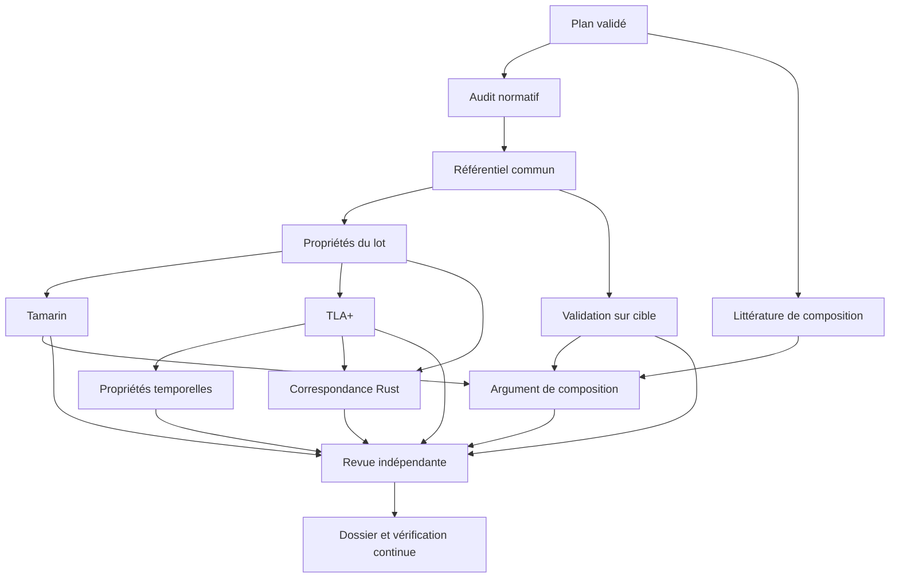

# Plan directeur de vérification Helios–Orion v5

## Objectif et référence

Produire un dossier reproductible qui instruit chacune des 51 obligations
actuelles du protocole, de l’enrôlement au retrait du PSK. Le dossier doit
justifier les conditions de validité de chaque verdict et montrer où le
logiciel Rust réalise, dépasse ou s’écarte du contrat.

La révision initiale est `fced071d8946c6a9c04ce050b06a9d36b11aafc3`.
Elle fixe les 51 obligations, 30 scénarios et 20 hypothèses ainsi que les
versions des sources du dépôt pour la préparation. Chaque nouveau résultat
référence ses propres révisions de contrat, de modèle et, le cas échéant,
de Rust. Les versions et empreintes des outils sont enregistrées dès que
chaque chaîne est choisie, avant l’acceptation de ses résultats.

Sources du cadrage. [Contrat v5](../docs/specification/NEGOCIATION-DE-CLE-V5.md) ·
[ADR-005 et amendements](../docs/adr/ADR-005-NEGOCIATION-DE-CLE.md) ·
[Catalogue v5](../docs/specification/VERIFICATION-FORMELLE-NEGOCIATION-V5.md) ·
[Rotation Astra](../docs/specification/ROTATION-CERTIFICATS.md) ·
[Validation sur cible](../docs/testing/TESTING.md)

## Responsabilités et écriture

| Responsable | Responsabilité | Périmètre d’écriture |
| --- | --- | --- |
| Coordination scientifique (Fable) | Tient le graphe du programme, valide les interfaces de travail, instruit les arbitrages et prépare la synthèse. | Plan, registre, décisions et intégration des interfaces approuvées. |
| Opus audit et Opus sémantique | L’audit vérifie les clauses. Le responsable sémantique fixe le sens des événements, des états et des abstractions. | Couverture normative, questions ouvertes, sémantique et contrats communs, avec revue croisée. |
| Opus de domaine | Porte un lot Tamarin, TLA+, temps, composition, Rust ou expérimentation. Définit les propriétés et examine leurs limites. | Répertoire de son domaine et résultats de son lot. Les changements de référentiel passent par une proposition. |
| Sonnet d’exécution | Implémente, exécute, fixe les versions d’outils, collecte les éléments reproductibles et documente les échecs. | Artefacts, scripts et résultats du lot attribué. |
| Opus indépendants | Cherchent les conclusions vacues ou circulaires, contrôlent les mutations et reproduisent la preuve ou l’observation. | Revues et contre-exemples, avec un auteur distinct de celui du résultat. |
| Responsable humain du projet | Arbitre le contrat normatif, les exclusions et les affirmations finales, et valide le lancement. | Approbations et décisions normatives tracées. |

Ces noms indiquent les rôles à attribuer lors du lancement. Le responsable
de lot est comptable du résultat, même lorsqu’un autre agent exécute les
outils. Les propositions contradictoires restent traçables jusqu’à décision.

## Phases et critères de sortie

| Phase | Travail et livrable | Critère de sortie |
| --- | --- | --- |
| 00 — Gouvernance | Plan, instructions, critères, registre, décisions. | Le responsable humain valide la méthode, les rôles et l’ordonnancement après revue indépendante du plan. |
| 01 — Audit normatif | Audit du contrat, des amendements, des frontières Astra et des écarts Rust. Matrice article–obligation et questions ouvertes. | Toute exigence est couverte ou a une exclusion motivée. Chaque écart est identifié et attribué. |
| 02 — Référentiel commun | Acteurs, événements, états, adversaire, hypothèses et contrats d’interface, avec traduction par outil. | Les événements et états partagés ont une définition et une provenance validées. Toute lacune d’interface est modélisée explicitement ou bloque la conclusion qui en dépend. |
| 03 — Propriétés | Registre des propriétés élémentaires et traces nominales. Consigner quantification, hypothèses, compromissions, méthode et résultat attendu. | Chaque obligation possède des propriétés élémentaires et une stratégie de décision ou une limite explicite. |
| 04 — Cryptographie symbolique | Noyau Tamarin, profils de menace et preuves par raffinement. | Chaque conclusion indique les propriétés de trace ou d’équivalence, ses hypothèses et les contrôles de non-vacuité et de sensibilité. |
| 05 — Machines d’état | Modèle TLA+ des opérations, concurrence, persistance, pannes, révocation et cycle du slot. | Le modèle représente l’effet backend sans acquittement lorsque le contrat le permet. Les résultats identifient la configuration et la portée de l’exploration. |
| 06 — Temps | Justification du choix entre temps discret en TLA+ et automates temporisés, puis résultats sur seuils et échéances. | Les bornes distinguent temps, observation et disponibilité. Les limites de résolution et d’ordonnancement sont explicites. |
| 07 — Composition crypto | Argument ML-KEM–HKDF–PSK–WireGuard, selon les secrets divulgués et l’horizon temporel. | Les conclusions symboliques et computationnelles sont séparément justifiées. Un relecteur indépendant contrôle toute revendication sur le trafic capturé. |
| 08 — Rust | Fonctions, invariants et correspondance des traces aux fonctions, transitions et tests existants. | Les correspondances vérifiées, partielles ou ouvertes sont identifiées avec la révision du code et les limites des outils. |
| 09 — Validation expérimentale | Contrats WireGuard Linux et Windows, effets du changement de PSK, erreurs backend, stockage et observations du réseau. | Les protocoles de mesure, plateformes, versions, limites et traces sont archivés. La relation de l’observation au candidat est instruite pour `ETAT-03`. |
| 10 — Revue indépendante | Audit des abstractions, reproductibilité, non-vacuité, restrictions, mutations et cohérence intermodèles. | Chaque résultat critique a une revue distincte. Une objection entraîne un verdict corrigé ou reste ouverte dans le dossier. |
| 11 — Industrialisation | Dossier final, génération du suivi, contrôles rapides et stratégie d’exécution des vérifications coûteuses. | Les 51 obligations ont un verdict motivé. Le dossier détecte une preuve périmée lorsque ses dépendances changent. |

## Ordre de travail et dépendances

- **Préparation.** Faire relire le dossier et valider `GOV-APPROVAL`.
  L’audit normatif, les contrats communs et l’inventaire Rust peuvent
  préparer leurs éléments en parallèle après cette validation.
- **Références communes.** Accepter les blocs d’interface lorsqu’ils
  sont stables. L’audit des clauses conditionne les propriétés qui en
  dépendent. Un écart localisé laisse avancer les autres obligations.
- **Chantiers parallèles.** Tamarin et TLA+ partagent les définitions
  et peuvent avancer ensemble dès le jalon `SPEC-GATE` et l’acceptation
  des propriétés du lot. Les travaux temporels consomment le modèle
  d’événements et les transitions pertinentes du slot. Le protocole
  expérimental de `ETAT-03` peut être préparé dès le contrat de frontière,
  puis ses mesures alimentent TLA+, Rust et la revue.
- **Composition.** Le travail bibliographique et la délimitation des
  hypothèses peuvent avancer tôt. Le verdict s’appuie sur les résultats
  effectivement acceptés pour ML-KEM, la KDF et le plan de données.
- **Intégration.** Revoir les résultats par lot au fil de leur production.
  Le dossier final attend les verdicts de domaine et le compte rendu de
  revue indépendante. Un verdict ouvert motivé est une sortie admissible.

Ce graphe résume les dépendances entre familles de livrables. Les
dépendances détaillées autorisent le travail et la revue par bloc.

Le [registre](TASK-REGISTRY.yaml) donne les dépendances exécutables.
La [liste des questions ouvertes](governance/OPEN-QUESTIONS.md) indique les
décisions qui bloquent une conclusion particulière.

## Architecture des artefacts

Le catalogue reste canonique dans `docs/specification/`. Les fichiers de
`formal/specification/` décrivent sa traduction commune sans dupliquer
les définitions `MEN-XX` ou `HYP-XX`. Les sections du référentiel peuvent être
scindées lorsqu’une charge de maintenance le justifie.

Les campagnes développeront `properties/` pour le registre élémentaire,
`models/{tamarin,tla,timed,composition}/` pour les modèles,
`implementation/` pour la correspondance Rust, `validation/` pour les plans
et observations sur cible, `reviews/` pour les revues et `results/` pour
les résultats versionnés. Les commandes de vérification et de génération
resteront sous `scripts/`. Les captures ou journaux volumineux et les
artefacts générés restent hors Git. Les rapports en référencent un dépôt
d’artefacts, la révision et l’empreinte, avec retrait des secrets et des données
réelles avant publication.

Les registres structurés deviennent la source des rapports d’avancement
quand le générateur est livré. Suivre les obligations instruites, leur
verdict et leur revue, les propriétés élémentaires, les scénarios couverts,
les hypothèses justifiées, les résultats périmés, les contre-exemples et les
correspondances Rust. La couverture des verdicts compte un verdict ouvert
seulement s’il contient une investigation et un motif revus.

## Mission initiale pour la coordination scientifique

À partir de la révision figée, faire relire ce plan par deux relecteurs
indépendants, valider les tâches avec leurs propriétaires et contrôler la
couverture normative, notamment les contrats WireGuard, disque et Astra.
Proposer les versions des premiers outils, les limites de calcul et les
conditions d’exécution sur cible. Remettre au responsable humain les
arbitrages prioritaires, les interfaces à approuver et le premier
ordonnancement de lots. Le jalon `GOV-APPROVAL` enregistre la décision sur
le plan avant le lancement de la campagne.
