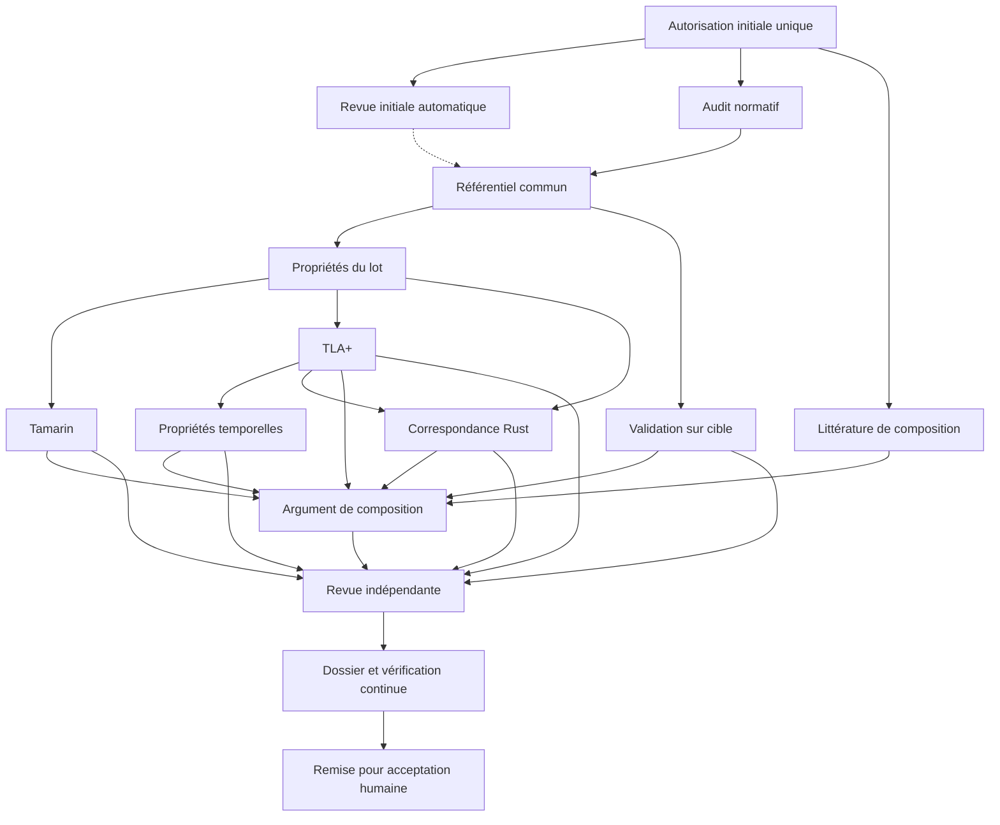

# Plan directeur de vérification Helios–Orion v5

## Objectif et référence

Produire un dossier reproductible qui instruit chacune des 51 obligations
actuelles du protocole, de l’enrôlement au retrait du PSK. Le dossier doit
justifier les conditions de validité de chaque verdict et montrer où le
logiciel Rust réalise, dépasse ou s’écarte du contrat.

La révision initiale est `fced071d8946c6a9c04ce050b06a9d36b11aafc3`.
Elle fixe les 51 obligations, 30 scénarios et 20 hypothèses ainsi que les
versions des sources du dépôt pour la préparation. Chaque nouveau résultat
référence ses propres révisions de contrat, de modèle et, le cas échéant,
de Rust. Les versions et empreintes des outils sont enregistrées dès que
chaque chaîne est choisie, avant l’acceptation de ses résultats.

Sources du cadrage. [Contrat v5](../docs/specification/NEGOCIATION-DE-CLE-V5.md) ·
[ADR-005 et amendements](../docs/adr/ADR-005-NEGOCIATION-DE-CLE.md) ·
[Catalogue v5](../docs/specification/VERIFICATION-FORMELLE-NEGOCIATION-V5.md) ·
[Rotation Astra](../docs/specification/ROTATION-CERTIFICATS.md) ·
[Validation sur cible](../docs/testing/TESTING.md)

## Responsabilités et écriture

| Responsable | Responsabilité | Périmètre d’écriture |
| --- | --- | --- |
| Coordination scientifique (Fable) | Orchestre la campagne entière. Décide de l’ordre, des affectations, des outils, de la méthode, des ressources autorisées et des réexécutions. Interprète les clauses ambiguës pour les modèles et conserve les variantes utiles. | Plan, registre, décisions, résultats de consolidation et intégration des interfaces retenues. |
| Opus audit et Opus sémantique | L’audit vérifie les clauses. Le responsable sémantique fixe le sens des événements, des états et des abstractions. | Couverture normative, questions ouvertes, sémantique et contrats communs, avec revue croisée. |
| Opus de domaine | Porte un lot Tamarin, TLA+, temps, composition, Rust ou expérimentation. Définit, révise et justifie le modèle sous coordination de Fable. | Répertoire de son domaine et résultats de son lot. Les changements de référentiel passent par une proposition tracée. |
| Sonnet d’exécution | Implémente, exécute, fixe les versions d’outils, collecte les éléments reproductibles et documente les échecs. | Artefacts, scripts et résultats du lot attribué. |
| Relecteurs indépendants | Valident scientifiquement les éléments, cherchent les conclusions vacues ou circulaires et reproduisent les résultats critiques. | Revues et contre-exemples, avec un auteur distinct de celui du résultat. |
| Responsable humain du projet | Autorise le lancement une fois et décide de l’acceptation du dossier remis. | Autorisation initiale et décision finale. |

Au lancement, `GOV-APPROVAL` enregistre la délégation de la campagne
et les ressources autorisées. Les arbitrages méthodologiques et les
interprétations de travail appartiennent ensuite à Fable. Une interprétation
est versionnée avec sa source, ses alternatives et les résultats qui en
dépendent. Une divergence avec le contrat ou le Rust reste visible dans le
dossier. Les sources normatives demeurent la référence des vérifications.

## Phases et critères de sortie

| Phase | Travail et livrable | Critère de sortie |
| --- | --- | --- |
| 00 — Gouvernance | Autorisation initiale, revue indépendante automatique et consolidation de la méthode par Fable. | La délégation est consignée. Fable traite ou circonscrit les objections qui affectent un lot. |
| 01 — Audit normatif | Audit du contrat, des amendements, des frontières Astra et des écarts Rust. Matrice article–obligation et questions ouvertes. | Fable consigne la couverture, les exclusions, les interprétations et les ouvertures par périmètre. |
| 02 — Référentiel commun | Acteurs, événements, états, adversaire, hypothèses et contrats d’interface, avec traduction par outil. | Fable accepte les portions revues, consigne les variantes et limite toute lacune aux conclusions qui en dépendent. |
| 03 — Propriétés | Registre des propriétés élémentaires et traces nominales. Consigner quantification, hypothèses, compromissions, méthode et résultat attendu. | Fable accepte les propriétés après revue par bloc. Chaque obligation possède une stratégie de décision ou une limite explicite. |
| 04 — Cryptographie symbolique | Noyau Tamarin, profils de menace et preuves par raffinement. | Chaque conclusion indique les propriétés de trace ou d’équivalence, ses hypothèses et les contrôles de non-vacuité et de sensibilité. |
| 05 — Machines d’état | Modèle TLA+ des opérations, concurrence, persistance, pannes, révocation et cycle du slot. | Le modèle représente l’effet backend sans acquittement lorsque le contrat le permet. Les résultats identifient la configuration et la portée de l’exploration. |
| 06 — Temps | Justification du choix entre temps discret en TLA+ et automates temporisés, puis résultats sur seuils et échéances. | Les bornes distinguent temps, observation et disponibilité. Les limites de résolution et d’ordonnancement sont explicites. |
| 07 — Composition | Argument ML-KEM–HKDF–PSK–WireGuard, selon les secrets divulgués et l’horizon temporel. Argument `ETAT-03` reliant contrat backend, modèle d’état, traces sur cible et transitions Rust (`CMP-05`). | Les conclusions symboliques et computationnelles sont séparément justifiées. Un relecteur indépendant contrôle toute revendication sur le trafic capturé. |
| 08 — Rust | Fonctions, invariants et correspondance des traces aux fonctions, transitions et tests existants. | Les correspondances vérifiées, partielles ou ouvertes sont identifiées avec la révision du code et les limites des outils. |
| 09 — Validation expérimentale | Contrats WireGuard Linux et Windows, effets du changement de PSK, erreurs backend, stockage et observations du réseau. | Les protocoles de mesure, plateformes, versions, limites et traces sont archivés. La relation de l’observation au candidat est instruite pour `ETAT-03`. |
| 10 — Revue indépendante | Audit des abstractions, reproductibilité, non-vacuité, restrictions, mutations et cohérence intermodèles. | Fable consolide les revues indépendantes. Une objection peut réviser un verdict ou rester ouverte avec sa portée et sa justification. |
| 11 — Industrialisation | Dossier final, génération du suivi, contrôles rapides et stratégie d’exécution des vérifications coûteuses. | Fable remet le dossier au responsable humain. Le dossier trace les verdicts, limites et travaux interrompus, ainsi que les résultats à réexaminer si leurs dépendances changent. |

## Ordre de travail et dépendances

- **Lancement.** Une fois `GOV-APPROVAL` enregistré, Fable organise
  automatiquement `GOV-REVIEW` et met en route les lots indépendants.
  Deux relecteurs remettent leur avis sans échanger avant consolidation.
- **Références communes.** Les jalons `AUD-GATE`, `SPEC-GATE` et
  `PROP-GATE` publient un statut par portion, utilisable, conditionnelle
  ou ouverte. Chaque lot utilise les portions revues dont il dépend. Les
  autres portions restent accessibles aux travaux d’investigation.
- **Chantiers parallèles.** Tamarin et TLA+ partagent les définitions
  du bloc pertinent. Le temps consomme les transitions nécessaires.
  Préparer tôt les validations de `ETAT-03`. Une frontière encore ouverte
  peut être examinée par plusieurs modèles ou par des sources et des
  mesures propres au backend. Les autres lots progressent en parallèle.
- **Composition.** Le travail bibliographique et la délimitation des
  hypothèses peuvent avancer tôt. Chaque verdict importe les garanties
  avec leur portée, leur révision et leurs conditions. Une dépendance
  ouverte limite le verdict qui l’emploie.
- **Intégration.** Les revues sont rendues au fil de l’eau.
  `REV-GATE` consolide les décisions et dissensions scientifiques.
  `IND-04` remet le dossier final pour la décision humaine d’acceptation.

Ce graphe résume les dépendances entre familles de livrables. Les
dépendances détaillées autorisent le travail et la revue par bloc.

Le [registre](TASK-REGISTRY.yaml) donne les dépendances exécutables.
La [liste des questions ouvertes](governance/OPEN-QUESTIONS.md) indique les
décisions qui bloquent une conclusion particulière.

## Architecture des artefacts

Le catalogue reste canonique dans `docs/specification/`. Les fichiers de
`formal/specification/` décrivent sa traduction commune sans dupliquer
les définitions `MEN-XX` ou `HYP-XX`. Les sections du référentiel peuvent être
scindées lorsqu’une charge de maintenance le justifie.

Les campagnes développeront `properties/` pour le registre élémentaire,
`models/{tamarin,tla,timed,composition}/` pour les modèles,
`implementation/` pour la correspondance Rust, `validation/` pour les plans
et observations sur cible, `reviews/` pour les revues et `results/` pour
les résultats versionnés. Les commandes de vérification et de génération
resteront sous `scripts/`. Les captures ou journaux volumineux et les
artefacts générés restent hors Git. Les rapports en référencent un dépôt
d’artefacts, la révision et l’empreinte, avec retrait des secrets et des données
réelles avant publication.

Les registres structurés deviennent la source des rapports d’avancement
quand le générateur est livré. Suivre les obligations instruites, leur
verdict et leur revue, les propriétés élémentaires, les scénarios couverts,
les hypothèses justifiées, les résultats périmés, les contre-exemples et les
correspondances Rust. La couverture des verdicts compte un verdict ouvert
seulement s’il contient une investigation et un motif revus.

## Continuité, sauvegarde et conditions d’arrêt

À chaque livrable partiel significatif, changement de responsabilité ou
interruption prévisible, Fable enregistre un point de reprise dans Git.
Le point de reprise identifie la tâche, les révisions d’entrée et d’outil,
les commandes et bornes, le dernier résultat exploitable, les décisions,
les dépendances affectées et le prochain travail possible. Reprendre depuis
ce point après un changement de session ou d’agent. Appliquer les règles
d’archivage des artefacts sensibles et volumineux.

Fable poursuit les tâches indépendantes lorsqu’une hypothèse, une cible,
une preuve ou une interprétation reste ouverte. Il peut réordonner le graphe,
subdiviser un lot, changer de méthode et réserver une partie des ressources
disponibles à la levée d’un blocage local. Toute modification du graphe ou
d’une garantie importée entraîne un examen des résultats concernés.

La campagne se termine dans l’un des cas suivants.

- Les 51 obligations ont été instruites et revues.
- Les travaux encore réalisables sont épuisés, après examen des alternatives.
- Une limite matérielle, technique ou budgétaire autorisée est atteinte
  et empêche de poursuivre, y compris avec une méthode de moindre coût.

Le dossier final distingue les travaux achevés, les verdicts ouverts ou
conditionnels et les obligations restées incomplètes. Pour ces dernières,
indiquer l’investigation disponible, la limite rencontrée et les conditions
de reprise. Une interruption de session entraîne une sauvegarde et une
reprise si le contexte d’exécution le permet.

## Mission initiale pour la coordination scientifique

À partir de l’autorisation enregistrée, organiser deux relectures
indépendantes, scientifique et opérationnelle. Consolider les avis sans
gommer les désaccords. Fixer les premiers outils, les limites de calcul,
les règles d’affectation et de reprise et les priorités de validation sur
cible dans le cadre autorisé. Ouvrir les lots indépendants en parallèle.
Présenter les arbitrages résiduels et la portée des conclusions au
responsable humain lors de la remise `IND-04`.
